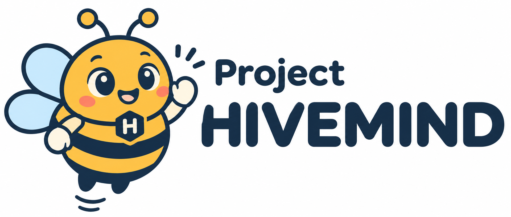
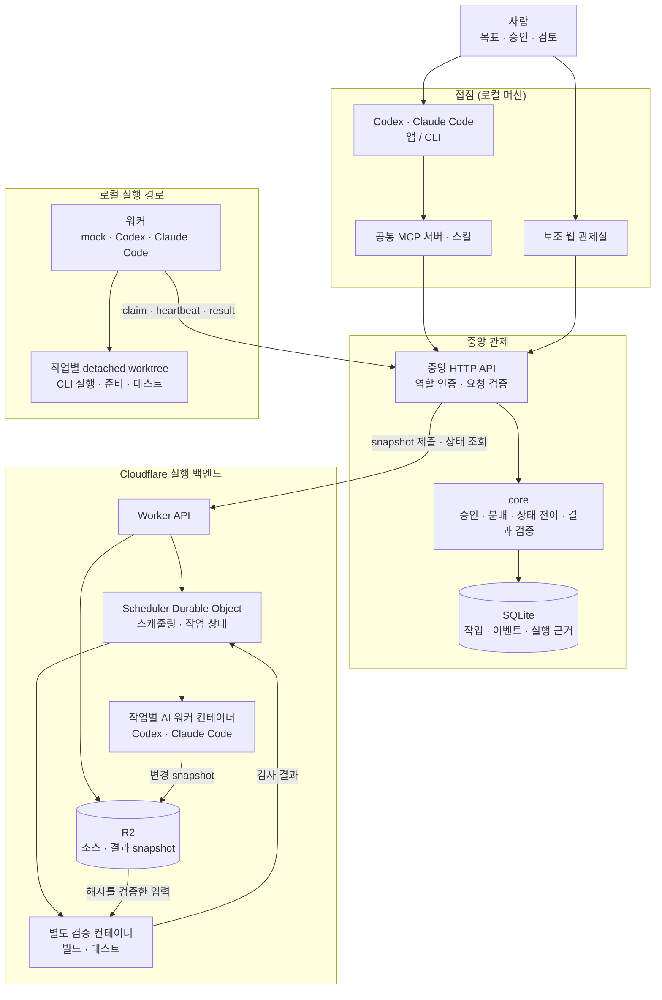
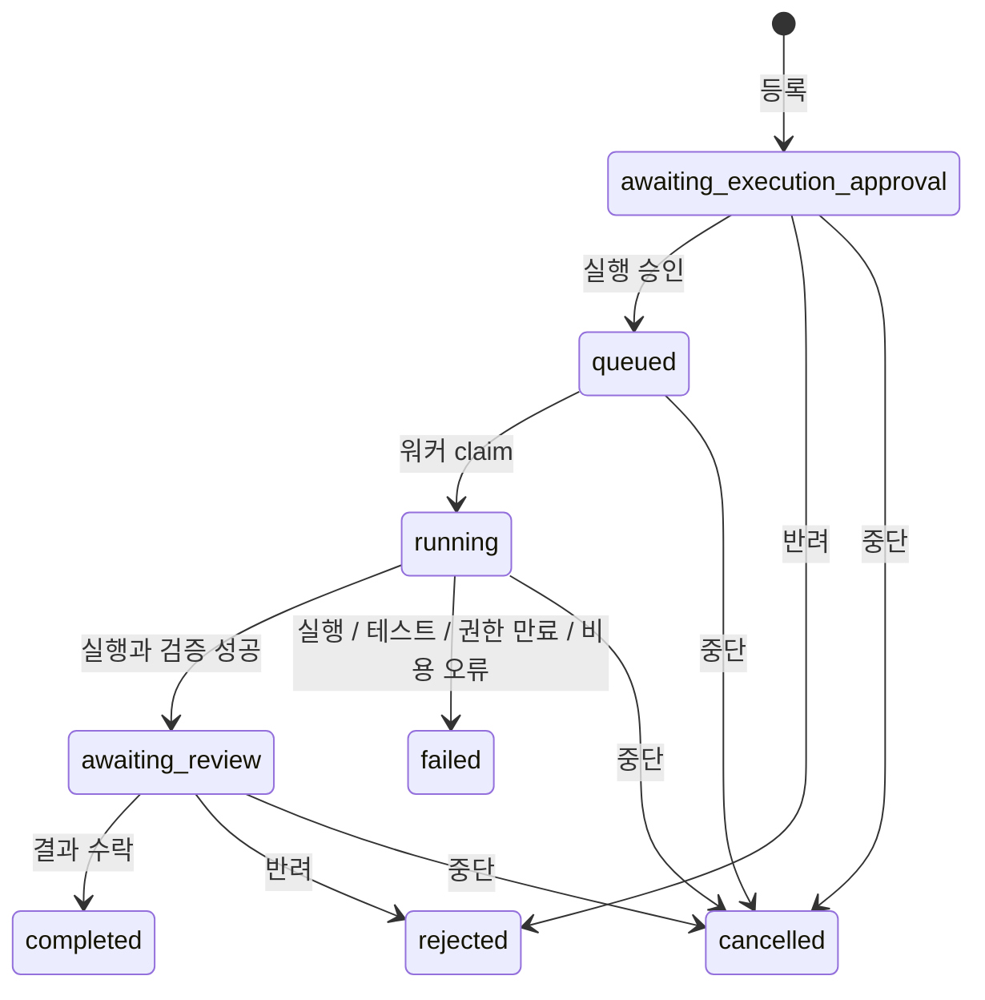

<p align="center">
  
</p>

# Project HIVEMIND

**One Vision. Many Agents.**

HIVEMIND는 **사람이 코드를 읽지 않고, 의도와 정책만으로 개발 목표를 달성**하게 하려는 플랫폼이다. 사람은 무엇을 왜 만드는지(의도)와 워커가 지켜야 하는 범위·권한·예산·완료 조건(정책)을 정하는 데 집중한다. AI 워커는 랄프 루프로 완료 조건을 충족할 때까지 구현·검증·수정을 스스로 반복한다. 랄프 루프는 워커가 같은 모델 세션의 컨텍스트를 이어 가며 이 반복을 수행하는 실행 방식이다.

HIVEMIND는 임시 개발 코드명이며 공개 제품명은 아직 정하지 않았다. 소스와 문서는 [Apache License 2.0](LICENSE)으로 제공한다.

## 왜 만드는가

AI 코딩 에이전트는 사람이 읽을 수 있는 양보다 훨씬 많은 코드를 만든다. 사람이 모든 diff를 읽고 승인하는 방식에서는 사람의 주의력이 전체 처리량의 상한이 된다. 에이전트를 늘려도 사람이 검토하는 속도는 늘지 않기 때문이다. HIVEMIND는 사람의 역할을 코드 검토에서 의도와 정책의 결정으로 옮겨 이 상한을 없애려고 한다.

사람이 코드를 보지 않으려면, 코드 대신 믿을 수 있는 다른 근거가 있어야 한다. HIVEMIND는 그 근거를 두 가지로 둔다. 첫째는 사람이 미리 정한 완료 조건을 워커와 분리된 환경에서 자동으로 검증한 결과다. 둘째는 중앙 관제가 강제하는 정책이다. 정책은 워커가 어느 저장소와 커밋에서, 어떤 검증 명령으로, 어떤 쓰기 범위·권한·예산 안에서 작업하는지를 정하며, 워커와 모델 출력은 이 정책을 바꾸지 못한다. 워커는 이 두 근거 안에서 랄프 루프를 돌려 목표에 도달한다.

## 달성하려는 목표

첫째 목표는 사람이 의도에만 집중하게 하는 것이다. 사람은 목표, 완료 조건과 정책을 정하고, 정책이 사람의 결정을 요구하는 지점에서만 개입한다. 결과가 의도에 맞는지는 코드를 읽어서가 아니라 완료 조건의 검증 결과와 정책 준수 기록으로 판단한다.

둘째 목표는 랄프 루프로 목표를 끝까지 달성하는 것이다. 워커는 한 번의 시도로 끝내지 않는다. 검증이 실패하면 검증 로그를 같은 모델 세션에 전달해 수정하고 다시 검증한다. 완료 조건이 충족되거나, 승인된 시간·반복 한도 또는 복구할 수 없는 오류에 도달할 때까지 이 과정을 반복한다. 같은 세션의 컨텍스트를 이어 가므로 반복마다 컨텍스트를 처음부터 다시 만드는 토큰 비용을 줄이는 효과도 기대한다. 수용 기준은 [MVP 범위](docs/mvp.md#실행-기본-정책)에 있다.

셋째 목표는 통제를 코드 검토가 아닌 정책으로 수행하는 것이다. 승인·취소·비용 정책과 상태 전이는 중앙 관제의 core 한 곳에서 결정한다. UI와 모델 어댑터는 이 정책을 우회하지 못한다. 작업 지시와 모델 출력은 신뢰하지 않는 데이터로 취급하며, 실행 대상 저장소와 검증 명령은 운영자가 서버에 설정한 값만 사용한다.

넷째 목표는 로컬 자원 한계를 넘는 것이다. 사람이 코드를 보지 않고 여러 워커를 오래 실행하려면 개발 머신 한 대의 CPU·메모리로는 부족하다. 그래서 구현·빌드·테스트·통합을 작업별로 격리된 클라우드 컨테이너에서 실행하고, 사람이 관제 프로세스를 종료한 동안에도 원격 작업과 결과 보존이 이어지게 한다. 서로 독립적인 작업은 공통 계약(여러 워커가 함께 지켜야 하는 인터페이스와 완료 기준을 적은 파일)을 먼저 고정한 뒤 병렬로 실행한다. 작업을 나누면 컨텍스트 재구축·인계·통합 비용이 생기므로, 예상되는 시간 절감이 이 비용보다 클 때만 분할한다.

다섯째 목표는 사람이 이미 쓰는 도구 안에서 의도를 전달하는 것이다. 1차 지원 대상은 Codex와 Claude Code 각각의 앱·CLI, 네 접점이다. 사람은 이 대화 안에서 작업을 등록하고 승인하며 진행 상태와 검증 결과를 확인한다. 웹 관제실은 검증과 관리를 돕는 보조 화면이다.

성공 기준은 워커 수가 아니다. 사람이 코드를 읽지 않고 의도와 정책만 다뤄서 목표에 도달했는지를 먼저 본다. 그다음 **같은 품질의 결과를 통합하기까지 걸린 시간, 로컬 자원 부담, 실패와 재시도를 포함한 총비용**으로 판단한다.

현재 구현은 이 의도에 아직 도달하지 못했다. 현재 작업 흐름에는 사람이 실제 Git diff와 테스트 결과를 확인한 뒤 결과를 수락하는 단계가 있다. 결과 수락은 검토 이력만 기록하며 원본 저장소에 변경을 적용하거나 커밋·병합·푸시를 수행하지 않는다. 자연어 목표 분해와 작업 의존성 DAG도 아직 구현하지 않았다.

## 현재까지 확인한 것과 확인하지 못한 것

아래는 각 검증 기록에 적힌 측정 결과다. 측정 시점 이후의 코드 변경은 반영하지 않는다.

| 확인 시점 | 확인한 내용 | 근거 |
|---|---|---|
| 2026-11-09 | 로컬에서 Codex와 Claude Code 워커가 서로 다른 worktree에서 46.247초 동안 겹쳐 실행됐고, 두 작업 모두 테스트를 통과했다. | [병렬 실행 안내](docs/concurrent-execution.md) · [실행 근거 JSON](docs/concurrent-run-evidence.json) |
| 2026-11-10 | Cloudflare에서 Codex와 Claude 작업이 약 30초 동안 동시에 실행됐고, 제공자별 별도 검증 컨테이너에서 테스트를 통과했다. 같은 결과를 MCP stdio 연결로도 조회했다. | [Cloudflare 관제 연결·검증](docs/verification/2026-11-10-codex-integration.md) · [원격 백엔드 검증](cloudflare/docs/verification/2026-11-10-cloudflare.md) |
| 2026-11-10 | Codex·Claude Code의 앱·CLI 네 접점에서 상태와 결과 조회가 동작했다. | [클라이언트 검증 기록](docs/verification/2026-11-10-claude-clients.md) · [지원 설계·구현 차이](docs/client-support.md) |
| 2026-11-14 | 로컬과 Cloudflare 비교 실측의 최종 검증(A 18회·B 9회·C 3회)을 통과했다. 로컬 관제 연결이 끊긴 동안에도 원격 통합과 결과 보존이 이어졌다. | [로컬·Cloudflare 실측](docs/verification/2026-11-14-resource-validation-final.md) |

**핵심 가설은 아직 입증하지 못했다.** 2026-11-14 실측에 쓴 작은 RealWorld 과제에서는 로컬 병렬 실행이 원격 실행보다 빨랐다. 사람이 코드를 읽지 않고 의도와 정책만으로 목표에 도달할 수 있다는 가설, 대규모 작업에서 원격 실행이 로컬 자원 한계를 극복한다는 가설, 랄프 루프가 토큰을 절감한다는 가설은 더 큰 실제 프로젝트에서 측정해야 한다.

이슈 #1의 장기 실행·예약·quota 대기·웹·외부 작업 경로는 bounded 구현 상태다. 검증 후보를 Cloudflare에 배포했으며 새 기능은 비활성이다. 원격 격리와 실제 장기 수용은 남아 있다. [구현·검증·잔여 운영 작업](docs/plans/2026-11-20-autonomous-remaining.report.md)을 확인한다. 사용자 결정에 따른 실제 프로젝트 검증 이관과 최신 연결 보완은 [구현 마감 기록](docs/plans/2026-11-20-issue1-implementation-closeout.md)을 따른다.

## 아키텍처

HIVEMIND는 세 계층으로 구성된다. 사람이 사용하는 **접점**, 승인과 작업 상태를 결정하는 **중앙 관제**, 승인된 작업을 수행하는 **실행 백엔드**다. 세 계층은 HTTP API로만 연결되며, 접점과 워커는 중앙 관제의 상태 저장소를 직접 열지 않는다.



### 접점: 사람이 이미 쓰는 앱과 CLI

사람은 Codex 또는 Claude Code 대화에서 `$hivemind`(Codex)나 `/hivemind`(Claude Code) 스킬로 작업을 등록하고 조회한다. 스킬은 `apps/mcp-server`의 MCP 도구를 호출하고, MCP 서버는 중앙 HTTP API만 호출한다. MCP 서버는 SQLite 파일, Cloudflare 제어 토큰, 제공자 인증에 접근하지 않는다. 이렇게 한 이유는 모델이 실행하는 도구가 비밀이나 상태 저장소를 직접 다루지 못하게 하기 위해서다. 작업 등록 도구는 실행 승인 전의 초안만 만들며, 실행 승인과 결과 수락은 사람의 명시적인 지시에 따라 별도 도구로 호출한다.

### 중앙 관제: 결정과 상태의 단일 지점

`apps/control-plane`은 요청을 검증하고 역할을 인증하는 HTTP 서버다. 승인·취소·비용 정책과 상태 전이는 `packages/core`가 결정한다. UI와 모델 어댑터는 이 정책을 우회하지 못한다. 작업은 아래 순서로 진행한다.



core는 작업 선택과 상태 변경을 SQLite `BEGIN IMMEDIATE` 트랜잭션 하나로 처리하므로, 두 워커가 같은 작업을 동시에 가져갈 수 없다. 각 실행에는 무작위 실행 권한 토큰이 붙는다. 실행 권한은 30초 후 만료되며 워커가 5초마다 heartbeat로 갱신한다. 실행 권한이 만료되거나 사람이 작업을 중단한 뒤에 도착한 결과는 거절한다. 실패한 작업은 자동으로 재시도하지 않으며 결과 수락으로 완료 처리할 수도 없다. 재시도는 새 작업으로 등록한다.

작업 API는 임의의 저장소 경로나 실행 명령을 받지 않는다. 운영자가 서버에 설정한 저장소, 서버 시작 시 고정한 커밋, 등록 시 작업에 복사한 테스트 명령만 사용한다. 작업 지시와 모델 출력은 신뢰하지 않는 데이터로 취급하므로, 지시문이 실행 대상이나 검증 방법을 바꾸지 못하게 하기 위한 제약이다.

### 실행 백엔드: 로컬 worktree와 Cloudflare 컨테이너

실행 경로는 두 가지다. 로컬 경로는 개발과 계약 검증에 쓰고, Cloudflare 경로가 이 프로젝트의 목표인 원격 실행이다.

로컬 경로에서는 `apps/worker`가 HTTP로 작업을 claim한다. `packages/adapters`의 공통 실행 계층이 고정 커밋에서 실행별 detached worktree를 만들고, 선택한 Codex 또는 Claude Code CLI를 실행한 뒤 준비·테스트 명령을 실행하고 실제 Git diff를 수집한다. worktree는 파일 변경을 분리할 뿐이며 보안 컨테이너가 아니다. 그래서 로컬 경로는 신뢰하는 저장소만 대상으로 한다. mock 워커는 합성 diff와 모의 비용을 만들며, 이 값은 실제 실행 근거와 구분해 표시한다.

Cloudflare 경로에서는 중앙 관제가 고정 커밋의 소스를 불변 snapshot으로 만들어 [Cloudflare 백엔드](cloudflare/README.md)에 제출한다. Worker API가 요청을 받고, Scheduler Durable Object가 승인과 작업 상태를 보존하며 작업을 배정한다. 모델 작업은 작업별 AI 워커 컨테이너에서 공식 Codex·Claude Code CLI로 실행한다. 빌드와 테스트는 제공자 인증이 없는 별도 검증 컨테이너에서 실행한다. 모델이 만든 코드가 실행되는 환경에 구독 인증을 두지 않기 위해 두 컨테이너를 분리한다. 소스와 결과 snapshot은 R2에 저장하고, 런타임은 해시를 검증한 입력만 읽기 전용으로 제공한다. 컨테이너는 인터넷 접근을 끈 상태로 시작하며 외부 요청은 허용 호스트 목록을 거친다. 현재 원격 소스 입력 한도는 4MiB·1000파일이다.

여러 워커가 함께 작업하는 [원격 통합 워크플로](cloudflare/backend/README.md#두-워커의-원격-통합-워크플로)는 다음과 같이 동작한다. 사람이 소스 snapshot과 공통 계약 파일의 해시를 지정해 계획을 승인한다. 각 워커는 독립 컨테이너에서 같은 입력 snapshot으로 랄프 루프를 실행하고, 라운드마다 별도 검증 컨테이너에 현재 결과를 전달한다. 모든 워커의 검증과 종료가 확인되면 스케줄러가 승인된 경로의 변경만 합치고 새 snapshot으로 통합 검사를 실행한다. 같은 파일에 대한 쓰기 범위가 겹치는 계획은 계획 검증 단계에서 차단한다. 로컬 요청 연결은 승인 응답 뒤에 닫혀도 원격 통합이 이어진다.

AWS ECS 백엔드는 현재 MVP 검증을 마친 다음 단계이며, 현재 AWS 리소스를 만들거나 배포하지 않는다.

### 신뢰 경계와 비용

운영자 토큰과 워커 토큰은 서로 달라야 하며, 워커 토큰으로는 사람의 승인·취소를 수행할 수 없다. 관제 토큰은 모델·준비·테스트 프로세스에 전달하지 않는다. 제공자 인증은 해당 CLI 프로세스에만 제공하고 다른 제공자나 준비·테스트 환경으로 넘기지 않는다. 운영자 토큰·워커 토큰·제공자 비밀은 로그, 이벤트, UI 응답과 저장소에 넣지 않는다. 대시보드는 서버 값을 `textContent`로만 표시한다.

실행 근거는 인증된 워커가 보고한 값이다. 독립적으로 검증한 증명이나 원격 attestation이 아니다. Codex와 Claude Code의 금액은 임의로 환산하지 않고 **미확정**으로 표시하며, 제공자가 보고한 토큰 수만 저장한다. 작업 예산은 제공자의 실제 과금을 중지하거나 상한을 보장하지 않는다.

### 코드 구성

| 구성 요소 | 책임 |
|---|---|
| `packages/contracts` | 작업, 저장소 정책, 실행 근거와 어댑터 계약 |
| `packages/core` | 승인·취소·실행 권한·분배, 결과 검증과 SQLite 저장 |
| `packages/adapters` | Codex·Claude·mock 실행, 공통 worktree·프로세스·diff·테스트 계층, Cloudflare 포트 |
| `apps/control-plane` | 중앙 HTTP API, 역할 인증, 저장소 정책 조회 |
| `apps/mcp-server` | 운영자 API를 `hivemind_*` 도구로 제공하는 MCP 서버 |
| `apps/worker` | HTTP 워커. 작업 claim, heartbeat와 결과 보고 |
| `apps/dashboard` | 보조 웹 관제실 |
| `cloudflare/` | 별도 패키지인 Cloudflare 실행 백엔드 |

API 목록, 저장 형식과 실행 권한의 상세 규칙은 [아키텍처 상세](docs/architecture.md)에 있다. 편집용 도식은 [Draw.io 파일](docs/hivemind-architecture.drawio)이다. 아직 구현하지 않은 자연어 목표 분해, 작업 의존성 DAG, 모델 선택은 [개발 로드맵](docs/roadmap.md)에 있다.

## 앱·CLI에서 연결

```sh
npm ci
npm run build
npm run start
# 다른 터미널에서 프로젝트 MCP 등록 (Codex)
npm run mcp:configure
# Claude Code 앱의 로컬 Code 탭 / CLI는 다음 명령 사용
npm run mcp:configure:claude
```

새 Codex 세션에서 `$hivemind`, Claude Code 세션에서 `/hivemind`를 사용한다. 작업을 등록하기 전에 대상 저장소와 고정 커밋을 먼저 확인한다. 인증 파일, 다른 포트, 기존 설정 보존과 도구 사용법은 [Codex 연결 안내](docs/codex-integration.md)와 [Claude Code 연결 안내](docs/claude-integration.md)에 있다. 공통 계약 워크플로의 등록·승인·랄프 라운드·통합 결과 조회는 [공통 계약 워크플로 연결](docs/workflow-mcp.md)에 있다.

중앙 서버에 Cloudflare 원격 설정을 제공하면 실행 환경으로 **Cloudflare**를 선택할 수 있다. 설정 방법은 [원격 백엔드 사용법](cloudflare/backend/README.md)에 있다. 실제 작업을 실행하기 전에 서버의 대상 저장소 정책을 설정해야 한다. 기본 실행은 mock/local이며, 실제 모델 호출과 유료 자원 생성은 사람이 명시적으로 요청한 경우에만 수행한다.

## 빠른 시작: 모의 실행

Node.js 24 이상과 npm이 필요하다. 프로젝트 루트에서 실행한다.

```sh
git clone https://github.com/roboco-io/project-hivemind.git
cd project-hivemind
npm ci
cp .env.example .env
npm run build
npm start
```

[로컬 관제실](http://127.0.0.1:4310)을 연다. 별도 터미널에서 같은 디렉터리로 이동한 뒤 실행한다.

```sh
npm run worker
```

1. 실행 워커에서 **모의 워커 (mock)**를 선택하고 목표·완료 조건·예산을 입력한다.
2. 결정 사유를 적고 **실행 승인**을 누른다.
3. 워커가 보고한 합성 diff와 모의 비용을 확인한다.
4. **결과 수락** 또는 **반려**를 누른다.

## 실제 Codex 실행

Git과 설치된 Codex CLI가 필요하다. 연동 옵션은 Codex CLI 0.166.0에서 확인했다.
[공식 Codex CLI 문서](https://learn.chatgpt.com/docs/cli/reference)를 참고한다.
워커를 실행하는 사용자 계정에서 `codex login`을 완료한다. 기존 ChatGPT 로그인도 사용할 수 있다.

서버와 워커에 **같은 신뢰하는 로컬 저장소 경로와 테스트 명령**을 설정한다.
API나 작업 지시로 임의 경로·테스트 명령을 전달할 수 없다.
아래는 `npm run check`를 제공하는 저장소의 예다. 설정은 `.env`에도 저장할 수 있다.

서버 터미널:

```sh
codex --version
codex login
export HIVEMIND_REPO_PATH="/absolute/path/to/trusted/repository"
export HIVEMIND_TEST_COMMAND='["npm","run","check"]'
npm start
```

워커 터미널에서 같은 프로젝트 디렉터리로 이동한 뒤 실행한다.

```sh
export HIVEMIND_REPO_PATH="/absolute/path/to/trusted/repository"
export HIVEMIND_TEST_COMMAND='["npm","run","check"]'
# package-lock.json이 있는 npm 프로젝트의 의존성 설치가 필요할 때만 설정한다.
export HIVEMIND_SETUP_COMMAND='["npm","ci","--ignore-scripts","--no-audit","--no-fund"]'
HIVEMIND_PROVIDER=codex HIVEMIND_WORKER_ID=worker-codex-1 npm run worker
```

준비 명령은 선택 사항이다. 새 worktree에는 원본의 `node_modules`를 공유하지 않으므로,
의존성이 필요한 저장소에는 해당 저장소에 맞는 준비 명령을 지정한다.

관제실에서 **실제 Codex 워커** 또는 **실제 Claude Code 워커**를 선택하면 저장소 이름, 고정 시작 커밋과 테스트 명령이 표시된다.
작업을 등록하고 실행을 승인하면 해당 제공자의 워커만 작업을 가져간다.
선택한 CLI가 별도 worktree에서 파일을 변경하고, 공통 실행 계층이 준비·테스트와 diff 수집을 수행한다.
결과 화면에서 실제 diff, worktree 경로, base/HEAD, 테스트 종료 코드와 출력을 확인한다.
제공자 실행이나 준비·테스트가 실패하면 실패 근거를 남기고 작업을 `failed`로 표시한다.
실패한 결과는 수락 완료로 바꿀 수 없다. 재시도는 새 작업으로 등록한다.

제공자가 사용량을 보고하면 입력·캐시 입력·출력 토큰을 표시한다.
Claude의 입력 토큰은 직접 입력·캐시 읽기·캐시 생성을 합산하고 캐시 읽기는 별도로 표시한다.
두 제공자의 금액은 임의로 환산하지 않으며 **미확정**으로 표시한다. Claude CLI의 비용 보고값도 실제 청구액으로 사용하지 않는다. 작업 예산은 실제 과금의 상한을 보장하지 않는다.

서버는 시작할 때 저장소의 `HEAD`를 고정한다. 새 기준 커밋을 사용하려면 서버를 재시작한다.
이미 등록한 작업의 기준 커밋은 바뀌지 않는다. 실행 중에는 서버·워커의 테스트 명령을 변경하지 않는다.
테스트 명령도 작업 등록 시 복사해 고정하며, 이후 서버 설정을 바꿔도 기존 작업의 명령은 바뀌지 않는다.
워커 설정이 작업에 고정한 명령과 다르면 실행 전에 거절한다.
고정한 명령과 다른 테스트 결과는 중앙 API가 거절한다.

## 실제 Claude Code 실행

Git과 설치된 Claude Code CLI가 필요하다. 연동 옵션은 Claude Code 2.1.319에서 확인했다.
[공식 프로그램 실행 문서](https://code.claude.com/docs/en/headless)와
[CLI 참조](https://code.claude.com/docs/en/cli-reference)를 참고한다.
워커 사용자 계정에서 `claude auth login`을 완료한다. CLI의 기존 로그인도 재사용한다.

서버는 위 Codex 절차와 같은 `HIVEMIND_REPO_PATH`, `HIVEMIND_TEST_COMMAND` 설정으로 실행한다.
다른 터미널에서 같은 저장소와 테스트 명령을 지정하고 Claude 워커를 시작한다.

```sh
claude --version
claude auth login
export HIVEMIND_REPO_PATH="/absolute/path/to/trusted/repository"
export HIVEMIND_TEST_COMMAND='["npm","run","check"]'
# 의존성 설치가 필요한 npm 저장소에서만 설정한다.
export HIVEMIND_SETUP_COMMAND='["npm","ci","--ignore-scripts","--no-audit","--no-fund"]'
HIVEMIND_PROVIDER=claude HIVEMIND_WORKER_ID=worker-claude-1 npm run worker
```

관제실에서 **실제 Claude Code 워커**를 선택한다.
Codex 워커와 Claude 워커를 함께 연결해도 각 워커는 자신의 제공자 작업만 가져간다.
공통 저장소 설정이 있으면 API는 지원하는 제공자를 목록으로 제공한다.
이 목록은 워커의 CLI 설치·로그인·연결이 준비되었다는 확인은 아니다.

Claude는 파일 조회·편집만 수행한다. 준비·테스트는 기존 공통 워커가 따로 실행한다.
종료 코드 0만으로 성공 처리하지 않으며 JSON 성공 상태, 권한 거절 여부와 테스트 결과를 함께 검사한다.
실행 화면에는 Claude의 세션·모델·사용량을 표시하고 기존 Codex 기록도 그대로 조회한다.

## 실행·보존 경계

결과 수락은 수락 이력만 기록한다. 파일 적용, Git 커밋·병합·푸시와 배포를 실행하지 않는다.
사유를 적어 **작업 중단**을 누르면 워커가 다음 heartbeat에서 중단을 확인하고 자식 프로세스를 종료한다.
시간 제한이나 heartbeat 오류도 실행을 중단하며, 취소·만료 뒤 도착한 결과는 거절한다.

Codex는 `workspace-write`와 비대화형 승인 정책으로 실행한다.
Claude는 `--restricted`, `--safe-mode`, `acceptEdits`와 파일 도구 목록만 사용한다.
Claude의 파일 도구는 작업 디렉터리로 제한하며 Bash·웹·에이전트·MCP 도구는 제공하지 않는다.
두 제공자 모두 권한 우회 옵션을 사용하지 않는다. 이 두 CLI 정책을 같은 OS 보안 격리로 간주하지 않는다.
Git worktree는 **파일 변경의 격리**다. 보안 컨테이너와 동일하지 않다.
준비·테스트 명령은 정리된 환경 변수로 로컬 호스트에서 실행하므로 신뢰하는 저장소만 지정한다.
각 제공자의 인증은 해당 CLI 프로세스에만 제공하며 서로 다른 제공자나 준비·테스트 환경으로 넘기지 않는다.
관제 토큰은 모델·준비·테스트 프로세스에 전달하지 않는다.

worktree는 기본적으로 `data/worktrees` 아래에 남겨 결과를 조사할 수 있게 한다.
자동으로 적용하거나 삭제하지 않는다. 검토 후 필요하면 원본 저장소에서 정리한다.

```sh
git -C /absolute/path/to/trusted/repository worktree list
git -C /absolute/path/to/trusted/repository worktree remove /absolute/path/to/worktree
```

변경 파일이 남아 있으면 Git이 삭제를 거절한다.
먼저 필요한 변경과 결과를 별도로 보관하고, 사용자가 변경 파일을 정리한 뒤 삭제한다.

워커마다 다른 ID로 여러 프로세스를 실행할 수 있다. 각 워커는 자신의 제공자와 저장소에 맞는 작업만 가져온다.

```sh
npm run worker:once
HIVEMIND_WORKER_ID=worker-local-2 npm run worker
```

`worker:once`는 해당 워커가 처리할 수 있는 승인 작업을 최대 하나 처리한다.
작업이 없으면 정상 종료한다. 서버와 상시 워커는 각 터미널에서 `Ctrl+C`로 종료한다.

## 구현 상태

| 항목 | 현재 동작 |
|---|---|
| 사람 중심 관제 | 작업 등록·실행 승인·결과 수락·반려·중단, 2초 간격 조회 |
| 중앙 분배 | 제공자·저장소별 선입선출 분배, 원자적 claim과 실행 권한 만료 |
| 실제 개발 실행 | Codex·Claude Code CLI 선택, 공통 실행 계층의 작업별 detached worktree |
| Git 변경 | 추적 파일 변경·삭제·새 파일·바이너리를 포함한 실제 diff 수집 |
| 테스트 | 설정된 준비·테스트 명령, 종료 코드·소요 시간·stdout/stderr 저장 |
| 이력 | SQLite에 작업·승인·실행 근거·이벤트 저장, 재시작 후 유지 |
| 비용 | mock은 1,000 micros = $0.001. Codex·Claude 금액은 null/미확정, 제공된 토큰 수 저장 |
| 실행 환경 | `local` 관제실 지원. 별도 Cloudflare 백엔드 검증 중; ECS 후속 |
| 연결 도구 | ChatGPT MCP 연결과 자연어 목표 분해는 후속 |

## 설정

`.env.example`을 복사한 `.env`는 서버와 워커 시작 시 읽힌다.

| 변수 | 기본값 | 용도 |
|---|---|---|
| `HIVEMIND_HOST` | `127.0.0.1` | 서버 수신 주소 |
| `HIVEMIND_PORT` | `4310` | 서버 포트 |
| `HIVEMIND_DB` | `data/hivemind.sqlite` | 중앙 상태 파일 |
| `HIVEMIND_OPERATOR_TOKEN` | `local-development-only` | 관제 조회·승인 권한 |
| `HIVEMIND_WORKER_TOKEN` | `local-worker-only` | 워커 등록·실행 보고 권한 |
| `HIVEMIND_API_URL` | `http://127.0.0.1:4310` | 워커가 연결할 중앙 API |
| `HIVEMIND_PROVIDER` | `mock` | 워커 제공자 `mock`, `codex` 또는 `claude` |
| `HIVEMIND_WORKER_ID` | 제공자별 로컬 ID | 같은 중앙에 연결하는 워커마다 고유 ID |
| `HIVEMIND_REPO_PATH` | 미설정 | 서버·실제 워커의 신뢰하는 Git 저장소 루트 |
| `HIVEMIND_TEST_COMMAND` | `["npm","run","check"]` | 서버·워커에 동일하게 설정하는 테스트 argv |
| `HIVEMIND_SETUP_COMMAND` | 미설정 | 워커에서만 쓰는 선택적 준비 argv |
| `HIVEMIND_WORKTREE_ROOT` | `data/worktrees` | 워커 실행 디렉터리 기준 worktree 보존 위치 |
| `HIVEMIND_CODEX_BIN` | `codex` | Codex 실행 파일 |
| `HIVEMIND_CODEX_MODEL` | 미설정 | 선택적 모델 지정. 미설정이면 CLI 기본 모델 |
| `HIVEMIND_CODEX_TIMEOUT_MS` | `600000` | Codex 실행 시간 제한 |
| `HIVEMIND_CLAUDE_BIN` | `claude` | Claude Code 실행 파일 |
| `HIVEMIND_CLAUDE_MODEL` | 미설정 | 선택적 Claude 모델. 미설정이면 CLI 기본값 |
| `HIVEMIND_CLAUDE_TIMEOUT_MS` | `600000` | Claude 실행 시간 제한 |
| `HIVEMIND_TEST_TIMEOUT_MS` | `120000` | 준비·테스트 명령별 시간 제한 |

운영자 토큰을 바꾸면 관제실의 **관제 연결 설정**에도 같은 값을 입력한다.
기본 토큰은 로컬 개발용이다. 루프백 외 주소에는 서로 다른 24자 이상의 사용자 지정 토큰이 필요하다.
현재 인증은 단일 운영자용이며 사용자 계정·조직별 권한은 제공하지 않는다.

`.env`, `data/`, `node_modules/`, `dist/`는 버전 관리에서 제외한다.
상태를 초기화할 때는 서버·워커 종료 후 SQLite 파일을 백업하고 해당 상태 파일만 정리한다.
`data/` 전체를 삭제하지 않는다. 그 아래 보존된 worktree는 위 Git 절차로 별도 정리한다.

## 프로젝트 구조와 검증

```text
apps/control-plane/  중앙 HTTP API, 저장소 정책과 시작점
apps/dashboard/      독립 관제 Web UI
apps/worker/         HTTP 워커, 실행 설정과 실행 루프
packages/contracts/  작업·실행 근거·어댑터 계약
packages/core/       상태 전이, SQLite 저장과 승인 정책
packages/adapters/   Codex·Claude·모의 실행, 공통 worktree와 프로세스 제어
infra/               모의 컨테이너 예시와 후속 클라우드 경계
tests/              상태·권한·워커·Git·프로세스·통합 검증
docs/               아키텍처, ADR, MVP와 개발 계획
```

```sh
npm run check
```

타입 검사, 빌드와 자동 테스트를 실행한다. 기본 자동 테스트는 실제 모델을 호출하지 않는다.
실제 제공자 호출 여부와 결과는 해당 실행 검증 기록을 별도로 확인한다.

- [아키텍처와 API](docs/architecture.md)
- [MVP 범위와 완료 조건](docs/mvp.md)
- [장기 자율 작업: 중앙 정책·HTTP·mock과 남은 실행 범위](docs/autonomous-tasks.md)
- [개발 로드맵](docs/roadmap.md)
- [외부 도구·클라우드 통합 설계](docs/integrations.md)
- [초기 개발 계획](docs/plans/2026-11-09-bootstrap.md)
- [실제 Codex 개발 계획](docs/plans/2026-11-09-codex-worktree.md)
- [로컬 Codex worktree 결정](docs/adr/0006-local-codex-worktrees.md)
- [Claude 워커와 공통 실행 결정](docs/adr/0007-claude-worker.md)
- [로컬 컨테이너 실행](infra/README.md)
- [자동 테스트와 실제 Codex 검증 결과](docs/verification.md)

공개 저장소: [roboco-io/project-hivemind](https://github.com/roboco-io/project-hivemind).
클라우드 배포 대상은 설정하지 않았다.

## Subdirectories & System Boundaries

각 디렉터리의 README는 그 디렉터리의 공개 인터페이스, 불변 조건과 부수 효과를 코드 심볼 근거와 함께 적은 계약 문서다.
`docs/`, `infra/`, `tests/`에는 계약 대상 소스가 없어서 이 색인에 넣지 않았다.

- apps: [apps/README.md](./apps/README.md) - 실행 가능한 프로세스와 운영자 화면. 중앙 관제 HTTP 서버(control-plane), 정적 대시보드(dashboard), 운영자 API를 `hivemind_*` 도구로 감싼 MCP 서버(mcp-server), 로컬 워커(worker)가 있다. 네 앱은 모두 control-plane의 HTTP API를 경계로 삼는다.
- packages: [packages/README.md](./packages/README.md) - 공통 계약(contracts), 상태 전이와 SQLite 저장을 맡는 중앙 core(core), 로컬 실행 어댑터와 Cloudflare 포트(adapters). core와 adapters는 정적 import로는 각각 contracts만 가져오고 서로 가져오지 않는다. 다만 adapters의 Cloudflare 포트는 `cloudflare/backend/src`의 모듈을 실행 시점에 동적으로 불러온다.
- scripts: [scripts/README.md](./scripts/README.md) - HIVEMIND MCP 서버를 사용자 프로젝트의 로컬 설정에 등록하는 설치 스크립트 2개와, 세션 분할 방식의 비용을 측정하는 실험 스크립트(experiments).
- cloudflare: [cloudflare/README.md](./cloudflare/README.md) - 별도 패키지인 Cloudflare 백엔드. Worker API, 스케줄러 Durable Object, 작업별 컨테이너 런타임, 운영자 스크립트와 phase 0 검증 스크립트가 있다.

## Global Invariants

- 승인, 취소, 비용 정책과 상태 전이는 중앙 core가 결정한다. 작업 상태를 바꾸는 `HiveStore`의 연산(`create`, `decision`, `claim`, `result` 등)은 `BEGIN IMMEDIATE` 트랜잭션에서 실행한다. 워커 등록(`register`)은 트랜잭션 없이 `workers` 테이블에 쓴다. `[packages/core/src/store.ts:HiveStore]`
- 운영자 토큰과 워커 토큰은 비어 있지 않고 서로 달라야 하며, 상수 시간 비교로 검사한다. `[apps/control-plane/src/app.ts:buildApp]`, `[packages/core/src/store.ts:equalSecret]`
- 워커는 워커 토큰으로 인증하는 HTTP API만 사용하고 중앙 SQLite 파일을 열지 않는다. `[apps/worker/src/worker.ts:runOnce]`
- MCP 서버의 `hivemind_create_task`는 실행 승인 전 초안만 등록한다. 실행 승인은 별도 도구 호출이다. `[apps/mcp-server/src/server.ts:createHivemindMcpServer]`
- codex·claude 작업의 `actualCostMicros`는 `null`이다. mock 작업의 diff와 비용은 합성 값이며 실제 실행 근거를 포함할 수 없다. `[packages/core/src/store.ts:HiveStore.result]`, `[packages/adapters/src/index.ts:mock]`
- lease가 만료된 `running` 작업은 `failed`로 바뀌며 자동 재시도하지 않는다. `[packages/core/src/store.ts:HiveStore.expire]`
- Cloudflare 제출 데이터에 자격 증명 키가 있으면 거부하고, 저장 전에 Bearer 토큰과 비밀 키의 값을 `[REDACTED]`로 바꾼다. `[packages/core/src/cloudflare-store.ts:assertPrivateSubmission]`, `[packages/core/src/cloudflare-store.ts:safe]`
- 대시보드는 서버 값을 `textContent`로만 표시한다. `[apps/dashboard/public/app.js:node]`

## Global Side Effects

- SQLite 파일을 만들고 쓴다. `main.ts`의 기본 경로는 `data/hivemind.sqlite`이다. 테이블은 `tasks`, `workers`, `events`, `cloud_tasks`, `cloud_events`, `cloud_metadata`, `cloud_workflows`이다. `[packages/core/src/store.ts:HiveStore]`, `[packages/core/src/cloudflare-store.ts:createCloudControl]`, `[packages/core/src/cloud-workflow-store.ts:createCloudWorkflowControl]`
- control-plane은 TCP 포트를 연다. 기본값은 `127.0.0.1:4310`이다. `[apps/control-plane/src/main.ts]`
- codex·claude 어댑터는 `codex` 또는 `claude` CLI를 자식 프로세스로 실행하며, 이때 실제 모델 호출이 일어난다. 실행마다 `git worktree add --detach`로 작업 디렉터리를 만든다. `[packages/adapters/src/codex.ts:createCodexAdapter]`, `[packages/adapters/src/claude.ts:createClaudeAdapter]`, `[packages/adapters/src/workspace.ts:createWorkspace]`
- Cloudflare 포트는 설정된 백엔드 주소로 HTTPS 요청을 보내고, 원격 출력 스냅샷을 로컬 worktree에 적용한다. `[packages/adapters/src/cloudflare.ts:createCloudPort]`
- 설치 스크립트는 대상 프로젝트의 `.codex/config.toml`, `.mcp.json`, `.claude/hivemind-mcp.local.json`과 Git `info/exclude`를 만들거나 수정한다. `[scripts/configure-hivemind-mcp.ts:configureHivemindMcp]`, `[scripts/configure-hivemind-claude.ts:configureHivemindClaude]`
- Cloudflare 백엔드는 Workers, Durable Objects, Containers와 R2를 사용한다. 일부 운영자 스크립트는 유료 원격 컨테이너나 모델 작업을 만든다. 상세는 [cloudflare/README.md](./cloudflare/README.md)에 있다.

## System Verification

- Run: `npm run check` (저장소 루트. 타입 검사 뒤 빌드하고 `node --test dist/tests/*.test.js`를 실행한다.)
- Run: `npm test` (`cloudflare/`와 `cloudflare/backend/`에서 각각 실행한다.)

## 라이선스

Copyright 2026 Project HIVEMIND contributors.

이 프로젝트의 소스와 문서는 Apache-2.0으로 제공한다.
재배포 시에는 [LICENSE](LICENSE)와 해당 [NOTICE](NOTICE)의 고지를 유지한다.
외부 의존성에는 각 의존성의 라이선스가 적용된다.
