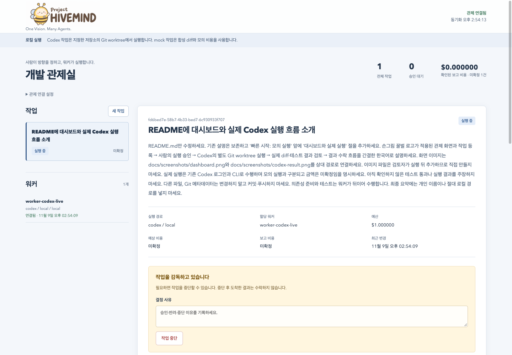
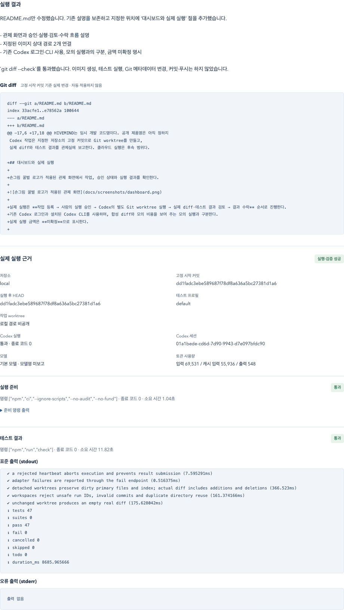

# Project HIVEMIND

<p align="center">
  
</p>

**One Vision. Many Agents.**

사람이 개발 목표와 방향을 정하고, 중앙 관제 시스템이 작업을 분배하며,
여러 AI 워커가 개발을 수행하는 플랫폼이다.
사람은 작업 과정, 승인, 비용과 Git 변경 제안을 한곳에서 확인한다.
HIVEMIND는 임시 개발 코드명이다. 공개 제품명은 아직 정하지 않았다.
소스와 문서는 [Apache License 2.0](LICENSE)으로 제공한다.

현재는 **단일 운영자용 로컬 개발 실행**을 지원한다.
모의 워커와 실제 Codex 워커를 선택할 수 있다.
Codex 작업은 지정한 저장소의 고정 커밋으로 Git worktree를 만들고,
실제 diff와 테스트 결과를 관제실에 보고한다. 클라우드 실행은 후속 범위다.

## 대시보드와 실제 실행

손그림 꿀벌 로고가 적용된 관제 화면에서 작업, 승인 상태와 실행 결과를 확인한다.



실제 실행은 **작업 등록 → 사람의 실행 승인 → Codex의 별도 Git worktree 실행 → 실제 diff·테스트 결과 검토 → 결과 수락** 순서로 진행한다.
기존 Codex 로그인과 설치된 Codex CLI를 사용하며, 합성 diff와 모의 비용을 보여 주는 모의 실행과 구분한다.
실제 실행 금액은 **미확정**으로 표시한다.



위 화면은 실제 Codex 워커가 이 README를 개선한 실행 기록이다.
의존성 준비 후 `npm run check`로 테스트 **47개 통과·실패 0개·종료 코드 0**을 확인하고 결과를 수락했다.
공개 스크린샷은 결과 영역을 발췌했으며 개인 로컬 경로만 숨겼다.

## 빠른 시작: 모의 실행

Node.js 24 이상과 npm이 필요하다. 프로젝트 루트에서 실행한다.

```sh
git clone https://github.com/roboco-io/project-hivemind.git
cd project-hivemind
npm ci
cp .env.example .env
npm run build
npm start
```

[로컬 관제실](http://127.0.0.1:4310)을 연다. 별도 터미널에서 같은 디렉터리로 이동한 뒤 실행한다.

```sh
npm run worker
```

1. 실행 워커에서 **모의 워커 (mock)**를 선택하고 목표·완료 조건·예산을 입력한다.
2. 결정 사유를 적고 **실행 승인**을 누른다.
3. 워커가 보고한 합성 diff와 모의 비용을 확인한다.
4. **결과 수락** 또는 **반려**를 누른다.

## 실제 Codex 실행

Git과 설치된 Codex CLI가 필요하다. 연동 옵션은 Codex CLI 0.166.0에서 확인했다.
[공식 Codex CLI 문서](https://learn.chatgpt.com/docs/cli/reference)를 참고한다.
워커를 실행하는 사용자 계정에서 `codex login`을 완료한다. 기존 ChatGPT 로그인도 사용할 수 있다.

서버와 워커에 **같은 신뢰하는 로컬 저장소 경로와 테스트 명령**을 설정한다.
API나 작업 지시로 임의 경로·테스트 명령을 전달할 수 없다.
아래는 `npm run check`를 제공하는 저장소의 예다. 설정은 `.env`에도 저장할 수 있다.

서버 터미널:

```sh
codex --version
codex login
export HIVEMIND_REPO_PATH="/absolute/path/to/trusted/repository"
export HIVEMIND_TEST_COMMAND='["npm","run","check"]'
npm start
```

워커 터미널에서 같은 프로젝트 디렉터리로 이동한 뒤 실행한다.

```sh
export HIVEMIND_REPO_PATH="/absolute/path/to/trusted/repository"
export HIVEMIND_TEST_COMMAND='["npm","run","check"]'
# package-lock.json이 있는 npm 프로젝트의 의존성 설치가 필요할 때만 설정한다.
export HIVEMIND_SETUP_COMMAND='["npm","ci","--ignore-scripts","--no-audit","--no-fund"]'
HIVEMIND_PROVIDER=codex HIVEMIND_WORKER_ID=worker-codex-1 npm run worker
```

준비 명령은 선택 사항이다. 새 worktree에는 원본의 `node_modules`를 공유하지 않으므로,
의존성이 필요한 저장소에는 해당 저장소에 맞는 준비 명령을 지정한다.

관제실에서 **실제 Codex 워커**를 선택하면 저장소 이름, 고정 시작 커밋과 테스트 명령이 표시된다.
작업을 등록하고 실행을 승인하면 Codex가 별도 worktree에서 변경하고 테스트한다.
결과 화면에서 실제 diff, worktree 경로, base/HEAD, 테스트 종료 코드와 출력을 확인한다.
Codex 실행이나 준비·테스트가 실패하면 실패 근거를 남기고 작업을 `failed`로 표시한다.
실패한 결과는 수락 완료로 바꿀 수 없다. 재시도는 새 작업으로 등록한다.

Codex 사용량이 제공되면 입력·캐시 입력·출력 토큰을 표시한다.
금액은 임의로 환산하지 않으며 **미확정**으로 표시한다. 작업 예산은 실제 과금의 상한을 보장하지 않는다.

서버는 시작할 때 저장소의 `HEAD`를 고정한다. 새 기준 커밋을 사용하려면 서버를 재시작한다.
이미 등록한 작업의 기준 커밋은 바뀌지 않는다. 실행 중에는 서버·워커의 테스트 명령을 변경하지 않는다.
테스트 명령도 작업 등록 시 복사해 고정하며, 이후 서버 설정을 바꿔도 기존 작업의 명령은 바뀌지 않는다.
워커 설정이 작업에 고정한 명령과 다르면 실행 전에 거절한다.
고정한 명령과 다른 테스트 결과는 중앙 API가 거절한다.

## 실행·보존 경계

결과 수락은 수락 이력만 기록한다. 파일 적용, Git 커밋·병합·푸시와 배포를 실행하지 않는다.
사유를 적어 **작업 중단**을 누르면 워커가 다음 heartbeat에서 중단을 확인하고 자식 프로세스를 종료한다.
시간 제한이나 heartbeat 오류도 실행을 중단하며, 취소·만료 뒤 도착한 결과는 거절한다.

Codex는 `workspace-write`와 비대화형 승인 정책으로 실행한다. 권한 우회 옵션을 사용하지 않는다.
Git worktree는 **파일 변경의 격리**다. 보안 컨테이너와 동일하지 않다.
준비·테스트 명령은 정리된 환경 변수로 로컬 호스트에서 실행하므로 신뢰하는 저장소만 지정한다.
Codex 인증은 Codex 프로세스에만 제공하며 관제 토큰은 모델·준비·테스트 프로세스에 전달하지 않는다.

worktree는 기본적으로 `data/worktrees` 아래에 남겨 결과를 조사할 수 있게 한다.
자동으로 적용하거나 삭제하지 않는다. 검토 후 필요하면 원본 저장소에서 정리한다.

```sh
git -C /absolute/path/to/trusted/repository worktree list
git -C /absolute/path/to/trusted/repository worktree remove /absolute/path/to/worktree
```

변경 파일이 남아 있으면 Git이 삭제를 거절한다.
먼저 필요한 변경과 결과를 별도로 보관하고, 사용자가 변경 파일을 정리한 뒤 삭제한다.

워커마다 다른 ID로 여러 프로세스를 실행할 수 있다. 각 워커는 자신의 제공자와 저장소에 맞는 작업만 가져온다.

```sh
npm run worker:once
HIVEMIND_WORKER_ID=worker-local-2 npm run worker
```

`worker:once`는 해당 워커가 처리할 수 있는 승인 작업을 최대 하나 처리한다.
작업이 없으면 정상 종료한다. 서버와 상시 워커는 각 터미널에서 `Ctrl+C`로 종료한다.

## 구현 상태

| 항목 | 현재 동작 |
|---|---|
| 사람 중심 관제 | 작업 등록·실행 승인·결과 수락·반려·중단, 2초 간격 조회 |
| 중앙 분배 | 제공자·저장소별 선입선출 분배, 원자적 claim과 실행 권한 만료 |
| 실제 개발 실행 | Codex CLI, 고정 base commit의 작업별 detached worktree |
| Git 변경 | 추적 파일 변경·삭제·새 파일·바이너리를 포함한 실제 diff 수집 |
| 테스트 | 설정된 준비·테스트 명령, 종료 코드·소요 시간·stdout/stderr 저장 |
| 이력 | SQLite에 작업·승인·실행 근거·이벤트 저장, 재시작 후 유지 |
| 비용 | mock은 1,000 micros = $0.001. Codex 금액은 null/미확정, 제공된 토큰 수 저장 |
| 실행 환경 | `local` 지원. ECS·Cloudflare는 후속 |
| 연결 도구 | Claude·ChatGPT MCP 연결과 자연어 목표 분해는 후속 |

## 설정

`.env.example`을 복사한 `.env`는 서버와 워커 시작 시 읽힌다.

| 변수 | 기본값 | 용도 |
|---|---|---|
| `HIVEMIND_HOST` | `127.0.0.1` | 서버 수신 주소 |
| `HIVEMIND_PORT` | `4310` | 서버 포트 |
| `HIVEMIND_DB` | `data/hivemind.sqlite` | 중앙 상태 파일 |
| `HIVEMIND_OPERATOR_TOKEN` | `local-development-only` | 관제 조회·승인 권한 |
| `HIVEMIND_WORKER_TOKEN` | `local-worker-only` | 워커 등록·실행 보고 권한 |
| `HIVEMIND_API_URL` | `http://127.0.0.1:4310` | 워커가 연결할 중앙 API |
| `HIVEMIND_PROVIDER` | `mock` | 워커 제공자 `mock` 또는 `codex` |
| `HIVEMIND_WORKER_ID` | 제공자별 로컬 ID | 같은 중앙에 연결하는 워커마다 고유 ID |
| `HIVEMIND_REPO_PATH` | 미설정 | 서버·Codex 워커의 신뢰하는 Git 저장소 루트 |
| `HIVEMIND_TEST_COMMAND` | `["npm","run","check"]` | 서버·워커에 동일하게 설정하는 테스트 argv |
| `HIVEMIND_SETUP_COMMAND` | 미설정 | 워커에서만 쓰는 선택적 준비 argv |
| `HIVEMIND_WORKTREE_ROOT` | `data/worktrees` | 워커 실행 디렉터리 기준 worktree 보존 위치 |
| `HIVEMIND_CODEX_BIN` | `codex` | Codex 실행 파일 |
| `HIVEMIND_CODEX_MODEL` | 미설정 | 선택적 모델 지정. 미설정이면 CLI 기본 모델 |
| `HIVEMIND_CODEX_TIMEOUT_MS` | `600000` | Codex 실행 시간 제한 |
| `HIVEMIND_TEST_TIMEOUT_MS` | `120000` | 준비·테스트 명령별 시간 제한 |

운영자 토큰을 바꾸면 관제실의 **관제 연결 설정**에도 같은 값을 입력한다.
기본 토큰은 로컬 개발용이다. 루프백 외 주소에는 서로 다른 24자 이상의 사용자 지정 토큰이 필요하다.
현재 인증은 단일 운영자용이며 사용자 계정·조직별 권한은 제공하지 않는다.

`.env`, `data/`, `node_modules/`, `dist/`는 버전 관리에서 제외한다.
상태를 초기화할 때는 서버·워커 종료 후 SQLite 파일을 백업하고 해당 상태 파일만 정리한다.
`data/` 전체를 삭제하지 않는다. 그 아래 보존된 worktree는 위 Git 절차로 별도 정리한다.

## 프로젝트 구조와 검증

```text
apps/control-plane/  중앙 HTTP API, 저장소 정책과 시작점
apps/dashboard/      독립 관제 Web UI
apps/worker/         HTTP 워커, 실행 설정과 실행 루프
packages/contracts/  작업·실행 근거·어댑터 계약
packages/core/       상태 전이, SQLite 저장과 승인 정책
packages/adapters/   Codex·모의 실행, worktree와 프로세스 제어
infra/               모의 컨테이너 예시와 후속 클라우드 경계
tests/              상태·권한·워커·Git·프로세스·통합 검증
docs/               아키텍처, ADR, MVP와 개발 계획
```

```sh
npm run check
```

타입 검사, 빌드와 자동 테스트를 실행한다. 기본 자동 테스트는 실제 모델을 호출하지 않는다.
실제 Codex 호출 여부와 결과는 해당 실행 검증 기록을 별도로 확인한다.

- [아키텍처와 API](docs/architecture.md)
- [MVP 범위와 완료 조건](docs/mvp.md)
- [개발 로드맵](docs/roadmap.md)
- [외부 도구·클라우드 통합 설계](docs/integrations.md)
- [초기 개발 계획](docs/plans/2026-11-09-bootstrap.md)
- [실제 Codex 개발 계획](docs/plans/2026-11-09-codex-worktree.md)
- [로컬 Codex worktree 결정](docs/adr/0006-local-codex-worktrees.md)
- [로컬 컨테이너 실행](infra/README.md)
- [자동 테스트와 실제 Codex 검증 결과](docs/verification.md)

공개 저장소: [roboco-io/project-hivemind](https://github.com/roboco-io/project-hivemind).
클라우드 배포 대상은 설정하지 않았다.

## 라이선스

Copyright 2026 Project HIVEMIND contributors.

이 프로젝트의 소스와 문서는 Apache-2.0으로 제공한다.
재배포 시에는 [LICENSE](LICENSE)와 해당 [NOTICE](NOTICE)의 고지를 유지한다.
외부 의존성에는 각 의존성의 라이선스가 적용된다.
