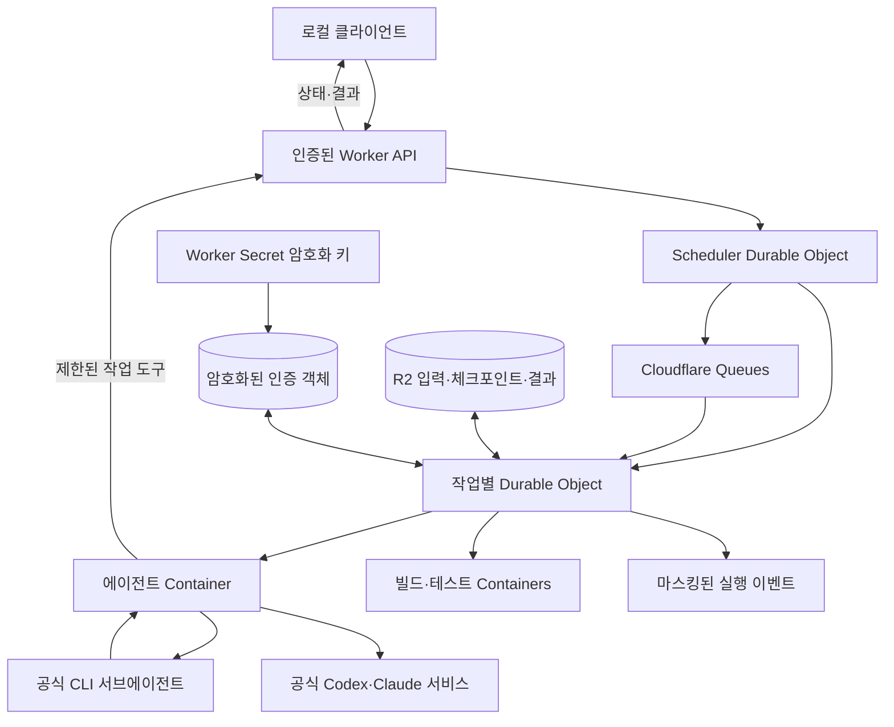

# Hivemind 아키텍처

작성일: 2026-11-09 · 구현 순서: Cloudflare 우선, AWS 후속.

이 문서는 목표 설계다. 첫 실행 가능한 범위와 검증 상태는 [백엔드 안내](backend/README.md)를 기준으로 한다.
첫 구현은 외부 Queues 대신 Durable Object alarm을 사용한다. 고급 MCP compute 제출과 AWS는 후속 범위다.

## 목적과 전제

로컬 머신의 컴퓨팅 리소스 한계를 서버리스 클라우드 컴퓨팅으로 해결한다. 로컬은 공식 로그인, 작업 지시, 결과 검토를 담당한다. 코드 탐색·편집·의존성 설치·빌드·테스트는 클라우드 컨테이너에서 수행한다. 모델 추론 자원은 공급자가 제공하며 구독의 사용량 한도는 그대로 적용된다.

사용자가 확정한 조건은 본인 구독, 공식 Codex·Claude Code CLI, 본인의 개발 작업이다. 신뢰할 수 있는 비공개 저장소와 Linux CPU 작업으로 시작한다. Cloudflare에서 MVP를 먼저 검증하고 이후 같은 동작을 AWS에 구현한다. AWS는 roboco 프로파일, 별도 지시가 없으면 ap-northeast-2, IaC는 AWS CDK를 사용한다. Cloudflare 리소스는 네이티브 Wrangler 선언 구성과 버전 고정 코드로 관리한다.

Cloudflare 공식 문서는 컨테이너에서 코딩 CLI를 실행하는 예제를 제공한다.[1] 그 예제의 AI Gateway·API 인증을 구독 인증의 근거로 사용하지 않는다. Hivemind는 공급자별 공식 구독 인증 경로를 유지하며 Cloudflare에서의 실제 동작을 별도로 검증한다. API 과금으로 자동 전환하지 않는다.

## Cloudflare 기본 구성

| 구성 요소 | 책임 |
|---|---|
| Worker API | 단일 사용자 인증, 입력 검증, 작업 제출·조회·취소, 제한된 worker callback |
| Scheduler Durable Object | 인증 lane, 실행 자원 예약, idempotency, 시도 소유권을 직렬화 |
| 작업별 Durable Object | 컨테이너 수명·heartbeat·마감시간·부모·자식 관계와 상태 관리 |
| Queues | 실행 요청 전달과 실패 재전달. 중복 전달은 idempotency로 처리 |
| Containers | 공식 CLI 및 별도 빌드·테스트 실행. Worker isolate에서 Linux CLI를 직접 실행하지 않음 |
| R2 | 불변 소스 snapshot, 시도별 결과, 마지막 완료 manifest |
| Worker Secrets와 별도 인증 객체 | 인증 암호화 키 및 암호화된 구독 인증 보관 |
| Wrangler 구성 | Worker·Durable Object·큐·컨테이너 바인딩과 이미지·호환 날짜 선언 |

원격 API는 인증 없이 임의 명령을 실행하는 엔드포인트를 제공하지 않는다. 초기 로컬 클라이언트는 별도 제어용 토큰으로 인증하고 Worker Secret과 대조한다. 이 토큰을 컨테이너에 전달하지 않는다. 향후 Cloudflare Access를 연결해도 내부 callback 권한과 사용자 인증을 분리한다.

## 백엔드 경계와 AWS 후속 구성

작업 상태, snapshot, 명령 argv, 결과 manifest, 이벤트, provider adapter는 공유한다. 실행·저장·인증·스케줄링은 백엔드별 구현을 둔다. 리소스 이름만 바꾼 것으로 이식 완료를 선언하지 않으며 장애·중복 전달·종료 동작을 각 환경에서 검증한다.

| 책임 | Cloudflare 우선 구현 | AWS 후속 구현 |
|---|---|---|
| 인증·작업 API | Worker, 제어용 토큰 | API Gateway·Lambda, IAM |
| 상태·lease·예산 | Scheduler와 작업별 Durable Object | DynamoDB 조건부 변경 |
| 실행 요청 | Queues와 Durable Object 조정 | AWS Batch 큐·dispatcher |
| 실행 환경 | Cloudflare Containers | Batch·Fargate |
| 산출물 | R2 | S3 |
| 구독 인증 | Worker Secret 키와 암호화된 인증 객체 | Secrets Manager |
| 상태 관측·조정 | Durable Object alarms, 실행 이벤트 | EventBridge·Lambda 조정기·CloudWatch |
| 인프라 구성 | Wrangler 선언 구성 | AWS CDK |

AWS 인증은 roboco/ap-northeast-2에서 확인했다. AWS 리소스 배포는 Cloudflare MVP 수용 시험 이후 수행한다. AWS 구성은 별도 adapter와 CDK stack으로 유지하며 Cloudflare MVP 실행에 AWS를 필수 의존성으로 추가하지 않는다.

## 병렬 실행 모델

| 계층 | 실행 단위 | 제약 |
|---|---|---|
| CLI 내부 | 공식 서브에이전트 | 에이전트 컨테이너의 자원과 구독 한도를 공유 |
| provider 간 | Codex·Claude 에이전트 컨테이너 | 독립 인증·소스 사본·산출물 경로 사용 |
| 컴퓨팅 | 빌드·테스트 컨테이너 | 구독 인증 없이 별도 자원으로 실행 |

Codex 인증 번들당 외부 CLI 실행 스트림은 하나로 유지한다.[2] 이 제한으로 내부 서브에이전트나 다른 provider·컴퓨팅 작업을 직렬화하지 않는다. 초기 외부 에이전트는 provider별 하나, 세션별 서브에이전트 목표 상한은 셋, 전체 컴퓨팅 컨테이너 상한은 넷이다. 실제 CLI 동시성 제어와 플랫폼 quota는 0단계에서 검증한다. Cloudflare 자원 프로필은 해당 계정의 지원 형태에 맞춰 정하며 AWS의 vCPU·메모리 값을 그대로 이식하지 않는다.

주 에이전트와 서브에이전트는 파일 소유 범위를 나누거나 Git worktree를 분리한다. 입력의 .git을 전달하지 않으므로 필요하면 컨테이너 안에서 입력 snapshot으로 임시 Git 기준 커밋을 만든다. 주 에이전트가 변경을 통합한 뒤 최종 검증을 수행한다. 서로 다른 provider의 변경도 단일 통합 소유자가 충돌 확인 후 합친다.

공식 CLI는 로컬 MCP 작업 도구를 호출한다. 도구는 모델을 직접 호출하지 않는다.

- submit_compute(parent_job_id, snapshot_id, kind, command, image_profile, resource_class, depends_on, idempotency_key): 빌드 또는 테스트 자식 작업 ID 반환.
- get_compute(child_job_id): 부모에 속한 자식의 상태·시도·입력 snapshot·종료코드·결과 manifest 반환.
- cancel_compute(child_job_id): 취소 접수. 실제 종료 확인은 별도 상태로 제공.
- snapshot 생성: 모든 편집자가 멈춘 경계에서 콘텐츠 해시와 파일 manifest를 게시. 편집 중인 작업 트리를 공유하지 않음.

명령은 실행파일·인수·작업 경로로 표현하며 서버가 이미지·자원·경로와 호출자 소유권을 검증한다. 컴퓨팅 컨테이너는 다른 자식을 재귀적으로 제출하지 않는다. 빌드 의존 테스트는 해당 빌드의 성공 manifest를 받은 후 시작한다. 독립 테스트는 같은 snapshot으로 병렬 실행한다.

## 작업 흐름과 결과 일관성

1. 로컬에서 기준 커밋과 필요한 미커밋 변경을 묶는다. .git·.env·인증·빌드 디렉터리를 기본 제외하고 업로드 목록을 보여준다. 초기 버전은 심볼릭 링크를 거부한다.
2. 파일 해시와 불변 snapshot을 R2에 게시하고 작업을 제출한다. idempotency key가 같은 다른 요청은 거부한다.
3. Scheduler가 인증 lane과 자원 예산을 예약한다. 자식 실행에 필요한 예산을 부모가 모두 차지하지 않도록 분리한다. 대기 작업에는 컨테이너를 할당하지 않는다.
4. 작업 Durable Object가 정확한 이미지로 컨테이너를 시작하고 입력을 복원한다. 공식 CLI용 인증 디렉터리는 workspace와 분리한다.
5. 공식 CLI가 서브에이전트로 조사·편집을 분담한다. supervisor가 이벤트와 프로세스 상태를 수집한다. 실제 모델 호출과 편집 결과를 확인하며 종료코드만으로 성공 처리하지 않는다.
6. 편집 통합 후 불변 snapshot을 만들어 별도 컨테이너에서 빌드·테스트한다. 코드가 바뀌면 이전 snapshot의 통과 결과를 최종 검증으로 재사용하지 않는다.
7. 종료 전에 갱신된 Codex 인증과 완료 체크포인트를 안전하게 게시한다. 새 파일·삭제·바이너리·실행 권한을 포함한 결과를 저장하고 manifest를 마지막에 게시한다.
8. 최종 snapshot의 모든 필수 검증, 결과 manifest, 인증 write-back 확인 후 부모를 성공 처리한다. 프로젝트 설정의 필수 검증을 모델이 임의로 생략할 수 없다.
9. 로컬에서 변경·테스트 결과를 검토한다. 현재 파일의 기준 해시와 충돌을 확인한 후 적용하고 중간 쓰기 실패 시 백업으로 복원한다. 자동 push·merge는 기본 동작에 포함하지 않는다.

R2 결과 경로는 job/attempt별로 분리한다. 중복·지연 callback은 현재 시도와 일치할 때만 반영한다. 원격 세션 데이터는 provider·CLI 버전 호환성을 확인해 선택적으로 보존하며 재개 불가 시 snapshot과 작업 요약으로 새 세션을 시작한다.

## 구독 인증의 수명주기

### Codex

원격 전용 공식 로그인 번들을 사용한다. 로컬에서 같은 번들을 동시에 사용하지 않는다. 공식 CLI가 refresh를 담당하며 Hivemind는 갱신된 auth.json을 보존한다.[2] 원본 seed를 매 실행마다 다시 덮어쓰지 않는다. 해당 자동화는 신뢰할 수 있는 비공개 저장소를 전제로 한다.

Cloudflare에서는 인증 객체를 일반 결과 버킷·경로와 분리하고 Worker Secret의 키로 인증된 암호화를 적용한다. 매 저장에 새 암호화 nonce를 사용하고 credential_id·키 버전·인증 세대와 연결한다. Scheduler가 lane을 소유한 작업의 새 버전만 게시하도록 제어한다. R2에 원문 토큰을 저장하지 않는다. AWS에서는 같은 계약을 Secrets Manager로 구현한다.

supervisor는 파일 변경과 정상 종료 시 최신 인증을 게시한다. refresh와 외부 저장을 원자적으로 만들 수 없으므로 강제 종료 후 재로그인 복구를 제공한다. write-back 실패 시 lane을 격리하고 AUTH_SYNC_FAILED를 반환한다. 단순 lease 만료로 다른 컨테이너를 시작하지 않는다. 이전 실행 종료와 저장 완료를 확인해야 한다.

### Claude Code

공식 claude setup-token을 안전하게 등록하고 CLI 프로세스에 CLAUDE_CODE_OAUTH_TOKEN으로 전달한다.[3] 만료·폐기 시 NEEDS_REAUTH로 전환한다. API 키 환경변수와 과금 gateway 설정을 제거해 구독 경로가 섞이지 않도록 한다. 본인 공식 CLI 사용 범위를 유지하며 고객용 인증 중개 기능을 만들지 않는다.[4]

### 비밀정보 경계

구독 인증은 공식 CLI에 필요하므로 CLI와 같은 신뢰 실행 환경 안의 완전한 비밀 격리를 보장하지 않는다. Cloudflare 관리 API 토큰과 Worker 제어 토큰·암호화 키는 컨테이너에 전달하지 않는다. 필요한 입력·결과·자식 제어는 부모·경로·시도·만료시간에 제한된 권한으로 수행한다. 컴퓨팅 컨테이너에는 모델 인증과 에이전트 설정·세션을 전달하지 않는다.

인증이 들어간 컨테이너의 전체 파일시스템 snapshot을 일반 체크포인트로 사용하지 않는다. workspace의 허용 파일만 보존하며 auth 디렉터리·환경변수·프로세스 메모리를 제외한다. Cloudflare의 플랫폼 snapshot 기능을 쓰더라도 구독 인증이 포함되지 않는 경계를 먼저 검증해야 한다.

## 실행 경계와 수명 관리

컨테이너는 non-root로 실행하며 privileged 모드·Docker socket·로컬 홈을 전달하지 않는다. Docker daemon·GPU·macOS가 필요한 작업은 초기 지원 대상에서 제외한다. CLI sandbox 기능은 각 플랫폼에서 검증한다. 로컬 Docker에서 관측한 namespace 오류를 이유로 자동 비활성화하지 않는다. 변경이 필요하면 외부 컨테이너·네트워크·파일 경계의 실험 결과를 바탕으로 문서와 시험을 갱신한다.

Cloudflare 원격 exec 시험에서 UID 1000에도 ambient capabilities가 상속되는 것을 관측했다. CLI·작업 프로세스는 setpriv로 inheritable·ambient·bounding capabilities를 제거하고 no-new-privileges를 설정한 뒤 실행한다. 이 방식에서 Codex sandbox 시작, workspace 내부 쓰기 허용·외부 쓰기 거부, read-only 쓰기 거부를 실제 원격 검증했다. UID만으로 권한 제거를 판단하지 않으며 Claude sandbox와 구독 모델 실행은 별도로 검증한다.

Cloudflare의 장기 프로세스 자체는 컨테이너 activity로 간주되지 않으므로 Durable Object alarm이 진행 상태와 마감시간을 확인한다. 재시작 후에도 inactivity 설정을 복구한다. 실행 종료 시 컨테이너를 명시적으로 정리하며 종료 신호만 기다려 결과 저장을 수행하지 않는다.[5] 플랫폼 중단에 대비해 지속 저장한 마지막 완료 manifest만 신뢰한다.

outbound는 공식 구독 인증·모델 서비스, 필요한 패키지 경로, 제한된 작업 callback에 허용한다. 공식 CLI의 인증 트래픽과 TLS 신뢰 동작을 실환경에서 확인한다. 공개 Worker 예제의 무인증 API나 API 키 주입 설정을 복사하지 않는다.

AWS에서는 인바운드를 차단하고 필요한 아웃바운드를 구성한다. ECS task role endpoint의 자격증명은 환경변수 제거·UID 분리만으로 격리됐다고 판단하지 않는다. Cloudflare에는 같은 endpoint가 있다고 가정하지 않으며 플랫폼별 실제 비밀정보 노출 경로를 시험한다.

## 상태·취소·비용

기본 상태는 QUEUED → STARTING → RUNNING → SAVING → SUCCEEDED다. FAILED, CANCELLED, TIMED_OUT, NEEDS_REAUTH, AUTH_SYNC_FAILED, NEEDS_INPUT, RATE_LIMITED를 별도로 둔다. 부모·자식은 큐 대기·실행 제한과 시도 ID를 가진다. 초기 전체 실행 제한은 60분이며 soft deadline을 저장 시간만큼 앞에 둔다.

부모 취소·실패·시간 초과 시 대기 자식을 취소하고 실행 자식의 종료를 요청한다. 실제 종료 전에는 자원 예약을 반환하지 않는다. 조정기가 고아 실행·누락 이벤트·불명확한 시작을 확인한다. 코드 편집이나 외부 부작용 이후 무조건 재실행하지 않는다. 자동 재시도는 초기 인프라 시작 실패로 제한한다. 임의 명령의 외부 부작용에 exactly-once를 보장하지 않는다.

추가 사용자 판단은 NEEDS_INPUT으로 저장·종료하고 후속 입력으로 재개한다. 구독 한도는 RATE_LIMITED로 처리하며 계정 교체나 API 과금 전환을 하지 않는다. 부모가 자식을 기다리는 동안 컨테이너를 유지하는 초기 방식은 대기 시간에도 비용이 발생한다. Cloudflare 비용은 Workers·Durable Object·Queues·R2·Containers, AWS 비용은 대응 리소스를 각각 측정한다. 리전·플랫폼 단가 확인 없이 월 비용을 확정하지 않는다.

## 검증과 구현 순서

공통 로컬 시험 → Cloudflare 0단계 → Cloudflare MVP 전체 수용 시험 → AWS CDK와 adapter → AWS 별도 수용 시험 순으로 진행한다. 어느 플랫폼의 통과도 다른 플랫폼의 증거를 대신하지 않는다.

1. 각 공식 CLI의 실제 편집·테스트·결과 왕복과 로컬 클라이언트 종료 후 지속 실행.
2. 공식 서브에이전트 둘 이상 및 독립 테스트 컨테이너 둘 이상의 실행 구간 중첩.
3. provider 간 독립 인증·소스·결과 병렬 실행과 최종 통합 코드 재검증.
4. Codex 외부 인증 스트림 직렬화와 갱신 보존·재로그인·저장 실패 복구.
5. 최종 snapshot·빌드·테스트 귀속, 새 파일·삭제·바이너리·한국어 이름·적용 충돌 처리.
6. 인증 미전달, 로그·이미지·일반 산출물의 비밀정보 배제, 실제 CLI sandbox와 관리 자격증명 경계.
7. 중복 요청·이벤트·시작 불명확성, 취소·OOM·강제 종료·고아 자식·자원 예산.
8. 고정 이미지·CLI·호환 날짜와 실제 플랫폼 작업 식별자, 실행 시간·비용·로컬 부하 측정.

0단계는 각 플랫폼의 계정·quota·네트워크·non-root CLI·MCP·서브에이전트·sandbox·자격증명 경계를 검증한다. Cloudflare 원격에서 공식 CLI 기동·stdio MCP·Codex 파일 경계의 일부 증거를 확보했다. 구독 모델 실행·서브에이전트·전체 복구와 AWS 원격 시험은 미완료다.

## 공식 근거

1. [Cloudflare coding agents](https://developers.cloudflare.com/sandbox/coding-agents/)
2. [Codex account auth in CI/CD](https://learn.chatgpt.com/docs/auth/ci-cd-auth)
3. [Claude Code authentication](https://code.claude.com/docs/en/authentication#generate-a-long-lived-token)
4. [Claude Code credential conditions](https://code.claude.com/docs/en/legal-and-compliance#authentication-and-credential-use)
5. [Cloudflare sandbox lifetime](https://developers.cloudflare.com/sandbox/concepts/lifetime/)
6. [Cloudflare sandbox security](https://developers.cloudflare.com/sandbox/concepts/security/)
7. [Codex subagents](https://learn.chatgpt.com/docs/agent-configuration/subagents)
8. [Claude Code subagents](https://code.claude.com/docs/en/sub-agents)
9. [AWS Batch Fargate](https://docs.aws.amazon.com/batch/latest/userguide/fargate.html)

플랫폼 지원 문서와 Hivemind 설계 제안은 구분한다. 구독 인증이 Cloudflare에서 실제 성공하는지는 원격 검증 결과로 판단한다.
