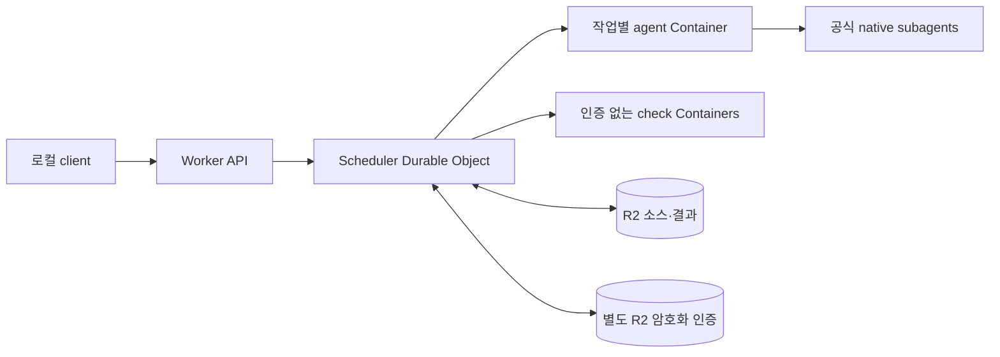

# Cloudflare 백엔드

공식 Codex·Claude Code CLI를 작업별 Cloudflare Container에서 실행한다.
로컬 클라이언트는 소스를 올리고 결과를 검토한다. 모델 호출은 사용자 구독 인증을 사용한다.

## 구성



Scheduler의 영속 alarm이 실행과 회수를 이어간다. HTTP 연결 종료는 작업을 취소하지 않는다.
동일한 credentialId는 한 번에 한 agent만 실행한다. 기본 상한은 agent 2개, check 4개다.
agent가 종료되면 최신 인증을 저장하고 컨테이너 종료를 확인한 뒤 필수 check를 실행한다.
모호한 인증 회수는 `AUTH_SYNC_FAILED`로 격리한다. 자동으로 같은 작업을 재실행하지 않는다.

`src/contracts.ts`, `scheduler.ts`, `snapshot.ts`는 공유 계약이다.
`src/cloudflare/`는 Cloudflare 실행·저장 연결이고 `src/runtime/`은 Linux 실행기다.
AWS 연결은 아직 구현하지 않았다.

## 로컬 검증

Node.js 24.14 이상 25 미만, Docker, Wrangler 로그인 계정이 필요하다.

```sh
npm ci
npm run types
npm run typecheck
npm test
```

`backend/`에서 실행한다. 테스트에는 모델 구독이나 클라우드 계정이 필요하지 않다.
Docker 빌드 컨텍스트는 상위 Cloudflare 프로젝트 폴더다.

## 배포

`wrangler.json`의 account_id와 리소스 이름을 배포 계정에 맞춘다.
R2 구독을 먼저 활성화하고 artifact·credential 버킷 두 개를 만든다.
두 버킷 모두 공개 접근을 활성화하지 않는다.

관리자는 다음 Worker Secrets를 비공개 파일에 준비한다.

| Secret | 용도 |
|---|---|
| `CONTROL_TOKEN` | 외부 API 제어용 난수 토큰 |
| `AUTH_STORAGE_KEY` | 32바이트 난수의 base64. 인증 객체 AES-GCM 키 |
| `AUTH_RETURN_PUBLIC_KEY` | RSA SPKI PEM. 컨테이너의 인증 반환 암호화 |
| `AUTH_RETURN_PRIVATE_KEY` | 대응하는 RSA PKCS8 PEM. Worker에서만 복호화 |

```sh
npx wrangler deploy --config wrangler.json --secrets-file ../.hivemind/backend-secrets.json
```

관리 비밀과 반환 개인키는 컨테이너에 전달하지 않는다.
구독 인증은 제어 API로 별도 등록하며 일반 소스 snapshot에 포함하지 않는다.
원격 전용 인증은 최초 등록 또는 명시적 재인증 때만 등록한다.
실행 후 최신 인증은 백엔드가 소유한다. 이전 로컬 시드를 다시 등록하지 않는다.
Codex는 `auth_mode: chatgpt`인 공식 파일 인증만 허용한다.
workspace 기반 권한 프로필은 `/runtime`, `/proc`, 인증 파일과 private 메타데이터 읽기를 차단하도록 구성한다.
실제 차단 여부는 원격 검사로 별도 확인한다.
Claude는 공식 setup-token의 OAuth 토큰만 허용한다. API 키는 허용하지 않는다.

배포 전 `CODEX_SANDBOX_APPROVED`와 `CLAUDE_NESTED_APPROVED`를 해당 계정의 원격 검증 결과와 대조한다.
Claude는 검증 조건을 통과하기 전 `CLAUDE_NESTED_APPROVED=false`를 유지한다.
Cloudflare에서 파일 쓰기·private/proc 읽기·부모 환경·토큰 환경 제거·권한 제거를 검증한 뒤에만 `true`로 바꾼다.
호환 모드에는 [추가 격리](../docs/adr/0002-claude-layered-sandbox.md)를 적용한다.
관리 Bash 훅이 공식 Codex 로컬 sandbox와 namespace 필터를 함께 실행한다.
이 경로는 모델을 호출하지 않으며 Codex 인증이 필요하지 않다.
실제 Claude 모델과 내부 서브에이전트는 Claude 구독을 사용한다.
CLI sandbox를 끄거나 비격리 실행을 허용하지 않는다.

## API

`/v1/` 경로는 `Authorization: Bearer <CONTROL_TOKEN>`이 필요하다.
공개 `/health`는 비밀이나 작업 정보를 반환하지 않는다.

| 메서드·경로 | 동작 |
|---|---|
| `PUT /v1/snapshots/:digest` | 해시를 검증한 불변 snapshot 저장 |
| `POST /v1/credentials/:id` | `{provider, auth}` 등록. 진행 중 lane 교체 금지 |
| `GET /v1/credentials` | 인증 값 없이 세대·격리 상태 조회 |
| `POST /v1/jobs` | JobSpec 제출. 동일 멱등 키의 다른 내용은 409 |
| `GET /v1/jobs` | 작업 목록 |
| `GET /v1/jobs/:id` | 상태·부모·자식·종료 확인 |
| `POST /v1/jobs/:id/cancel` | 취소 요청. 반환·종료 후 상태 확정 |
| `GET /v1/jobs/:id/result` | 입력·출력 snapshot과 실제 check 결과 |

작업은 provider, credentialId, snapshotId, instructions, checks, timeoutMs, idempotencyKey를 받는다.
checks는 1~4개의 `{id, argv, timeoutMs}`다. 서버는 최종 출력 snapshot을 별도 컨테이너에 복원해 실행한다.
argv는 인증된 사용자가 지정하며 셸 문자열로 합치지 않는다.

## 소스와 결과

snapshot은 파일 내용(base64)·해시·실행 권한을 포함한다. 최대 1,000파일·4MiB다.
심볼릭 링크, Git 내부, 인증 파일, 비밀 설정 파일은 거부하거나 제외한다.

```sh
export HIVEMIND_URL=https://YOUR-WORKER.workers.dev
# HIVEMIND_CONTROL_TOKEN은 비공개 셸 환경에서 설정한다.
node src/client.ts snapshot /path/to/source --out /path/to/input.json
node src/client.ts upload /path/to/source
node src/client.ts submit /path/to/job.json
node src/client.ts get JOB_ID
node src/client.ts result JOB_ID --out /path/to/result.json
node src/client.ts apply JOB_ID /path/to/source
```

`apply`는 성공한 작업만 허용한다. 로컬 파일이 입력 snapshot과 다르면 적용을 거부한다.
먼저 result의 입력·출력을 비교한다. 로컬 Git worktree에서 적용하면 기존 Git diff로 검토할 수 있다.

이 백엔드는 초기 실행 슬라이스다. 기존 로컬 대시보드는 별도 프로토타입이며 원격 UI 연결은 후속 작업이다.
외부 Queue, 고급 MCP compute 제출, 자동 장애 재시도, AWS 수용 검증은 이번 구현 범위 밖이다.
원격 수용 상태와 실패는 `../docs/phase0/` 및 별도 원격 증거 문서에 기록한다.
