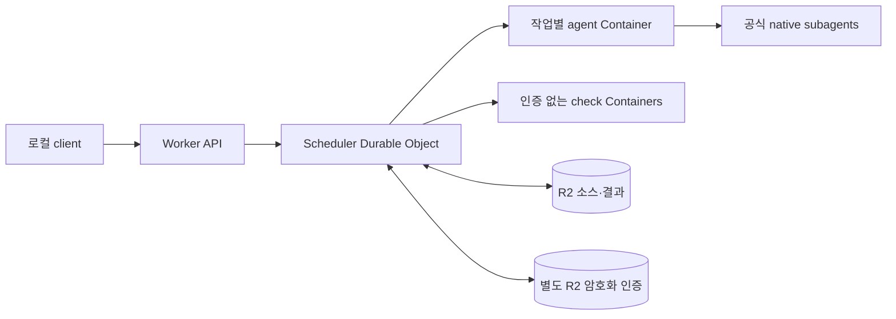

# Cloudflare 백엔드

공식 Codex·Claude Code CLI를 작업별 Cloudflare Container에서 실행하는 초기 백엔드다.
현재 계정에서 Codex·Claude 동시 원격 실행, native worker, 별도 테스트와 인증 회수를 검증했다.
[최신 검증 상태](../docs/verification/2026-11-10-cloudflare.md)를 확인한다.
로컬 클라이언트는 소스를 올리고 결과를 검토한다. 모델 호출은 사용자 구독 인증을 사용한다.

## 구성



Scheduler의 영속 alarm이 실행과 회수를 이어간다. HTTP 연결 종료는 작업을 취소하지 않는다.
동일한 credentialId는 한 번에 한 agent만 실행한다. 기본 상한은 agent 2개, check 4개다.
agent가 종료되면 최신 인증을 저장하고 컨테이너 종료를 확인한 뒤 필수 check를 실행한다.
모호한 인증 회수는 `AUTH_SYNC_FAILED`로 격리한다. 자동으로 같은 작업을 재실행하지 않는다.

`src/contracts.ts`, `scheduler.ts`, `snapshot.ts`는 공유 계약이다.
`src/cloudflare/`는 Cloudflare 실행·저장 연결이고 `src/runtime/`은 Linux 실행기다.
AWS 연결은 아직 구현하지 않았다.

## 로컬 검증

Node.js 24.14 이상 25 미만, Docker, Wrangler 로그인 계정이 필요하다.

```sh
npm ci
npm run runtime:check
npm run types
npm run typecheck
npm test
```

`backend/`에서 실행한다. 테스트에는 모델 구독이나 클라우드 계정이 필요하지 않다.
Docker 빌드 컨텍스트는 상위 Cloudflare 프로젝트 폴더다.

## 배포

`wrangler.json`의 account_id와 리소스 이름을 배포 계정에 맞춘다.
R2 구독을 먼저 활성화하고 artifact·credential 버킷 두 개를 만든다.
두 버킷 모두 공개 접근을 활성화하지 않는다.

관리자는 다음 Worker Secrets를 비공개 파일에 준비한다.

| Secret | 용도 |
|---|---|
| `CONTROL_TOKEN` | 외부 API 제어용 난수 토큰 |
| `AUTH_STORAGE_KEY` | 32바이트 난수의 base64. 인증 객체 AES-GCM 키 |
| `AUTH_RETURN_PUBLIC_KEY` | RSA SPKI PEM. 컨테이너의 인증 반환 암호화 |
| `AUTH_RETURN_PRIVATE_KEY` | 대응하는 RSA PKCS8 PEM. Worker에서만 복호화 |

```sh
npm run runtime:stamp
npm run runtime:check
npx wrangler deploy --config wrangler.json --secrets-file ../.hivemind/backend-secrets.json
```

실행 소스나 빌드 입력을 바꾸면 버전 파일을 갱신하고 함께 커밋한다.
배포 후 `/health`의 `expectedRuntimeRevision`이 `runtime-build.json`의 `digest`와 같은지 확인한다.
컨테이너 지문이 맞기 전에는 인증을 전달하지 않는다. 확인한 버전은 시도별로 고정한다.
[버전 확인 규칙](../docs/adr/0004-runtime-revision-fence.md)과 배포 이미지 digest도 함께 기록한다.

관리 비밀과 반환 개인키는 컨테이너에 전달하지 않는다.
구독 인증은 제어 API로 별도 등록하며 일반 소스 snapshot에 포함하지 않는다.
원격 전용 인증은 최초 등록 또는 명시적 재인증 때만 등록한다.
실행 후 최신 인증은 백엔드가 소유한다. 이전 로컬 시드를 다시 등록하지 않는다.
Codex는 `auth_mode: chatgpt`인 공식 파일 인증만 허용한다.
workspace 기반 권한 프로필은 `/runtime`, `/proc`, 인증 파일과 private 메타데이터 읽기를 차단하도록 구성한다.
실제 차단 여부는 원격 검사로 별도 확인한다.
Claude는 공식 setup-token의 OAuth 토큰만 허용한다. API 키는 허용하지 않는다.

배포 전 `CODEX_SANDBOX_APPROVED`와 `CLAUDE_NESTED_APPROVED`를 해당 계정의 원격 검증 결과와 대조한다.
Claude는 검증 조건을 통과하기 전 `CLAUDE_NESTED_APPROVED=false`를 유지한다.
Cloudflare에서 파일 쓰기·private/proc 읽기·부모 환경·토큰 환경 제거·권한 제거를 검증한 뒤에만 `true`로 바꾼다.
호환 모드에는 [추가 격리](../docs/adr/0002-claude-layered-sandbox.md)를 적용한다.
현재 설정의 `true` 값은 문서에 기록한 계정의 검증 결과다. 새 계정에서는 검증 전 `false`로 설정한다.
관리 Bash 훅이 공식 Codex 로컬 sandbox와 namespace 필터를 함께 실행한다.
이 경로는 모델을 호출하지 않으며 Codex 인증이 필요하지 않다.
실제 Claude 모델과 내부 서브에이전트는 Claude 구독을 사용한다.
CLI sandbox를 끄거나 비격리 실행을 허용하지 않는다.

## API

`/v1/` 경로는 `Authorization: Bearer <CONTROL_TOKEN>`이 필요하다.
공개 `/health`는 비밀이나 작업 정보를 반환하지 않는다.

| 메서드·경로 | 동작 |
|---|---|
| `PUT /v1/snapshots/:digest` | 해시를 검증한 불변 snapshot 저장 |
| `POST /v1/credentials/:id` | `{provider, auth}` 등록. 진행 중 lane 교체 금지 |
| `GET /v1/credentials` | 인증 값 없이 세대·격리 상태 조회 |
| `POST /v1/jobs` | JobSpec 제출. 동일 멱등 키의 다른 내용은 409 |
| `GET /v1/jobs` | 작업 목록 |
| `GET /v1/jobs/:id` | 상태·부모·자식·종료 확인 |
| `POST /v1/jobs/:id/cancel` | 취소 요청. 반환·종료 후 상태 확정 |
| `GET /v1/jobs/:id/result` | 입력·출력 snapshot과 실제 check 결과 |

작업은 provider, credentialId, snapshotId, instructions, checks, timeoutMs, idempotencyKey를 받는다.
checks는 1-4개의 `{id, argv, timeoutMs}`다. 서버는 최종 출력 snapshot을 별도 컨테이너에 복원해 실행한다.
argv는 인증된 사용자가 지정하며 셸 문자열로 합치지 않는다.

## 소스와 결과

snapshot은 파일 내용(base64)·해시·실행 권한을 포함한다. 최대 1,000파일·4MiB다.
심볼릭 링크, Git 내부, 인증 파일, 비밀 설정 파일은 거부하거나 제외한다.

```sh
export HIVEMIND_URL=https://YOUR-WORKER.workers.dev
# HIVEMIND_CONTROL_TOKEN은 비공개 셸 환경에서 설정한다.
node src/client.ts snapshot /path/to/source --out /path/to/input.json
node src/client.ts upload /path/to/source
node src/client.ts submit /path/to/job.json
node src/client.ts get JOB_ID
node src/client.ts result JOB_ID --out /path/to/result.json
node src/client.ts apply JOB_ID /path/to/source
```

`apply`는 성공한 작업만 허용한다. 로컬 파일이 입력 snapshot과 다르면 적용을 거부한다.
먼저 result의 입력·출력을 비교한다. 로컬 Git worktree에서 적용하면 기존 Git diff로 검토할 수 있다.

이 백엔드는 초기 실행 슬라이스다. 기존 로컬 대시보드는 별도 프로토타입이며 원격 UI 연결은 후속 작업이다.
외부 Queue, 고급 MCP compute 제출, 자동 장애 재시도, AWS 수용 검증은 이번 구현 범위 밖이다.
원격 수용 상태와 실패는 `../docs/phase0/` 및 별도 원격 증거 문서에 기록한다.

## 두 워커의 원격 통합 워크플로

공통 계약 파일과 소스 snapshot을 고정한다. 계획에는 `snapshotId`, `contractPath`, `contractHash`(계약 파일의 SHA-256), `idempotencyKey`, `workers`, `integration`을 담는다. `workers`에는 Codex·Claude를 한 번씩 지정한다. 각 항목은 `provider`, `credentialId`, `writes`(허용 경로), `instructions`, `checks`, `timeoutMs`를 포함한다. `integration`은 두 변경을 합친 snapshot에서 실행할 별도 CheckSpec이다. 계약과 검증 스크립트는 워커의 쓰기 범위 밖에 둔다.

```sh
node src/client.ts upload /path/to/source
node src/client.ts workflow-draft /path/to/plan.json
node src/client.ts workflow-approve WORKFLOW-ID
node src/client.ts workflow-get WORKFLOW-ID
node src/client.ts workflow-result WORKFLOW-ID --out result.json
```

초안은 워커를 만들지 않는다. 승인하면 두 작업을 원격 스케줄러에 함께 기록한다. 각 워커는 한 모델 세션에서 최대 3번의 구현·검증을 수행한다. 별도 검증 컨테이너가 해당 라운드의 불변 snapshot을 검사한다. 실패하면 검증 결과를 전달하고 같은 세션을 재개한다. 작업의 시간 제한은 검증 대기까지 포함한다.

두 워커의 검증 성공·인증 회수·컨테이너 종료가 확인되면 허용 경로의 변경을 합친다. 계약 또는 다른 워커의 경로가 변경되거나 통합 테스트가 실패하면 실패 상태를 기록한다. 완료된 결과는 조회용이며 원본 저장소에 대한 적용은 운영자가 결정한다. 승인 이후 진행은 Durable Object의 alarm에서 이루어진다. 로컬 CLI를 종료한 뒤 다른 프로세스로 조회할 수 있다.

## 자원 검증 실험 작업 묶음

운영자 API의 `POST /v1/compute-groups`는 `snapshotId`, `idempotencyKey`, `concurrency`(1·2·4), `instance`(standard-1·standard-3), 네 개의 `checks`와 최종 `integration`을 받아 초안을 만든다. 각 검사는 기존 CheckSpec의 id·argv·timeoutMs 형식을 따른다. `POST /v1/compute-groups/:id/approve` 후 서버가 정한 동시 실행 수로 검사를 실행하고 전부 성공하면 같은 snapshot에서 통합 검사를 수행한다. `GET /v1/compute-groups/:id`는 group과 작업별 job·result를 반환한다. `POST /v1/compute-groups/:id/cancel`은 실행과 후속 통합을 중단한다.

WorkflowSpec은 선택적으로 `concurrency: 1|2`와 `instance`를 받는다. 순차 모드는 앞 워커의 검증까지 끝난 후 다음 워커를 실행한다. 모델 워커의 `model`과 `effort`는 함께 지정하며, Codex는 low·medium·high·xhigh, Claude는 low·medium·high를 받는다. 기존에 선택값을 생략한 작업은 종전 기본 동작을 사용한다.

실험 그룹의 `createdAt`, `approvedAt`, `finishedAt`과 작업의 `createdAt`, `startedAt`, `runningAt`, `finishedAt`을 기록한다. startedAt은 스케줄러가 실행을 배정한 시간이고 runningAt은 런타임 시작을 처음 확인한 시간이다. 실제 명령 구간은 result.process의 시간으로 확인한다. 실험 결과의 `resources`는 cgroup CPU 사용량·스로틀링·메모리 피크를 포함하며, 지원되지 않는 계측값은 생략한다. 모델·effort 필드는 요청 설정이며 실제 제공자 응답의 모델 식별 근거는 별도로 확인한다.

실험 compute 그룹과 instance를 명시한 워크플로는 패키지 설치에 필요한 npm registry·Prisma binary·GitHub 읽기 경로를 사용한다. 모델 워커는 자기 제공자 경로를 추가로 사용한다. 기존 일반 작업의 네트워크 정책과 전역 상한인 agent 2개·compute 4개는 유지한다.

Claude 결과의 `claudeResultMetrics`는 마지막 native result가 보고한
`duration_ms`, `duration_api_ms`, `num_turns`와 허용된 모델별 숫자 사용량을 보존합니다.
`coverage: final-result-provider-reported`는 전체 세션 합계를 보장하지 않습니다.
이 계측에는 원문 출력이나 인증 정보를 저장하지 않으며 Codex의 실제 모델을 추정하지 않습니다.

### 대형 compute 입력과 standard-4 (DuckDB P0)

일반 compute-group은 `standard-1`, `standard-3`, `standard-4`와 1–4개 검사를 받는다. 전역 compute 동시성 상한은 4다. 기존 Carbon/모델 벤치마크의 instance 선택 범위는 바꾸지 않는다.

기존 4MiB·1,000파일 snapshot은 작은 실행 manifest와 runner용으로 유지한다. 큰 입력은 operator가 별도 R2 multipart 객체로 등록한다. `source`는 tar.gz(압축 최대 1GiB, 해제 최대 2GiB·100,000파일), `data`는 최대 8GiB 일반 파일이다. 임의 URL·bucket·경로를 받지 않는다.

```sh
node scripts/large-artifacts/upload.ts /absolute/duckdb.tar.gz source tar.gz 2147483648 100000 https://BACKEND ../.hivemind/backend-secrets.json
# data의 마지막 두 숫자는 실제 byte 길이와 1이다.
node scripts/large-artifacts/upload.ts /absolute/input.db data file 123456789 1 https://BACKEND ../.hivemind/backend-secrets.json
```

반환된 `ref`를 compute-group의 `artifacts: [ref]`에 넣는다. `/v1/large-artifact-uploads`는 인증된 operator만 사용하며, parts는 8MiB(마지막만 나머지 길이)다. 같은 digest의 완료 객체는 덮어쓰지 않고 같은 선언만 재사용한다. 미완료 upload는 `POST /v1/large-artifact-uploads/<id>/abort`로 정리할 수 있다. uploader는 실패 시 자신의 multipart를 중단한다.

**등록 metadata의 SHA는 선언값이다.** 응답은 `contentHashVerification: runtime-required`로 표시한다. 신뢰된 runtime은 전체 다운로드 길이·SHA-256을 확인하고 안전한 tar 해제를 마친 뒤에만 compute를 실행한다. 링크·장치·경로 탈출·중복 경로·확장 크기 초과는 거부한다. 전송은 job/attempt/입력 digest/deadline에 묶인 read capability를 사용하며 제어 토큰과 모델 인증은 전달하지 않는다. 완료·취소·만료된 작업의 capability는 사용할 수 없다.

workload에는 `HIVEMIND_ARTIFACT_SOURCE`(archive 최상위 디렉터리를 보존한 source 디렉터리)와 `HIVEMIND_ARTIFACT_DATA` 경로만 제공한다. Codex compute sandbox가 runtime 비공개 디렉터리를 deny하고 준비된 입력 subtree를 read로 연다. 쓰기 build·DB temp는 별도 작업 공간에서 수행한다. 같은 UID의 chmod만을 읽기 전용 경계로 신뢰하지 않는다. macOS의 실제 read/write/delete/비공개-read 경계 probe와 unit tests를 수행했으며, 원격 Linux probe도 통과한 뒤 실행 적합성을 주장해야 한다.

큰 입력은 검사 작업들에만 제공하고 최종 integration에는 다시 내려받지 않는다. 통합 검사는 작은 receipt 집계를 맡거나 별도 준비된 검증을 수행해야 한다. 다운로드·검증·해제 시간은 작업 timeout에 포함된다. 성공 결과에는 digest·실제 해제 크기/파일 수·준비 시간을 남기고, capability는 로그·결과에서 제거한다.
