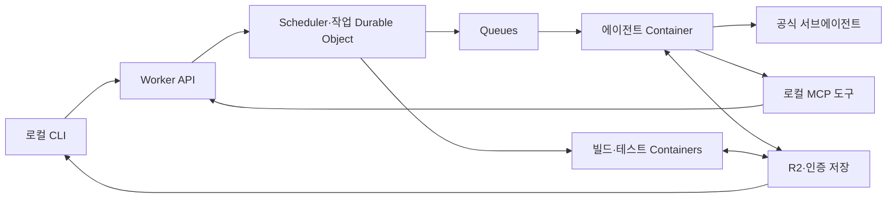
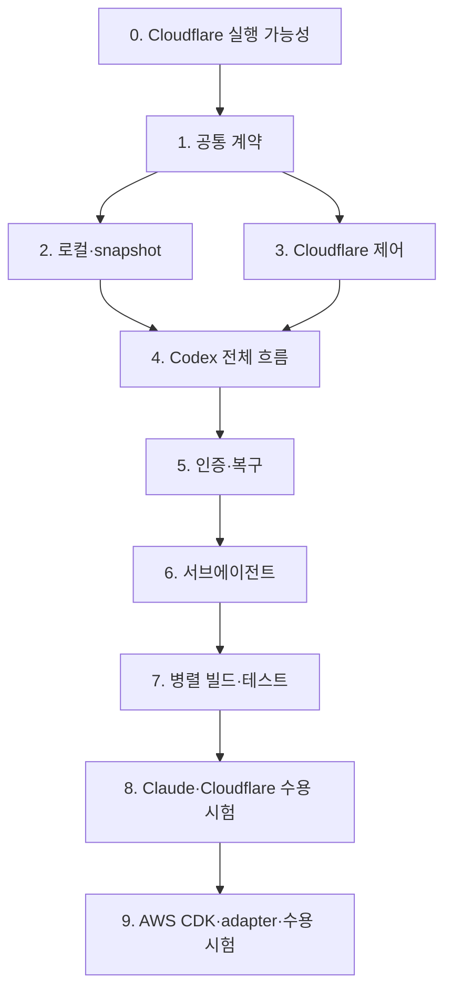

# Hivemind MVP 구현 계획

작성일: 2026-11-09 · 상태: 사용자 지시에 따라 구현 중. Cloudflare 원격 0단계 미통과.

기준: 프로젝트 루트의 ARCHITECTURE.md. 구현 순서는 Cloudflare MVP 완성 후 AWS backend 추가다. 기존 AWS 우선 계획을 대체하며 기존 로컬 검증 증거는 유지한다. 이 계획 자체가 배포·검증 완료를 의미하지 않는다.

## 요약

공식 Codex·Claude Code CLI를 구독 인증으로 클라우드 컨테이너에서 실행한다. 공식 서브에이전트가 개발을 분담하고 별도 컨테이너가 빌드·테스트를 병렬 실행한다. 로컬은 인증 등록·지시·검토만 맡는다. Cloudflare에서 전체 작업 왕복과 장애 복구를 먼저 검증한다. 이후 공통 계약을 유지하면서 AWS 실행·저장·제어 구현과 CDK stack을 추가하고 같은 수용 시험을 다시 수행한다.

## 완료 후 제공할 것

- 로컬 CLI: 입력 미리보기·제출·상태·취소·결과 다운로드·충돌 확인 후 적용·재인증.
- Cloudflare Worker API, Scheduler와 작업별 Durable Object, Queues, Containers, R2, 암호화된 인증 저장.
- 각 공식 CLI의 내부 서브에이전트와 provider 간 독립 실행, 구독 인증 없는 병렬 빌드·테스트.
- 인증 갱신 보존, 불변 snapshot, 결과 manifest, idempotency, 예산·마감시간·부모·자식 취소.
- AWS adapter와 AWS CDK 배포 구성. AWS 환경은 roboco/ap-northeast-2가 기본이다.
- 로컬 자동 시험과 두 플랫폼별 실제 수용 시험, 설정·운영·재인증·정리 안내.

## 구현할 구성 요소

S는 한 가지 책임, M은 여러 경계 연동, L은 인증·동시성·실환경 검증을 포함한다. 별도 구현 에이전트 배정은 전제하지 않는다.

| 구성 요소 | 역할 | 규모 | 구현 담당 |
|---|---|---|---|
| 공통 계약과 snapshot | 작업·시도·결과·파일 왕복 형식을 정의한다. | M | 구현자 |
| 로컬 CLI | 사용자 인증과 작업·결과 관리를 제공한다. | M | 구현자 |
| Cloudflare 제어·실행 | Durable Object와 컨테이너의 상태·수명·예산을 관리한다. | L | 구현자 |
| 인증·supervisor | 공식 CLI와 인증 갱신·보존·재로그인을 연결한다. | L | 구현자 |
| MCP·컴퓨팅 worker | 불변 입력으로 빌드·테스트를 병렬 수행한다. | L | 구현자 |
| AWS adapter와 CDK | 같은 계약으로 AWS 실행·저장·제어를 제공한다. | L | 구현자 |
| 수용 시험·운영 안내 | 실제 동작과 장애 복구를 검증한다. | M | 구현자 |

## 연결 구조

도식의 저장 접근은 실제로 제어 경계를 거친다. 컨테이너에 Cloudflare 관리 API 토큰이나 전체 버킷 권한을 주지 않는다. 구독 인증 저장과 일반 산출물 경로·권한을 분리한다.

## 구현 순서

0단계가 실패하면 실험 증거로 경계 변경안을 결정한다. API 과금 전환이나 AWS 선행 구현으로 Cloudflare gate를 우회하지 않는다. 계약이 확정되면 2·3단계의 독립 작업을 병행할 수 있다.

### 0. Cloudflare 실행 가능성 검증

로컬 공통 시험과 플랫폼별 gate를 구분한다. 로컬 도구·non-root CLI 기동·stdio MCP 시험은 준비돼 있다. Cloudflare 계정 로그인과 회사 계정 확인 후 다음을 수행한다.

- 공식 CLI와 MCP SDK, Wrangler, 이미지 digest와 Workers compatibility date를 고정한다. 신규 컨테이너 API와 기존 Sandbox SDK 0.x 예제를 섞지 않는다.
- Worker·Durable Object에서 작은 시험 컨테이너를 시작·실행·정리하고 계정 quota·자원 프로필·네트워크 연결을 확인한다.
- 공식 구독 인증을 원격 전용으로 등록한다. Cloudflare 예제의 AI Gateway provider key·placeholder API key 설정을 사용하지 않는다.
- 두 CLI 각각 실제 편집, MCP nonce 응답, 서브에이전트 둘 이상의 실행 구간 중첩을 확인한다.
- non-root·CLI sandbox·작업 경로·아웃바운드·관리 자격증명 비노출을 확인한다. 구독 토큰이 컨테이너에 필요한 경계는 명확히 기록한다.
- Durable Object 재시작·alarm·inactivity·강제 종료에서 진행 중인 작업과 마지막 체크포인트가 어떻게 변하는지 확인한다.

**산출물:** 재현 명령, 고정 버전과 이미지, 원격 실행 ID·시간·상태·증거 위치, 제약·설계 변경 기록.

**완료 조건:** 모든 Cloudflare 필수 검사에 실제 원격 증거가 있다. 로컬 Docker나 SDK 직접 호출을 공식 CLI·Cloudflare 실행 증거로 대신하지 않는다. AWS 인증은 이 gate의 선행 조건이 아니다.

### 1. 공통 계약과 테스트 기반

TypeScript 단일 저장소와 Node.js를 기본으로 한다. 현재 로컬 검증기는 Node.js 내장 TypeScript 실행을 쓰며 제품 코드에는 타입 검사·빌드·테스트 구성을 추가한다. 정확한 지원 버전은 0단계 확인값으로 고정한다. 첫 언어 스택은 Node.js 프로젝트다.

작업·부모·자식·시도·snapshot·manifest·이벤트·오류·인증 세대를 정의한다. ExecutionBackend, ArtifactStore, CredentialStore, JobStore 경계를 정하고 플랫폼 객체를 공통 계약에 노출하지 않는다. 상태 값은 아키텍처와 맞춘다. 실행 명령은 argv·작업 경로로 표현한다.

**완료 조건:** 불법 전이, 다른 부모의 자식 접근, 이전 시도의 갱신, 서로 다른 snapshot 결과 혼합, 동일 idempotency key의 다른 요청을 거부한다. API와 도구 입력의 크기·형식을 검증한다.

### 2. 로컬 CLI와 snapshot

파일 수집·제외 목록·미리보기·업로드·다운로드·적용을 구현한다. .git·.env·인증 디렉터리를 기본 제외한다. 경로 이탈과 절대 경로를 차단하며 초기 심볼릭 링크는 거부한다. 콘텐츠 해시·실행 권한·기준 커밋·미커밋 입력을 기록한다.

결과는 입력 대비 변경 manifest와 콘텐츠로 보관한다. 적용 전 현재 파일의 기준 해시와 충돌을 확인한다. 충돌 시 전체 적용을 중단하고 쓰기 실패에는 백업 복원을 제공한다.

**완료 조건:** 한국어 파일명, 새 파일, 삭제, 바이너리, 실행 권한, 미커밋 입력이 왕복한다. 비밀 제외·경로 차단·충돌 시 무변경·중간 실패 복원을 시험한다.

### 3. Cloudflare 제어 기반

Wrangler 선언 구성으로 Worker, Scheduler·작업 Durable Object, Queues, R2, 컨테이너 이미지와 바인딩을 정의한다. 사용자의 회사 계정을 명시적으로 선택하고 제어 API를 인증한다. Cloudflare 관리 토큰과 사용자 제어 토큰은 컨테이너로 전달하지 않는다.

Scheduler가 인증 lane·자원 예산·현재 시도를 직렬화한다. Queue 중복 전달과 시작 결과 불명확성을 시도 ID로 조정한다. Durable Object alarm이 heartbeat·마감시간·고아 작업을 확인한다. inactivity 설정은 재생성 시 복구한다. 부모가 자식 자원을 모두 소진하지 않도록 예산을 나눈다.

**완료 조건:** 중복 제출은 논리 작업 하나를 반환하고 인증 번들을 외부에서 중복 사용하지 않는다. 종료 확인 전 lane과 예산을 반환하지 않는다. 무인증 요청으로 작업을 시작할 수 없고 idle worker 비용과 살아 있는 컨테이너를 구분해 관측한다.

### 4. Codex 전체 작업 흐름

공식 Codex 이미지·supervisor·adapter를 연결한다. 입력 복원, 임시 Git 기준 커밋, workspace와 분리된 인증 디렉터리, 이벤트·편집 결과·테스트 로그·manifest를 구현한다. Cloudflare AI Gateway나 API 키 없이 구독 로그인 경로로 실행한다.

**완료 조건:** 작은 비공개 저장소 작업을 제출하고 로컬 도구를 종료한 뒤 재접속해 결과를 받는다. 충돌 없는 로컬 작업 트리에 적용한다. 이 단계는 중간 이정표이며 병렬 MVP 완료가 아니다.

### 5. 인증 보존과 실패 복구

Worker Secret의 암호화 키와 별도 인증 객체를 사용한다. 매 저장에 새 암호화 nonce를 사용하고 credential_id·인증 세대·키 버전에 연결한다. 저장 권한은 현재 lane 소유 시도만 가진다. R2에 원문 구독 토큰을 저장하지 않는다.

Codex CLI의 파일 변경·종료에 최신 인증을 게시하며 직접 OAuth refresh를 구현하지 않는다. 강제 종료·write-back 실패·오래된 시도 업로드를 처리한다. 인증이 들어간 전체 컨테이너 snapshot은 일반 코드 체크포인트로 사용하지 않는다.

**완료 조건:** 다음 실행이 갱신 인증을 사용한다. 저장 실패 시 AUTH_SYNC_FAILED로 lane을 격리하고 코드 결과를 보존한다. 토큰 폐기·재로그인, 종료 경합, 이전 시도의 지연 저장, NEEDS_INPUT·RATE_LIMITED 복구를 확인한다.

### 6. 공식 서브에이전트

명시적 위임 지침과 파일 소유 범위·worktree 분리를 제공한다. 주 에이전트가 결과를 통합한다. 모든 편집 담당이 멈춘 경계에서만 불변 snapshot을 생성하며 이를 보장할 수 없다면 먼저 서브에이전트를 종료·회수한다.

**완료 조건:** 두 서브에이전트의 실행 구간이 겹치고 통합 결과가 있다. 편집 충돌을 검출하며 종료 후 고아 프로세스가 없다. 외부 컨테이너로 인증 번들을 복제하지 않는다.

### 7. 병렬 빌드·테스트

MCP에 snapshot, submit_compute, get_compute, cancel_compute를 제공한다. 서버가 부모 소유권, 경로, 이미지·명령·자원 프로필을 검증한다. Worker callback은 부모·시도·경로·만료에 한정된 권한을 사용한다.

자식은 불변 입력으로 명령을 실행하고 종료코드·로그·manifest를 게시한다. 독립 테스트는 병렬로, 빌드 의존 테스트는 정확한 성공 manifest 후에 실행한다. 구독 인증·CLI 설정·세션을 자식에 전달하지 않는다. 초기 상한은 provider별 에이전트 하나, 세션별 서브에이전트 목표 셋, 사용자 전체 컴퓨팅 컨테이너 넷이다. 실제 물리 자원은 0단계 확인한 Cloudflare 프로필에 맞춘다.

**완료 조건:** 두 독립 테스트의 실제 실행 구간이 겹친다. 최종 snapshot에 필수 검증이 모두 귀속된다. 예산 초과·의존 실패·부모 취소·고아 자식·중복 종료 이벤트에도 상태와 자원 예약이 일치한다.

### 8. Claude와 Cloudflare MVP 수용 시험

공식 setup-token과 Claude adapter·이미지·서브에이전트를 추가한다. 공통 supervisor와 결과 계약을 재사용하고 provider별 원본 이벤트를 마스킹해 정규화한다. Codex와 Claude는 독립 인증·소스·결과로 동시에 실행한다. 같은 코드로 합치면 통합 소유자가 새 snapshot을 검증한다.

**완료 조건:** 두 provider 모두 실제 편집·MCP·서브에이전트·빌드·테스트·결과 적용을 통과한다. 로컬 종료 후 지속 실행, 인증 갱신·사용량 제한·취소·OOM·강제 종료·자식 실패를 시험한다. 이미지·로그·일반 산출물·컴퓨팅 컨테이너에 인증이 없다. 실제 로컬 기준 작업과 시간·부하·비용을 비교한다. 실행 종료 후 고아 컨테이너가 없다.

이 시점에 Cloudflare MVP를 달성한 것으로 판단한다. 전체 프로젝트 목표에는 다음 AWS 후속 구현도 남아 있다.

### 9. AWS CDK와 backend 추가

Cloudflare 수용 시험 후 AWS용 실행 가능성 gate를 별도로 수행한다. 기본 환경은 roboco/ap-northeast-2다. Fargate non-root CLI·sandbox·MCP·서브에이전트·IAM 자격증명 endpoint 경계·quota·네트워크를 다시 확인한다. Cloudflare 통과를 AWS 증거로 재사용하지 않는다.

CDK로 API Gateway·Lambda·DynamoDB·Batch/Fargate·S3·Secrets Manager·ECR·EventBridge·CloudWatch를 정의한다. 기존 공통 계약에 AWS 실행·저장·인증·상태 adapter를 연결한다. Cloudflare 코드의 ARN·계정 의존성을 제거하려고 제품 계약을 바꾸지 않는다.

**완료 조건:** CDK 합성·구성 시험과 실제 배포가 성공하고 Cloudflare에서 사용한 전체 수용 시나리오를 AWS에서 다시 통과한다. 각 플랫폼 결과·운영·정리 안내와 측정값이 있다. 두 플랫폼 모두 검증한 뒤에만 전체 목표를 완료 처리한다.

## 변경 가능한 기본 선택

- AWS: roboco, ap-northeast-2, AWS CDK. 사용자 전역 지침에 기록한 회사 프로젝트 기본값이다.
- Cloudflare: 회사 계정은 로그인 후 사용자가 지정한다. Wrangler 네이티브 선언 구성과 고정 버전을 사용한다.
- UI: 로컬 CLI와 상태 조회부터 제공한다. 대시보드는 후속 작업이다.
- 일반 실행 제한: 전체 60분, 저장시간을 확보하는 soft deadline. 0단계 시험은 소수의 짧은 작업으로 제한한다.
- AWS 초기 자원: 일반 2 vCPU·8 GiB, 큰 빌드 4 vCPU·16 GiB, 전체 24 vCPU·96 GiB를 제안하며 배포 계정 지원 조합과 quota로 검증한다.

## 주요 위험과 대응

| 위험 | 대응 |
|---|---|
| Cloudflare 예제와 구독 요구사항의 불일치 | API Gateway 키가 아닌 공식 구독 경로를 실험하고 자동 과금 전환을 금지한다. |
| CLI sandbox·non-root·컨테이너 제약 | 0단계에서 실제 경계를 확인하고 권한을 자동 해제하지 않는다. |
| 토큰 회전과 종료·저장 경합 | lane 직렬화·인증 세대·암호화 저장·실패 격리·재로그인 복구를 구현한다. |
| 전체 컨테이너 snapshot에 인증 포함 | workspace 허용 파일만 결과로 보존하고 원문 인증을 분리한다. |
| inactivity·재배포·플랫폼 중단 | alarm·deadline·설정 복구·마지막 완료 manifest로 조정한다. |
| 잘못된 코드 버전의 테스트 성공 | 입력 해시와 최종 snapshot을 기준으로 필수 검증한다. |
| 취소 후 자식·예약 잔류 | 실제 종료 확인과 고아 실행 조정을 수행한다. |
| 대기·시작 비용으로 실익 감소 | 실제 로컬 작업과 실행 시간·자원·비용을 비교한다. |

## 범위 밖

고객 인증 중개, 공개 PR 자동 실행, GPU·macOS·특권 컨테이너, Docker daemon 빌드, 무제한 병렬화, 자동 push·merge, API 과금 자동 전환, 외부 부작용 exactly-once, 완전한 세션 메모리 복원은 포함하지 않는다.

## 수용 기준

1. 입력 목록 확인 후 제출하고 로컬을 종료해도 작업이 이어진다.
2. 각 공식 CLI가 실제 서브에이전트 둘 이상을 병렬 실행하고 결과를 통합한다.
3. 별도 빌드·테스트 컨테이너가 실행되며 독립 테스트 둘 이상의 실행 구간이 겹친다.
4. 최종 코드의 필수 검증과 새 파일·삭제·바이너리의 로컬 적용이 성공한다.
5. Codex·Claude 동시 작업의 인증·소스·결과가 섞이지 않고 Codex 인증 번들은 외부에서 동시 사용되지 않는다.
6. 인증 갱신·폐기·사용량 제한·OOM·취소·강제 종료·자식 실패에서도 상태·결과·예산이 일치한다.
7. 원문 인증이 이미지·일반 산출물·로그·컴퓨팅 컨테이너에 없고 종료 후 실행 자원이 남지 않는다.
8. 로컬 부하 감소를 측정하고 전체 시간·실행 비용·제약을 보고한다. 속도 향상을 보장하지 않는다.
9. 1~8을 Cloudflare에서 먼저 통과하고 AWS CDK 배포 환경에서 다시 통과한다.

## 기간과 비용

기존 AWS 단일 backend의 13~21 작업일 추정은 Cloudflare 우선·두 backend 범위의 예측으로 사용하지 않는다. 0단계의 구독 인증·컨테이너·계정 검증 결과로 구현 작업량을 다시 산정한다. 검증 전 특정 완료일이나 월 비용을 확정하지 않는다. 구독료와 Cloudflare·AWS 실행·저장·네트워크 비용은 별도로 기록한다.

## 자체 검토

공통 계약과 파일 왕복은 1~2단계, 제어·동시성은 3·7단계, 공식 CLI는 4·6·8단계, 인증·복구는 5단계, Cloudflare 수용은 8단계, AWS 독립 검증은 9단계가 담당한다. 이전 AWS 우선 gate와 일정 가정을 제거하고 구독 인증·병렬 실행·실제 증거 요구사항을 유지했다. 기존 로컬 시험은 계속 사용하지만 원격 통과 증거로 승격하지 않는다.
