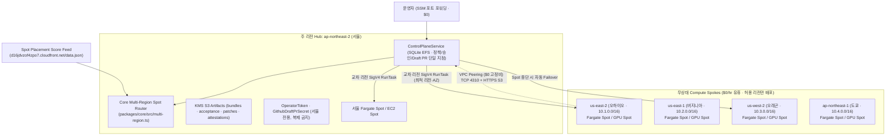

# ADR-0009: 서울 주 리전(Hub) + 스팟 배치 스코어 기반 멀티 리전(Spoke) 아키텍처

- 상태: 수락 · 구현 완료 (2026-11-26)
- 선행 결정: [ADR-0008 AWS 단일 실행 경로와 검증 Draft PR](0008-aws-single-path-and-verified-draft-pr.md)

## 배경

HIVEMIND의 주 운영 리전은 서울(`ap-northeast-2`)이다. 그러나 AWS CPU·NVMe·GPU 스팟 인스턴스의 가용성(Spot Placement Score)과 시간당 스팟 단가는 리전·가용영역(AZ)별로 크게 다르다. 예를 들어 2026-11-26 기준 `https://d16jdvzof4zpo7.cloudfront.net/data.json` 실측에서:

- `c.xlarge-arm`(CPU ARM64)은 서울(`ap-northeast-2`)이 스코어 9 · `$0.0474/hr`로 5개 리전 중 최저가인 반면,
- `g6e.12xlarge`(4×L40S GPU)는 서울 스코어 **1**(`$5.93/hr`)이지만 오하이오(`us-east-2`)는 스코어 **9**(`$5.36/hr`, 약 10% 저렴)이고,
- `p5.48xlarge`(8×H100 GPU)는 서울 스코어 8(`$33.34/hr`) 대비 오하이오(`us-east-2`)가 스코어 9(`$24.89/hr`, **25% 저렴**)이다.

단일 서울 리전에 모든 연산을 고정하면 GPU/고메모리 작업에서 스팟 배치 실패와 과도한 비용이 발생한다.

## 결정

### 1. Hub-and-Spoke 멀티 리전 구조 (서울 단일 중앙 관제 + 무상태 스포크 연산)

- **서울 Hub (`ap-northeast-2`) 단일 원장 유지:** `ControlPlaneService`, EFS SQLite, `OperatorTokenSecret`, `GithubDraftPrSecret`은 **서울 리전에만** 둔다. 상태 저장소를 멀티 리전으로 분산하지 않는다.
- **무상태 Spoke 스택 (`infrastructure/aws-runtime/lib/aws-spoke-stack.ts`):** 허용된 원격 리전(`us-east-2`, `us-east-1`, `us-west-2`, `ap-northeast-1`)에는 상시 서비스·EFS·NAT·EIP·ALB·인바운드 규칙이 모두 **0개**인 무상태 연산 스택만 배포한다(**유휴 고정비 `$0/hr`**).
- **네트워크 및 비밀 경계 유지:**
  - 서울 Hub VPC(`10.0.0.0/16`)와 각 스포크 VPC(`10.1.0.0/16`~`10.4.0.0/16`)는 **AWS VPC Peering(고정비 `$0`)**으로 연결해 퍼블릭 인바운드 CIDR 0개 원칙을 유지한다.
  - 스포크 리전에는 `WorkerTokenSecret`과 `ModelSubscriptionAuthSecret`만 선택 복제하며, `OperatorTokenSecret`·`GithubDraftPrSecret`은 복제하지 않는다. 스포크 검증기(`SpokeVerifierTaskRole`)는 모든 비밀에 접근 불가다.

### 2. 스팟 배치 스코어 · 추세 기반 비용 최적화 라우팅 (`packages/core/src/multi-region.ts`)

- **추세 분석 피드 (`packages/adapters/src/spot-placement-feed.ts`):** `https://d16jdvzof4zpo7.cloudfront.net/data.json`의 6시간 주기 시계열(`scores`, `azScores`, `prices`, `azPrice`, `noPool`)을 15분 TTL 캐시로 조회한다. 피드 장애나 노후화(`maxFeedAgeHours` 초과, 기본 24시간) 시 **서울 주 리전으로 안전 폴백**한다.
- **중앙 core 결정 규칙 (`selectOptimalSpotPlacement`):**
  1. **승인 허용 목록 강제:** 작업 승인 지문(`approvalFingerprint`)에 `RegionRoutingPolicy`(`primaryRegion`, `allowedRegions`, `workloadClass`, `maxHourlyPriceUsd`)를 포함해, 미승인 리전으로의 우회 실행을 차단한다.
  2. **하드 게이트:** `noPool` 제외, 최신 스코어 `< minPlacementScore`(기본 7) 제외, 최근 `trendWindowHours`(기본 48시간) 평균 스코어 불안정 리전 제외, `maxHourlyPriceUsd` 초과 리전 제외.
  3. **주 리전 보너스 + 추세 안정성 가중치:** 서울(`ap-northeast-2`)에는 기본 **5% 주 리전 보너스**를 부여해 가격 차가 미미할 때는 지연·전송비 없는 서울에서 실행한다. 반대로 타 리전이 5% 이상 저렴하거나 서울 스팟 스코어가 낮으면 최적 스포크 리전과 **물리 AZ ID(`use2-az2` 등)**까지 선택해 해당 AZ 서브넷에 배치한다. 하락 추세(`declining`) 리전에는 페널티를 부여해 중단 위험을 낮춘다.
  4. **Spot 중단 시 자동 리전 Failover:** 실행 중 Spot `SIGTERM` 중단이 발생하면 해당 리전을 `excludeRegions`에 추가해 체크포인트 복구 재시도를 차선 리전(`fallbackChain`)으로 자동 전환한다.

## 결과

- 서울을 주 리전으로 유지하면서도 CPU/NVMe/GPU 스팟 가용성과 가격 추세에 따라 최적 리전·AZ를 중앙 정책(`packages/core`)에서 감사 가능하게 선택할 수 있다.
- 운영자는 `GET /api/delivery/spot-placement` 또는 `scripts/aws-spot-advisor.ts`로 현재 5개 리전의 실시간 추천·절감률·추세를 즉시 조회할 수 있다.
- 실제 스포크 리전 AWS 배포는 각 리전에 대한 명시적 승인 뒤에만 수행한다.
