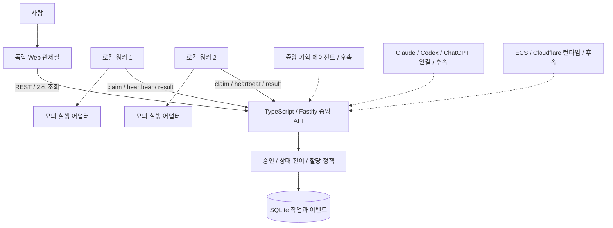
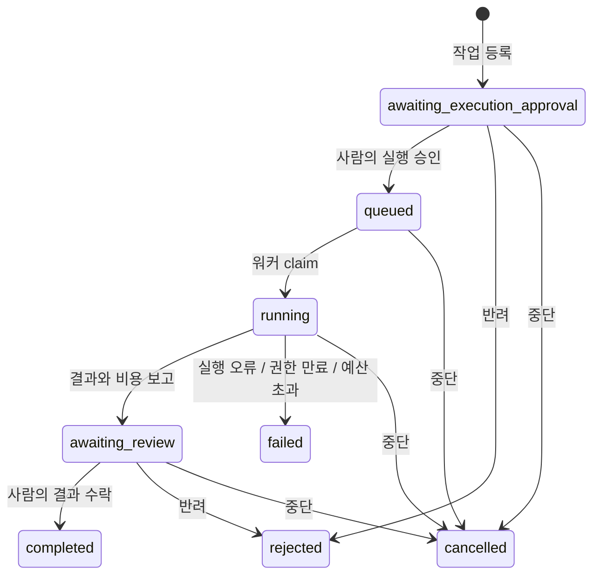

# 아키텍처

## 비전과 현재 경계

사람이 목표를 정하고 중요한 결정을 승인한다. 중앙 관제 시스템이 계획과 작업 상태를 관리한다.
워커는 할당받은 작업을 격리된 실행 환경에서 수행하고, 결과와 비용을 중앙에 보고한다.
Web UI와 Claude Code·Codex·ChatGPT는 같은 중앙 상태를 사용한다.

현재 구현은 이 흐름을 검증하는 단일 운영자용 로컬 골격이다.
중앙 기획은 사람이 작성하는 작업 지시이고, 자동 분해·의존성 DAG·모델 선택은 후속 기능이다.
실행 어댑터는 `mock`, 실행 환경은 `local`만 지원한다.

점선은 확장 설계다. 해당 연결을 현재 실행할 수 있다는 뜻은 아니다.

## 구성 요소

| 구성 요소 | 책임 | 의존성 |
|---|---|---|
| `packages/contracts` | Task, Lease, HiveEvent, AgentAdapter, RuntimeDriver의 공통 형태 | 없음 |
| `packages/core` | 승인·취소·실행 권한, 상태 전이, 작업 분배, 저장 | 공통 계약, SQLite |
| `apps/control-plane` | 요청 검증, 운영자/워커 인증, API, UI 파일 제공 | core |
| `apps/dashboard` | 작업·비용·diff·이력 표시와 사람의 결정 입력 | HTTP API |
| `apps/worker` | 작업 요청, heartbeat, 어댑터 실행과 결과 보고 | HTTP API, 어댑터 |
| `packages/adapters` | 제공자별 실행을 공통 결과로 변환 | 공통 계약 |

현재 워커 프로세스 하나는 작업 하나를 처리한다. 여러 워커를 시작하면 서로 다른 승인 작업을 병렬 처리한다.
SQLite 파일은 중앙 서버만 소유한다. 워커는 데이터 파일을 공유하지 않는다.

## 작업 수명주기

`completed`, `rejected`, `failed`, `cancelled`는 종료 상태다.
현재 재시도는 새 작업을 등록하는 방식이다. 종료 작업을 자동 재실행하지 않는다.
실행 승인과 결과 수락은 별도 결정이다. 각 결정의 단계, 사유와 시각을 이벤트로 저장한다.

## 할당과 실행 권한

승인된 대기 작업을 선입선출로 선택한다. SQLite `BEGIN IMMEDIATE` 트랜잭션 안에서
상태와 claim을 함께 변경해 같은 작업의 중복 할당을 막는다.
각 실행에는 별도 `runId`와 무작위 `leaseToken`을 부여한다.
워커는 자신의 `workerId`와 실행 권한을 함께 제출해야 heartbeat와 결과를 보고할 수 있다.

실행 권한은 30초 후 만료된다. 워커는 실행 중 5초마다 heartbeat로 갱신한다.
만료 검사는 상태 조회와 실행 관련 요청 시 수행된다.
만료된 작업은 `failed`가 되며, 취소·만료 후 도착한 결과는 거절한다.
워커는 heartbeat 거절이나 연결 오류를 확인하면 어댑터 실행을 중단한다.
실제 원격 컨테이너의 강제 종료는 후속 런타임 어댑터의 책임이다.

## 데이터와 일관성

- `Task`: 지시, 예산, 상태, 실행 ID, 워커, 예상·보고 비용, 결과와 diff.
- `Worker`: 식별자, 제공자·실행 환경과 마지막 연결 시각.
- `HiveEvent`: 증가하는 sequence, taskId, runId, 종류, 시각과 부가 정보.
- `Lease`: 실행 워커에게만 전달하는 작업별 권한. 관제 상태 응답에는 토큰을 포함하지 않는다.

작업 상태 변경과 관련 이벤트는 같은 트랜잭션으로 저장한다.
SQLite WAL을 사용한다. 서버 재시작 시 같은 파일을 열어 상태를 이어간다.
이벤트는 데이터베이스에 누적하며, 현재 상태 API는 최근 200개만 반환한다.
페이지별 이력 조회, 스키마 마이그레이션 도구와 백업 자동화는 후속 범위다.
이벤트는 운영 추적용이며 변조 방지 감사 저장소는 아니다.

비용 단위는 USD micros 정수다. `1 USD = 1,000,000 micros`다.
모의 예상·보고 비용은 1,000 micros다. 등록 예산이 예상보다 작으면 작업 생성을 거절한다.
워커 보고액이 예산을 넘으면 실제 보고액을 보존하고 실패로 표시한다.
이 검사는 이미 발생한 외부 지출을 되돌리지 않으며, 실제 제공자 과금의 상한을 보장하지 않는다.

## HTTP API

응답은 별도 envelope 없이 공통 계약 객체를 반환한다. 워커 claim은 작업이 없으면 `null`이다.
모든 `/api` 요청은 역할에 맞는 `Authorization: Bearer <token>`이 필요하다.

| 권한 | 메서드와 경로 | 요청/응답 |
|---|---|---|
| 공개 | `GET /health` | 서버 상태 |
| 공개 | `GET /`, `/app.js`, `/styles.css` | 정적 관제 UI |
| 운영자 | `GET /api/state` | `{tasks, workers, events}` |
| 운영자 | `POST /api/tasks` | `{title,instructions,budgetMicros,provider,runtime}` → Task |
| 운영자 | `POST /api/tasks/:id/decision` | `{decision:"approve" 또는 "reject",reason}` → Task |
| 운영자 | `POST /api/tasks/:id/cancel` | `{reason}` → Task |
| 워커 | `POST /api/workers/register` | `{workerId,provider:"mock",runtime:"local"}` → Worker |
| 워커 | `POST /api/workers/claim` | `{workerId}` → Lease 또는 null |
| 워커 | `POST /api/tasks/:id/heartbeat` | `{workerId,leaseToken}` → Task |
| 워커 | `POST /api/tasks/:id/result` | 실행 권한 + `{summary,diff,actualCostMicros}` → Task |
| 워커 | `POST /api/tasks/:id/fail` | 실행 권한 + `{message}` → Task |

워커 토큰으로 사람의 승인·취소를 수행할 수 없다.
현재 인증은 공유 역할 토큰 두 개다. 사용자별 인증, 조직 분리와 토큰 회전은 후속 범위다.
기본 수신 주소는 루프백이다. 원격 운영에는 별도 TLS, 비밀 관리와 접근 정책을 구현해야 한다.

## 확장 방향

계획 에이전트와 대화 도구도 중앙 API를 사용한다. 제공자별 대화 기록을 서로 복사하는 구조는 사용하지 않는다.
AgentAdapter는 모델 실행을, RuntimeDriver는 실행 환경의 시작과 중지를 담당한다.
향후 영속 워크플로 엔진·PostgreSQL·이벤트 스트리밍을 도입할 때도 승인 정책과 공통 계약을 유지한다.
구체적인 순서와 검증 조건은 [개발 로드맵](roadmap.md)을 따른다.
