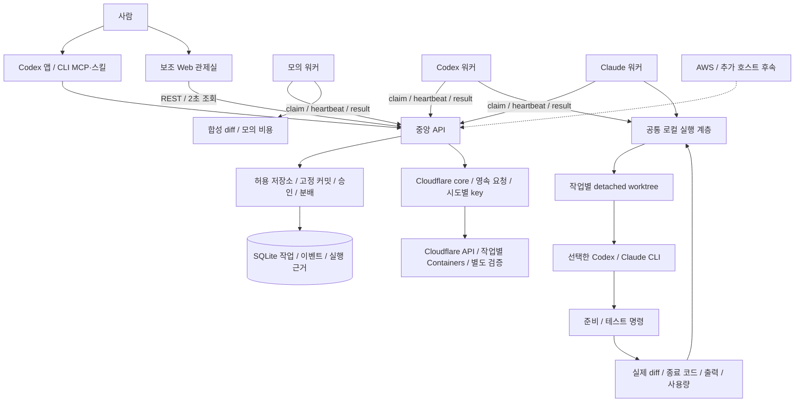
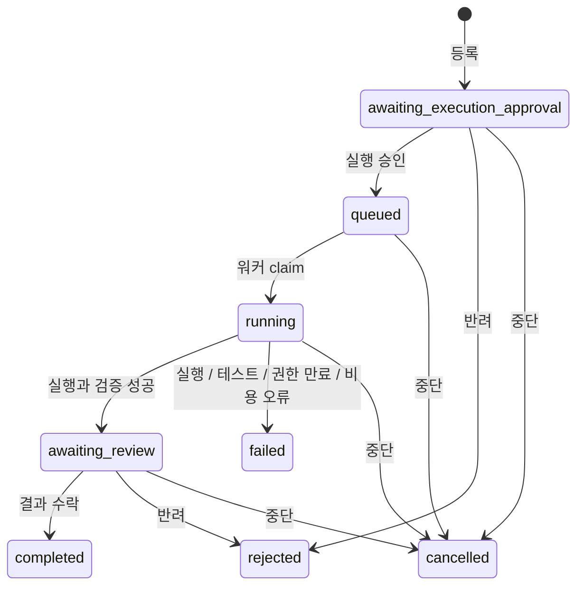

# 아키텍처

## 비전과 현재 경계

사람이 목표를 정하고 실행과 결과를 승인한다. 중앙 관제 시스템이 작업 상태와 실행 근거를 관리한다.
워커는 승인된 작업을 가져와 결과를 보고한다.
현재 주 접점은 Codex 앱·CLI 공통 MCP·스킬이다. 중앙 API가 Cloudflare Codex·Claude 실행을 조정한다.
웹은 검증·관리 보조 접점이며 기존 mock/local과 로컬 제공자 실행도 지원한다.
자연어 목표 분해·의존성 DAG·모델 선택과 ChatGPT 연결은 후속 기능이다.

## 구성 요소

| 구성 요소 | 책임 | 의존성 |
|---|---|---|
| `packages/contracts` | 작업, 저장소 정책, 실행 근거와 어댑터 계약 | 없음 |
| `packages/core` | 승인·취소·실행 권한·분배, 결과 검증과 저장 | 공통 계약, SQLite |
| `apps/control-plane` | 요청 검증, 역할 인증, 저장소 정책 조회와 UI 제공 | core, 읽기 전용 Git 조회 |
| `apps/dashboard` | 작업·실제/모의 결과·비용·이력 표시, 사람의 결정 | HTTP API |
| `apps/worker` | 설정 로드, provider별 작업 요청, heartbeat와 결과 보고 | HTTP API, 어댑터 |
| `packages/adapters` | 제공자 CLI, 공통 worktree·프로세스·diff·테스트 계층 | Git, 선택한 CLI, 공통 계약 |

워커 프로세스 하나는 작업 하나를 처리한다. 워커마다 다른 ID를 사용한다.
중앙 SQLite 파일은 API만 열고, 워커는 HTTP로 연결한다.

## 저장소와 실행 정책

운영자가 서버와 워커에 로컬 저장소 루트와 테스트 argv를 설정한다.
서버는 시작할 때 `HEAD`를 full commit SHA로 고정하고 `local` 저장소 ID와 `default` 테스트 프로필로 노출한다.
관제실은 이 정책을 조회하며, 실제 제공자 작업에는 `repositoryId`, `baseCommit`, `testProfile`만 전달한다.
임의 경로나 실행 명령은 작업 API가 받지 않는다.

새 작업의 커밋은 서버가 노출한 값과 일치해야 한다. 새 기준을 쓰려면 서버를 재시작한다.
등록 시 테스트 argv도 작업에 복사해 고정하므로 서버 설정 변경·재시작이 기존 승인을 바꾸지 않는다.
워커는 작업에 고정한 argv와 설정이 일치해야 실행하며, 결과도 해당 작업의 argv와 대조한다.
실행 중 테스트 설정을 바꾸지 않는다.

워커는 제공자·실행 환경·저장소 ID에 맞는 작업만 가져온다.
mock·Codex·Claude의 claim은 서로 섞이지 않으며 heartbeat가 워커의 실행 능력 정보를 덮어쓰지 않는다.
저장소 정책의 제공자 목록은 지원 범위다. 각 워커의 CLI 설치·인증·연결 상태를 보증하지 않는다.

## 작업 수명주기

`completed`, `rejected`, `failed`, `cancelled`는 종료 상태다. 재시도는 새 작업으로 등록한다.
제공자·준비·테스트 실패도 가능한 실행 근거와 diff를 보존한다. 실패 작업은 결과 수락으로 완료할 수 없다.
실행 승인과 결과 수락은 별도 결정이며 단계·사유·시각을 저장한다.
결과 수락은 원본 저장소에 변경을 적용하거나 Git 커밋·병합·푸시를 수행하지 않는다.

## 실행 권한과 중단

SQLite `BEGIN IMMEDIATE` 트랜잭션에서 승인 작업의 선택과 상태 변경을 함께 처리한다.
각 실행에 `runId`, `workerId`와 무작위 `leaseToken`을 연결한다.
같은 작업의 중복 할당과 잘못된 실행 권한의 결과 제출을 거절한다.

실행 권한은 30초 후 만료된다. 워커는 실행 중 5초마다 heartbeat로 갱신한다.
상태 조회·실행 관련 요청에서 만료를 검사하고, 결과 수락 트랜잭션 안에서도 기한을 다시 검사한다.
취소·만료 후 도착한 결과는 거절한다.
워커는 heartbeat 거절·연결 오류·사용자 중단·시간 제한에 따라 자식 프로세스를 종료한다.
POSIX에서는 프로세스 그룹에 종료를 요청하고, 응답하지 않으면 강제 종료를 시도한다.
원격 컨테이너의 시작·강제 종료는 후속 런타임 어댑터의 책임이다.

## worktree와 실행 근거

고정 커밋에서 실행별 detached worktree를 만든다. 원본의 dirty 파일과 index를 실행 입력으로 복사하지 않는다.
기존 실행 디렉터리를 재사용하거나 덮어쓰지 않는다. 원본과 worktree는 Git 메타데이터를 공유한다.
Codex는 `workspace-write`, 비대화형 승인 정책, `--ignore-user-config`로 실행한다.
추가 권한이 필요한 명령을 자동으로 허용하지 않는다.
Claude는 `--restricted`, `--safe-mode`, `acceptEdits`와 Read·Edit·Write·Glob·Grep 도구 목록을 사용한다.
파일 도구의 범위를 작업 디렉터리로 제한하며 Bash·웹·에이전트·MCP 실행은 제공하지 않는다.
이 정책은 Codex의 OS sandbox와 동일한 격리를 뜻하지 않는다.

두 제공자는 같은 `local-execution` 계층으로 worktree·준비·테스트·diff 수집을 수행한다.
선택적 준비 명령 후 설정된 테스트를 실행한다. 각 프로세스의 argv, 상태, 종료 코드,
소요 시간과 stdout/stderr를 수집한다. Codex JSONL과 Claude 최종 JSON에서 세션 ID와 사용량을 수집한다.
Claude는 프로세스 종료 코드와 JSON 성공 상태를 함께 확인하며 권한 거절·refusal·손상된 JSON을 실패로 처리한다.
금액은 두 제공자 모두 미확정으로 보존한다.

별도 `GIT_INDEX_FILE`에 base tree와 작업 변경을 반영해 실제 diff를 얻는다.
추적 파일의 수정·삭제, 새 파일과 바이너리를 포함하며 원본 index를 바꾸지 않는다.
테스트 실행 후 diff를 수집하므로 테스트가 남긴 추적 대상 변경도 결과에 포함될 수 있다.
HEAD가 고정 base에서 바뀐 실행은 성공으로 인정하지 않는다.
변경 없는 실행의 diff는 빈 문자열이다. 미보고 `null`과 구분한다.

저장 한도는 diff 180,000자, 준비·테스트의 stdout/stderr 각각 16,000바이트다.
한도를 넘으면 잘림 여부를 표시한다. worktree를 자동 삭제하지 않으므로 전체 결과를 로컬에서 조사할 수 있다.
정리 절차는 [README](../README.md#실행보존-경계)를 따른다.

Git worktree는 파일 변경 격리이며 보안 컨테이너가 아니다.
준비·테스트는 최소 환경 변수와 별도 HOME을 사용하지만 로컬 호스트에서 실행한다.
저장소 코드는 신뢰하는 것을 전제로 한다. 관제 토큰은 모델·준비·테스트 프로세스에 전달하지 않는다.
제공자별 로그인·추론 인증 환경은 해당 CLI에만 제공하고 다른 제공자·준비·테스트 환경에는 넘기지 않는다.

## 저장과 비용

- `Task`: 지시, 고정 저장소 정책, 예산, 상태, 실행 ID, 결과와 diff.
- `ExecutionEvidence`: base/HEAD, worktree, 실행·준비·테스트 상태와 출력, 사용량, 잘림 여부.
  Codex는 `codex`, Claude는 `claude` 실행 메타데이터를 사용한다.
- `Worker`: 제공자·실행 환경·저장소 ID, 마지막 연결 시각.
- `HiveEvent`: 증가하는 sequence, taskId, runId, 종류, 시각과 부가 정보.
- `Lease`: 해당 실행 워커에게만 전달하는 작업별 권한. 관제 상태 응답에 토큰을 넣지 않는다.

작업과 관련 이벤트는 같은 트랜잭션으로 저장한다. SQLite WAL을 사용하고 같은 파일로 재시작하면 복원한다.
기존 모의 작업과 `execution.codex` JSON 기록을 유지한다. Claude 결과는 `execution.claude`로 별도 저장한다. 이벤트는 누적 저장하며 상태 API는 최근 200개를 반환한다.
이벤트는 운영 추적용이며 변조 방지 감사 저장소는 아니다.

비용 단위는 USD micros 정수이며 `1 USD = 1,000,000 micros`다.
모의 예상·보고 비용은 1,000 micros다. 모의 예산이 예상보다 작으면 등록을 거절하고 초과 보고액은 보존한다.
Codex·Claude 예상·보고 금액은 `null`이며 UI는 미확정으로 표시한다. 제공된 토큰 수만 저장한다.
Claude 입력 토큰은 직접 입력·캐시 읽기·캐시 생성을 합산하고 캐시 읽기는 별도로 표시한다.
CLI의 `total_cost_usd` 보고값을 실제 청구액으로 저장하지 않는다.
작업 예산은 실제 제공자의 외부 과금을 중지하거나 상한을 보장하는 장치가 아니다.

## HTTP API

응답은 envelope 없이 공통 계약 객체를 반환한다. 작업이 없는 claim은 JSON `null`이다.
모든 `/api` 요청에 역할별 `Authorization: Bearer <token>`이 필요하다.

| 권한 | 메서드와 경로 | 요청/응답 |
|---|---|---|
| 공개 | `GET /health` | 서버 상태 |
| 공개 | `GET /`, `/app.js`, `/styles.css` | 정적 관제 UI |
| 운영자 | `GET /api/capabilities` | `{providers,repository}`. 저장소 경로 없이 고정 커밋·프로필·명령 조회 |
| 운영자 | `GET /api/state` | `{tasks,workers,events}`와 저장된 실행 근거 |
| 운영자 | `POST /api/tasks` | 기본 작업 필드 + 실제 제공자의 `{repositoryId,baseCommit,testProfile}` → Task |
| 운영자 | `POST /api/tasks/:id/decision` | `{decision:"approve" 또는 "reject",reason}` → Task |
| 운영자 | `POST /api/tasks/:id/cancel` | `{reason}` → Task |
| 워커 | `POST /api/workers/register` | `{workerId,provider,runtime:"local",repositoryId?}` → Worker |
| 워커 | `POST /api/workers/claim` | `{workerId}` → Lease 또는 null |
| 워커 | `POST /api/tasks/:id/heartbeat` | `{workerId,leaseToken}` → Task |
| 워커 | `POST /api/tasks/:id/result` | 실행 권한 + `{summary,diff,actualCostMicros,execution?}` → Task |
| 워커 | `POST /api/tasks/:id/fail` | 실행 권한 + `{message}` → Task |

실제 결과의 저장소·커밋·고정 테스트 명령과 성공 상태의 일관성을 검사한다.
작업 제공자와 다른 실행 메타데이터, 두 제공자가 섞인 메타데이터와 필수 근거 누락은 거절한다.
실행 근거는 인증된 워커의 보고이며, 독립적으로 검증된 증명이나 원격 attestation은 아니다.
워커 토큰으로 사람의 승인·취소를 수행할 수 없다.
현재는 공유 역할 토큰 두 개다. 사용자별 인증·조직 분리·토큰 회전·원격 TLS는 후속 범위다.

## 확장 방향

ChatGPT와 계획 에이전트도 같은 중앙 API를 사용하도록 확장한다.
AgentAdapter는 모델 실행, RuntimeDriver는 실행 환경의 시작과 중지를 담당한다.
PostgreSQL, 영속 워크플로, 원격 컨테이너와 이벤트 스트리밍은 [개발 로드맵](roadmap.md)에 따라 추가한다.

## Codex 공통 MCP와 원격 관제 연결

`apps/mcp-server`는 stdio 도구 6개로 중앙 운영자 HTTP API를 호출한다.
MCP는 SQLite나 Cloudflare/제공자 비밀을 직접 열지 않는다. 변경 도구는 읽기 도구와 구분한다.
초안과 실행 승인, 결과 수락은 각각 별도 동작이다. 사용자 의도 없이 초안에서 실행으로 넘어가지 않는다.
서버 설정의 대상 저장소와 base를 먼저 대조한다. 자세한 연결은 [안내](codex-integration.md)를 따른다.

`packages/core/src/cloudflare-store.ts`는 원격 작업·이벤트·비공개 요청과 설정 범위를 보존한다.
전달 응답이 유실되면 같은 snapshot/spec/key로 재연결하며 새 원격 실행을 만들지 않는다.
설정 범위가 바뀌면 미실행 승인을 차단하고, 모호한 전달·실행 중인 작업은 보존해 원래 설정에서 회수한다.
취소 요청 뒤 실제 종료 전에는 중단 완료로 표시하지 않는다. 검증 완료 결과의 수락은 로컬 이력 기록이다.

`packages/adapters/src/cloudflare.ts`는 기존 검증 client와 snapshot 코드를 재사용한다.
고정 커밋의 detached worktree에서 소스를 만들고 완료 snapshot을 검토 worktree에 적용해 실제 Git diff를 얻는다.
원본 dirty 파일·index와 구분한다. 각 필수 검증의 입력 snapshot, 인증 부재·소스 무결성·종료를 확인한다.
브라우저/MCP가 경로·원격 URL·검증 argv·제공자 인증을 임의로 선택하지 않는다.

연결 확인은 준비 상태에서 30초 캐시하며 진행 중 작업은 계속 조회한다.
사용량·비용은 실제 청구액과 구분한다. 원격 소스는 현재 backend의 4MiB·1000파일 한도를 따른다.
전체 장애·재개 수용과 상시 HUD는 후속이며 AWS는 현재 MVP 완료 이후다.
