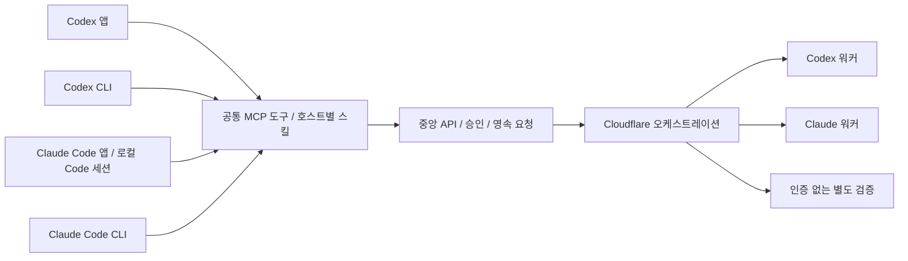

# 1차 클라이언트 지원 설계와 구현 차이

기준일: 2026-11-10. 사용자가 확정한 1차 대상은 **Codex와 Claude Code 각각의 앱·CLI**다.
네 접점은 동등한 MVP 지원 대상이며, Claude Code 클라이언트는 후속 호스트로 미루지 않는다.

## 역할과 경계

클라이언트는 사람이 지시·승인·조회하는 접점이다. 워커는 원격에서 개발을 수행하는 실행 제공자다.
Codex 또는 Claude Code 클라이언트에서 Codex·Claude 워커를 각각 선택할 수 있어야 한다.
Claude 워커 실행 성공은 Claude Code 앱·CLI 클라이언트 지원의 증거가 아니다.

Claude Code 앱은 Claude Desktop의 **로컬 Code 탭 세션**을 뜻한다.
일반 Claude 채팅, Cowork, 모바일과 공급자 호스팅 cloud 세션은 이번 네 접점의 지원 선언에 포함하지 않는다.
확장된 앱 범위는 별도 설계·검증한다. 웹은 선택적인 검증·관리 보조 화면이다.

## 현재 지원·검증 수준

| 클라이언트 | 구현·등록 | 실제 검증 | 미완료 |
|---|---|---|---|
| Codex CLI | 프로젝트 등록 도구·공통 스킬 | 실제 CLI 0.167.0 세션에서 스킬 사용·status/list 및 두 워커의 새 작업 등록·실행 승인·진행·diff/테스트 조회 통과 | 취소·재시작 등 전체 수용 |
| Codex 앱 | CLI와 공유하는 프로젝트 설정·스킬 | Hivemind 프로젝트에서 새 로컬 Codex 채팅으로 status/list와 두 워커의 diff·테스트 조회 통과 | 새 원격 실행·승인·재시작 복원 |
| Claude Code CLI | 설정 보존 `.mcp.json` 등록 도구·공통 원본을 읽는 `/hivemind` 진입점 | 실제 CLI 2.1.321 세션에서 공통 원본 읽기·status/list 및 두 워커의 새 작업 등록·실행 승인·진행·diff/테스트 조회 통과 | 취소·재시작 등 전체 수용 |
| Claude Code 앱 | 로컬 Code 탭용 프로젝트 등록·스킬 | 사용자 폴더 신뢰 승인 후 실제 앱 세션에서 공통 원본 읽기·status/list·두 결과 조회 통과 | 새 원격 실행·승인·재시작 복원 검증 |

공통 MCP 서버·중앙 API·Cloudflare 실행·검토 worktree·실제 diff·별도 테스트는 구현돼 있다.
실제 Codex·Claude 워커를 웹 보조 화면에서 실행했고 같은 결과를 SDK stdio로 조회했다.
검증 대상은 `dashboard-remote-fixture`라는 전용 저장소다. 현재 Hivemind 저장소 자체의 원격 개발 검증은 아니다.
[이전 검증 기록](verification/2026-11-10-codex-integration.md)과 [두 CLI의 새 원격 실행 검증](verification/2026-11-11-remote-execution.md)에 작업 ID와 결과를 기록했다.

[공통 계약 워크플로 안내](workflow-mcp.md)에는 새 MCP 도구와 승인·재조회 절차를 정리했다.

## 호스트 어댑터 원칙

MCP 도구와 HTTP 계약, 상태·결과 의미는 공통으로 유지한다.
호스트마다 MCP 등록 형식, 스킬 발견 경로, 신뢰·도구 승인 정책과 재시작 절차를 제공한다.
스킬의 업무 규칙은 공통 원본으로 유지하고 호스트별 진입점·호출 표기만 조정한다.
중앙 상태 저장소나 승인 정책을 호스트마다 복제하지 않는다.

Codex는 프로젝트 `.codex/config.toml`과 `.agents/skills`를 사용한다.
Claude Code는 프로젝트 `.mcp.json`과 `.claude/skills`를 대상으로 한다.
Claude 앱 Code 탭과 CLI는 설정 우선순위가 다를 수 있으므로 공통 파일이 있다는 이유만으로 호환을 선언하지 않는다.
설치 도구는 기존 서버·설정을 보존하고 충돌을 알리며, 전역 설정·인증을 임의로 덮어쓰지 않는다.
절대 경로는 생성한 로컬 설정에만 두고 비밀 값은 커밋하지 않는다.

호스트 도구 호출 승인은 중앙 작업 실행 승인과 구분한다.
등록만으로 실행하지 않으며 사용자의 명시적 실행 의도가 있어야 승인한다.
결과 수락은 검토 기록이고 원본 적용·병합·푸시가 아니다.
호스트가 승인 정책을 강제하지 못하는 경우를 조용히 허용하지 않도록 연동 검증에 포함한다.

## 미구현·미검증 작업 순서

1. **구현 — Claude Code 등록·스킬**: 프로젝트 설정 보존·충돌·경로·권한·재실행 검사를 갖춘 설치 어댑터와 공통 원본을 읽는 스킬 진입점. [연결 안내](claude-integration.md)와 [이번 검증](verification/2026-11-10-claude-clients.md)을 따른다.
2. **P0 — 네 호스트의 종단 수용**: 아래 4×2 검증표를 실제 앱·CLI 세션으로 수행하고 버전·OS·설정 범위·작업 ID·증거를 기록.
3. **P0 — 실사용 저장소 온보딩**: 현재 검증용 저장소에서 원하는 프로젝트로 안전하게 전환하고, 기준 커밋·테스트·입력 크기 사전 점검. 현재 입력 한도는 4MiB·1000파일이며 큰 저장소 전략은 미구현.
4. **P1 — 서비스 수명과 복구**: 브라우저 없이 중앙 서비스 시작·상태·중지를 관리하는 경로와 실제 호스트 종료·통신 단절·재연결·설정 변경의 통합 수용. 현재 중앙 서비스는 별도 실행이 필요하다.
5. **P1 — 진행 알림**: 현재는 호출 시 상태 조회다. 호스트별 지속 알림·진행 표시·HUD의 공개 확장 범위와 전달 방식을 별도 검증한다. 임의 고정 HUD를 네 호스트 공통 필수 구현 방식으로 가정하지 않는다.
6. **후속 MVP 항목**: 전체 장애·재개 수용, 실제 청구 기반 비용 수집, 도구별 세밀한 승인. 자연어 자동 목표 분해·DAG는 별도 확장이다.

AWS는 현재 MVP가 완전히 끝난 다음 단계다. Claude 등록·스킬은 구현했으며, HUD와 네 접점 전체 종단 수용은 완료로 선언하지 않는다.

## 네 호스트 공통 완료 기준

각 호스트에서 Codex·Claude 워커를 각각 실행하는 **4×2 조합**을 검증한다.
스킬/도구 발견 → 대상 저장소·base 확인 → 초안 → 사용자 실행 승인 → 진행 조회 → 실제 diff·검증 로그 → 결과 검토를 통과해야 한다.
미승인 초안, 중단 요청/실제 종료, 실패·미보고·잘림, 인증 저장, 재시작·중복 재연결, 설정 충돌과 비밀 미노출도 확인한다.
SDK 단독 통과나 워커 성공만으로 호스트 수용을 대체하지 않는다.
네 접점의 필수 흐름이 검증되기 전에는 1차 지원 완료로 표시하지 않는다.

## 공식 호스트 계약

- [Codex MCP 설정](https://learn.chatgpt.com/docs/extend/mcp): 앱·CLI가 공유하는 설정과 프로젝트 범위.
- [Claude Code MCP](https://code.claude.com/docs/en/mcp): 프로젝트 `.mcp.json`, 신뢰·승인과 서버 관리.
- [Claude Code Desktop](https://code.claude.com/docs/en/desktop#shared-configuration): 로컬 Code 세션의 공유 설정과 앱/CLI 우선순위 차이.
- [Claude Code skills](https://code.claude.com/docs/en/skills#choose-where-skills-load): 프로젝트 `.claude/skills`와 세션별 적용 범위.
