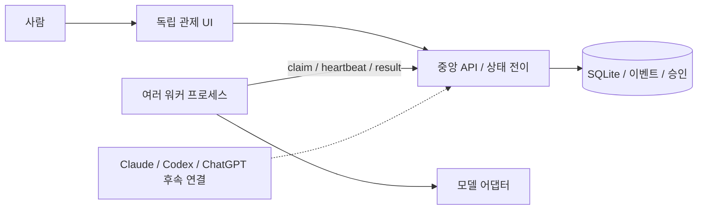

# Project HIVEMIND 초기 설계와 개발 계획

사용자 요구: 사람 중심 관제, 중앙 기획과 분배, 저비용 원격 워커,
ECS/Cloudflare Containers, Claude Code/Codex/ChatGPT 연결, 이벤트·승인·비용·Git diff 추적.
이번 요청은 문서 작성과 최소 골격 구현을 함께 승인한 것으로 해석한다.

## 결정

- TypeScript + Fastify, Node 24, SQLite로 로컬 수직 흐름을 먼저 구현한다.
- 독립 Web UI를 제공한다. Next.js와 PostgreSQL/Temporal은 운영 확장 시 재평가한다.
- 저장 상태를 중앙 API만 변경한다. 워커는 HTTP로 작업을 가져온다.
- 실행 전과 결과 수락 전 사람이 승인한다. 수락은 Git 적용·병합을 뜻하지 않는다.
- provider/runtime 선택은 실제 지원 여부로 검증한다. 현재 mock/local만 실행한다.
- 모의 비용과 합성 patch를 명확히 표시한다. 모델 호출과 Git checkout은 후속 단계다.
- 공유 계약을 기준으로 워커와 UI를 병렬 구현하고, 실제 API 통합 검증을 마지막에 한다.
- 외부 저장소·배포·계정은 만들지 않는다. 로컬 파일만 제공한다.

## 구현 순서와 검증

1. 공통 계약, 의존성, 구성과 테스트 실행 도구를 만든다.
2. 중앙 저장소의 승인·원자적 claim·lease·비용·diff 상태 전이를 테스트하고 구현한다.
3. HTTP API, 워커, UI를 계약별로 구현한다.
4. API와 워커를 실제 HTTP로 연결하고 지속성·권한·경합·취소·만료를 검증한다.
5. README, ADR, MVP와 후속 로드맵을 실제 구현에 맞춘다.

완료 기준: npm ci/build/check 성공, 두 프로세스 로컬 실행,
실행 승인 없이 claim 불가, 한 작업에 동시 claim 불가,
워커가 사람 승인을 수행할 수 없음, 결과 diff/비용/이벤트가 재시작 후 유지됨.

## 검토 초점

외부 모델 호출 없음, 서버 토큰 비노출, 허용하지 않은 상태 전이 거절,
실행 lease 만료와 취소 후 결과 거절, 실제/모의 구현 경계와 문서 일치.
