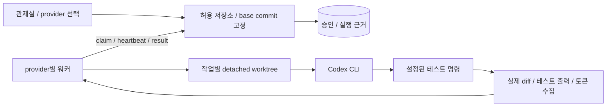

# 실제 Codex 워커와 실행 근거

## 목표와 결정

사람이 승인한 작업을 실제 Codex CLI로 실행하고, 원본 작업 공간을 변경하지 않은 채
작업별 Git worktree에서 생성한 diff와 테스트 결과를 관제실에서 확인한다.
이번 구현 요청을 위 동작의 구현·로컬 검증 승인으로 해석한다.

- 공식 `codex exec --json`을 사용한다. 설치된 CLI와 기존 로그인을 재사용한다.
- 서버·워커의 운영자 설정으로 저장소 하나와 테스트 명령 배열을 지정한다.
- API에는 저장소 ID·고정 base commit·테스트 프로필만 전달한다. 임의 경로나 명령을 받지 않는다.
- Codex는 workspace-write, 비대화형 승인 정책으로 실행한다. 권한 우회 옵션을 사용하지 않는다.
- Git worktree는 파일 변경 격리이며 보안 컨테이너와 동일하지 않다. 로컬의 신뢰하는 저장소만 실행한다.
- Codex와 테스트 프로세스에 관제 토큰을 전달하지 않는다. 테스트는 최소 환경에서 실행한다.
- 추적 파일 변경·삭제·새 파일을 포함한 diff를 수집한다. 결과 수락은 적용·커밋·푸시를 수행하지 않는다.
- 테스트 실패와 실행 오류도 근거를 저장한다. 성공하지 않은 결과를 완료 처리하지 않는다.
- Codex 비용은 null로 기록한다. CLI 사용량이 있으면 토큰 수를 저장하며 임의 가격을 적용하지 않는다.
- 이 작업에서는 외부 배포를 하지 않는다. 검증은 작은 임시 Git 저장소에서 실제 Codex 실행까지 수행한다.

## 구성과 흐름

## 구현 단위

1. 공통 계약: nullable 비용, 저장소 정책, 프로세스·실행 근거.
2. 실행 계층: worktree 생성, 자식 프로세스 취소·시간 제한, CLI JSONL, 실제 diff와 테스트 수집.
3. 중앙 API: 제공자별 분배, 저장소 정책 조회, 결과 검증·저장과 실패 처리.
4. 워커: provider 설정, 실행 계층 연결, 지속 heartbeat와 결과 보고.
5. UI: 실제/모의 실행 구분, 고정 커밋, 테스트 결과·출력, 미확정 비용 표시.
6. 테스트와 문서: 임시 저장소에서 파일 격리·diff·실패·취소·지속성 검증, 실제 CLI smoke.

## 수용 조건

- 모의 실행 회귀 검증 유지. mock 워커가 Codex 작업을 가져가지 않는다.
- 원본 저장소의 dirty 파일과 index를 보존하고 각 실행마다 다른 worktree를 사용한다.
- base에서 tracked/untracked/deleted 파일의 실제 diff를 얻고 변경 없는 경우 빈 diff를 허용한다.
- 실제 테스트 종료 코드와 stdout/stderr가 재시작 후에도 보인다.
- 테스트 실패·Codex 오류·시간 초과는 성공으로 표시되지 않는다.
- 승인 전 실행 불가, 취소/lease 거절 시 자식 프로세스 종료, 늦은 결과 거절.
- 사용량 금액을 모르면 0원 대신 미확정으로 표시한다.
