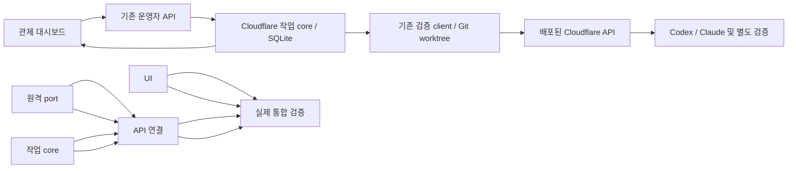

# Cloudflare 관제실 연결

사용자는 구현·실제 Codex/Claude 원격 검증·커밋·푸시를 요청했다. 현재 승인된 범위를 실행한다. AWS는 MVP 종료 이후다.

## 설계와 결정

기존 로컬 작업은 유지하고, Cloudflare 작업을 같은 관제 화면에서 조회한다. 서버가 원격 토큰을 보관하며 브라우저는 기존 운영자 인증으로 로컬 API만 사용한다. Cloudflare runtime·구독 인증·실행기는 수정하지 않는다.
Ruling: 원격 작업의 승인·취소·수락은 새 core 서비스에서 관리한다. 로컬 lease 큐에 넣지 않는다.
Ruling: 운영자가 정한 저장소·base commit·테스트 argv만 사용한다. 브라우저가 경로/원격 URL/토큰/명령을 선택하지 않는다.
Ruling: 승인 후 고정 커밋의 detached worktree를 만들고 기존 snapshot/client로 업로드한다. 완료 snapshot을 해당 검토 worktree에 반영해 실제 Git diff를 얻는다. 원본 index/작업 파일과 Git push는 건드리지 않는다.
Ruling: SQLite에 요청·스냅샷·idempotency key·원격 작업 ID를 보존한다. 응답 유실/재시작에는 동일 spec/key로 조회·재연결한다. 취소 중 제출 결과가 불명확하면 같은 key로 ID를 회수한 뒤 취소한다.
Ruling: dashboard 종료는 원격 작업을 중단하지 않는다. native SUCCESS와 모든 필수 검증/인증 저장/종료 확인 후 결과 검토 대기로 전이한다. 실패/응답 미수집은 성공으로 표시하지 않는다.

## 공통 계약 (새 packages/contracts/src/cloudflare.ts, T2 소유)

기존 Task/TaskStatus/RepositoryPolicy/HiveEvent를 import한다.
- CloudProcess = Omit<ProcessEvidence,'command'>
- CloudCheck = {id:string;name:string;status:string;command:string[];process:CloudProcess|null;credentialsAbsent:boolean|null;sourceUnchanged:boolean|null}
- CloudEvidence = {phase:string;jobId:string|null;inputSnapshotId:string|null;outputSnapshotId:string|null;containerStopped:boolean;authSynced:boolean;agent:CloudProcess|null;checks:CloudCheck[];errorCode:string|null}
- CloudTask extends Task = {provider:'codex'|'claude';runtime:'cloudflare';remote:CloudEvidence;worktreePath:string|null;diffTruncated:boolean}. execution은 null. 비용은 null.
- CloudConnection = {status:'checking'|'ready'|'unavailable';message:string|null;checkedAt:string|null}
- CloudCapabilities = {providers:Array<'codex'|'claude'>;repository:RepositoryPolicy;connection:CloudConnection}
- CloudState = {tasks:CloudTask[];events:HiveEvent[];connection:CloudConnection}
- CloudPrivateTask = {task:CloudTask;submission:CloudSubmission|null;cancelRequested:boolean}
- CloudSubmission = {snapshot:unknown;spec:Record<string,unknown>;worktreePath:string} (개인 DB 내부 전용, 브라우저 반환 금지)
- CloudPort = {connection():Promise<CloudConnection>;prepare(task:CloudTask):Promise<CloudSubmission>;submit(submission:CloudSubmission):Promise<string>;poll(jobId:string,submission:CloudSubmission):Promise<CloudPoll>;cancel(jobId:string):Promise<void>}
- CloudPoll = {phase:string;terminal:boolean;success:boolean;cancelled:boolean;evidence:CloudEvidence;summary:string|null;diff:string|null;diffTruncated:boolean}
  success는 parent SUCCEEDED, authSynced, containerStopped 및 모든 필수 check의 성공/무결성/인증 부재를 확인한 때만 true.
- CloudControl = {capabilities():CloudCapabilities;state():CloudState;create(input:CreateTask):CloudTask;decision(id:string,decision:string,reason:string):CloudTask;cancel(id:string,reason:string):CloudTask;tick():Promise<void>;start():void;close():Promise<void>}

예: connection ready 후 create({title:'합계',instructions:'구현',provider:'codex',runtime:'cloudflare',budgetMicros:0,repositoryId:'cloudflare',baseCommit:'a'.repeat(40),testProfile:'default'}) -> status awaiting_execution_approval, remote.jobId null.
approve -> queued; tick -> remote.jobId='job-1', status running, remote.phase RUNNING.
poll SUCCEEDED + verified checks -> awaiting_review; approve -> completed. FAILED는 failed, accept 불가.

## HTTP/UI 계약 (T4)

AppOptions.cloudflare?: CloudControl. 미설정 시 기존 응답 그대로 유지한다.
- GET /api/capabilities -> 기존 필드 + optional cloudflare:CloudCapabilities
- GET /api/state -> 기존 필드 + optional cloudflare:CloudState
- POST /api/cloudflare/tasks -> CreateTask, 201 CloudTask (기존 schema와 provider/runtime 제한)
- POST /api/cloudflare/tasks/:id/decision -> {decision:'approve'|'reject',reason}, 200 CloudTask
- POST /api/cloudflare/tasks/:id/cancel -> {reason}, 200 CloudTask
모두 operator guard. local worker token은 접근 불가. 다른 경로/URL/토큰/테스트 명령 입력 불허.
UI는 state.tasks와 cloudflare.tasks, events를 합쳐 표시한다. Cloudflare task IDs는 cf- 접두사로 충돌 방지.
기존 폼에 task-runtime local/cloudflare 선택 추가, provider는 Cloudflare에서 Codex/Claude만 허용. 선택을 polling이 바꾸지 않는다.
remote task는 기존 result/diff 영역을 재사용하고 별도 remote-execution-section에 phase, job ID, snapshot IDs, agent 상태·출력, 각 check 상태/명령/로그/종료 코드/소요 시간을 표시한다.
Cloudflare 오류는 로컬 모드로 자동 전환하지 않는다. 중단 요청은 실제 종료 확인 전까지 running/CANCELLING이다. accept는 검토 기록이며 원본 적용/병합이 아니다.

## 작업

### T1 원격 port와 Git 근거
Owns: packages/adapters/src/cloudflare.ts, tests/cloudflare-adapter.test.ts
createCloudPort({baseUrl,controlToken,repositoryPath,worktreeRoot,policy,credentialIds,checks,timeoutMs?,moduleRoot?}, optional fetchImpl) -> CloudPort. 모듈 source는 컴파일 산출물의 프로젝트 root cloudflare/backend/src/*.ts를 동적 import한다(Node24.14). 기존 client/files를 재사용한다. provider tokens를 읽거나 import하지 않는다.
prepare는 고정 base의 worktree/snapshot + 영속 가능한 spec(key='dashboard-'+task.id)를 만든다. poll은 원래 snapshot/provider/credential binding 확인, 실패에도 가능한 실제 diff, 검증된 로그만 DTO 투영, .auth/private 필드 배제. 원본 source에 쓰지 않는다. 네트워크 오류는 고정 안전 오류로만 반환한다. 원격 cancel은 서버 토큰으로 고정 endpoint만 호출한다. 테스트에는 실제 클라우드/모델을 쓰지 않는다.

### T2 core 저장·승인·복구
Owns: packages/contracts/src/cloudflare.ts, packages/core/src/cloudflare-store.ts, tests/cloudflare-store.test.ts
먼저 공통 계약을 만들고 다른 구현자에게 알린다. createCloudControl({dbPath,policy,port,pollIntervalMs?}) -> CloudControl. 연결 상태·RemoteTask·이벤트·비공개 submission을 별도 SQLite 테이블에 저장한다. core가 승인/취소/수락/실패를 결정한다. 미승인 제출 금지. tick 중복 방지, 같은 key 재연결, late cancel, human terminal decision 보호, 재시작 복원, 연결 실패 시 기존 상태 보존. 포트 Fake로 테스트한다.

### T3 대시보드
Owns: apps/dashboard/public/app.js, apps/dashboard/public/index.html, apps/dashboard/public/styles.css, tests/cloudflare-dashboard.test.ts
위 HTTP/DTO 계약에 맞춰 기존 꿀벌 디자인·로컬 기능을 유지하며 확장한다. 사용자/모델 문자열은 textContent. 원격 제어 비밀을 브라우저에 요구/저장하지 않는다. 원격 연결/phase/실제 diff/check 로그와 미보고·실패·취소·검토 상태를 구분한다. 테스트는 가능한 실제 DOM 동작/asset 계약으로 최소한 작성하고 실제 브라우저는 통합 검증에서 수행한다.

### T4 서버/API와 환경 설정
Owns: apps/control-plane/src/app.ts, apps/control-plane/src/main.ts, apps/control-plane/src/cloudflare-config.ts, tests/cloudflare-api.test.ts, tests/cloudflare-config.test.ts, .env.example
T1/T2 완료 후 시작한다. 설정: HIVEMIND_CLOUDFLARE_URL, HIVEMIND_CLOUDFLARE_CONTROL_TOKEN 또는 HIVEMIND_CLOUDFLARE_SECRETS_FILE(0600, CONTROL_TOKEN만 읽음), HIVEMIND_CLOUDFLARE_REPO_PATH, HIVEMIND_CLOUDFLARE_WORKTREE_ROOT, HIVEMIND_CLOUDFLARE_CODEX_CREDENTIAL(기본 codex-remote), HIVEMIND_CLOUDFLARE_CLAUDE_CREDENTIAL(기본 claude-remote), HIVEMIND_CLOUDFLARE_CHECKS(JSON [{id,argv,timeoutMs}]), HIVEMIND_CLOUDFLARE_TIMEOUT_MS. settings 미설정은 기존 local/mock 동작. partial/invalid 설정은 명확한 고정 startup 오류. 저장소 HEAD fullSHA 고정, 경로는 서버에서만 보관. onReady start, onClose close(원격 취소 아님). API 기존 테스트 그대로 유지.

### T5 검증·문서·발행
Owns: README.md, docs/mvp.md, docs/architecture.md, docs/screenshots/remote-*.png, docs/verification/2026-11-10-cloudflare-dashboard.md
npm run check, 기존 Cloudflare tests/runtime:check, fake HTTP+core seam, restart/duplicate/secret suppression. 별도 작은 Git fixture에서 실제 Codex/Claude 작업을 대시보드로 각각 승인하고 동시 실행·실제 diff·테스트 로그를 브라우저에서 검증한다. 기존 R2 credential streams만 사용하고 원래 로컬 시드를 재등록하지 않는다. 스크린샷에 비밀을 넣지 않는다. fresh final review 후 논리적 commit, 모든 configured remotes push 및 CI 확인. AWS는 수행하지 않는다.

## 사용자가 확정한 추가 방향 — Codex 공통 MCP·스킬 우선

웹 UI를 주 접점으로 해석한 것을 수정한다. 사용자 선택: 앱·CLI 공통 MCP·스킬 연동 우선.
기존 웹은 검증·관리 보조 화면이며 위 공통 core/API는 재사용한다. 고정 앱 HUD나 실험적 CLI 상태줄 확장을 이번 범위에서 약속하지 않는다.

### T6 MCP stdio
Owns: apps/mcp-server/src/server.ts, apps/mcp-server/src/main.ts, tests/mcp.test.ts
공식 MCP SDK1.32.2와 Zod4.6.7(루트가 설치)을 사용한다. MCP는 기존 중앙 HTTP API의 얇은 클라이언트이며 SQLite/Cloudflare control/provider credentials에 직접 접근하지 않는다.
설정: HIVEMIND_API_URL 기본 http://127.0.0.1:4310; HIVEMIND_OPERATOR_TOKEN 또는 HIVEMIND_OPERATOR_TOKEN_FILE(JSON OPERATOR_TOKEN,0600). 미설정 기본개발토큰은loopback에서만 허용, 외부 HTTP 금지/HTTPS 인증필수. redirecterror, 요청/응답 크기·시간 제한, 알려진토큰가림과고정안전오류.
createHivemindMcpServer({apiUrl,operatorToken,fetchImpl?}) -> McpServer, loadMcpSettings(env?) server-only.
도구명: hivemind_status, hivemind_list_tasks, hivemind_create_task, hivemind_decide_task, hivemind_cancel_task, hivemind_get_result.
status는 Cloudflare capabilities/연결/고정저장소/작업상태카운트 요약, list는limit<=20요약. create는 title/instructions/provider(codex|claude)/budgetMicros>=0만 받아현재cap정책을서버에서조회하고 Cloudflare draft만생성한다. 사용자입력URL/경로/토큰/검증argv불허. decide({taskId,decision:approve|reject,reason}), cancel({taskId,reason}), result({taskId,includeDiff?,includeLogs?,maxChars?<=20000})는cf-task만 대상. status/list/result readOnlyHinttrue, create/decide/cancel false; cancel destructiveHinttrue. 결과수락은metadata기록이며apply/merge/push아님. 모든반환값 DTOwhitelist/상태·로그한도·가림, rawAPI/인증헤더출력불허. stdout는JSONRPC만,오류stderr고정문구.
검사: 실제SDK Client와InMemory/StdioTransport로handshake/list/call, 승인없는draft, 실제cap정책pin, schema/권한/네트워크오류/토큰미노출/로그한도. Fake API만사용; root가실제UI작업상태·diff·tests를MCP SDK로다시조회한다. 모델/Cloud추가실행금지.

### T7 스킬과 프로젝트 MCP 등록
Owns: .agents/skills/hivemind/SKILL.md, scripts/configure-hivemind-mcp.ts, tests/mcp-config.test.ts, docs/codex-integration.md
공식skills설치위치에Codex앱/CLI공통스킬. 현재서버의대상저장소·base를확인하고원하는프로젝트와다르면제출하지않는다. draft→사용자실행의도확인→decide, 상태·diff·테스트조회, 실패/미보고/취소중구분. 웹을열필요없이조작, 상시HUD가아님을명시한다. remoteprovider원본인증시드재등록금지.
configure 스크립트는 프로젝트 .codex/config.toml에 hivemind 서버의 생성블록만 추가/갱신한다(기존다른설정보존,같은이름사용자설정충돌은고정오류로안전중단). 절대node/컴파일entry/cwd와환경 APIURL, optional OPERATOR_TOKEN_FILE 경로만기록한다. 토큰값은기록하지않는다. global ~/.codex 수정금지. 디렉터리/파일symlink거부, atomicwrite/0600, 반복실행안정. 생성블록은machine-local로git정보exclude; 공유설정예시는문서에placeholder. 기본 approval_mode writes로변경도구에host승인정책적용. 실제설치는Root최종병합후OriginalRoot에서수행한다. 새세션/restart후MCP·스킬로드가필요할수있음을설명. 스크립트는 node24 nativeTS로실행가능, 타입안전tests.
루트만 package.json scripts mcp, mcp:configure를정리하고통합검증·문서·발행한다. T6/T7은다른파일수정금지.
