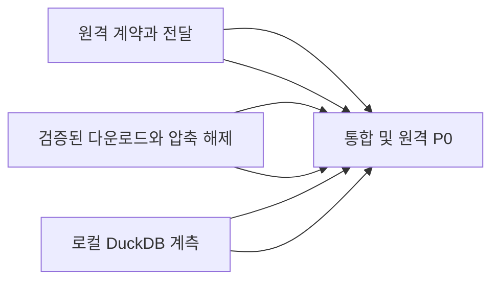

# DuckDB 사전 측정 구현

**Goal:** standard-4와 큰 source/data 입력을 지원하고 로컬 P0를 측정한다.
**Spec:** docs/plans/local-resource-validation/large-project-plan.md
**Full suite:** yes

사용자가 설계의 구현과 P0 실행을 승인했다. 기존 미커밋 구현을 보존하며 현 작업 트리에서 진행한다. 커밋·푸시는 이번 요청에 포함되지 않는다. 대형 입력은 4MiB snapshot 한도를 늘리지 않고 별도 SHA-256 객체로 전달한다. 원격 배포·P0 $5 제안은 검증 후 구체적인 대상과 함께 확인한다. 본실험은 실행하지 않는다.

## T1 원격 경로
소유: backend contracts/compute-group/cloudflare API·worker 및 관련 tests, Dockerfile, runtime 연결.
standard-4를 일반 compute에 추가한다. 기존 Carbon 비교 경로는 변경하지 않는다. P0용 compute-group의 1–4개 검사도 지원한다. 아티팩트 계약은 source/data 파일의 SHA-256·byte 길이·형식·풀린 크기 한도를 고정한다. 인증된 operator 등록·R2 immutable 저장, job/attempt/입력 객체에 제한된 만료 read capability, streamed 전달을 사용한다. 입력 객체의 arbitrary URL/경로와 credential bucket 접근을 금지한다. 출력 snapshot에 거대 파일을 넣지 않는다. 필요한 쓰기 작업 공간과 작은 receipt만 허용한다. runtime 안전 extractor와 경계 연결은 T2와 합의한다. 준비 완료 후 runtime revision stamp는 root만 수행한다.

## T2 아티팩트 런타임
소유: backend/src/runtime/large-artifacts.ts 및 안전 tar helper/test. T1과 인터페이스를 먼저 합의한다.
stream download의 byte cap·SHA 검증·atomic rename, tar 목록과 확장 크기/파일수 cap, 절대경로/.., 링크, 장치, 중복경로, gzip bomb 차단을 검증한다. 원래 source/data를 읽기 전용으로 제공하고 job 쓰기 공간을 분리한다. 모델·운영자 비밀을 child 환경/로그에 전달하지 않는다. 손상·취소·초과한도·경로탈출 테스트를 먼저 작성한다.

## T3 로컬 P0
소유: backend/scripts/duckdb-pilot/ 및 관련 tests. 승인된 v1.4.2 commit을 다운로드하고 source hash, 도구 버전, 압축 해제 검증을 기록한다. 프로젝트 전용 도구 경로에 Ninja 등 부족한 도구를 준비한다. 로컬 CPU·RSS·swap-out·응답성과 macOS pressure 이벤트, compile/link/test/data 생성 단계를 측정한다. timeout·메모리·디스크 중단과 자식 정리를 제공한다. baseline/컴파일은 root와 조율해 다른 테스트와 겹치지 않는다. 코드 구현·짧은 단위 검사까지만 agent가 실행하며 실제 P0는 root가 실행한다.

## T4 통합·판정
root가 독립 검사와 로컬 P0를 진행한다. CPU/메모리 적합성을 각각 판정하며 강제 메모리 filler를 사용하지 않는다. remote 준비 검증 후 승인된 경우에만 기존 backend에 배포하고 좁은 P0를 실행한다. 실패와 미측정은 근거를 남긴다. 준비비·정답·본실험 설정·예상 비용을 보고한다.

Ruling: 기존 dirty 구현이 현재 서비스 기반이므로 빈 HEAD worktree로 복사해 기능을 누락시키지 않는다. 작업 소유 파일을 나누고 기존 변경을 보존한다. 스킬의 자동 checkpoint commit은 프로젝트의 요청 시 commit 규칙에 따라 사용하지 않는다.

Ruling: 고정 upstream DuckDB archive에 CSV symlink 테스트 fixture 2개가 존재한다. 원본 SHA-256을 확인한 offline 정규화에서 이 두 링크만 제외하고 정규화 해시·경로·target을 기록한다. 나머지 일반 파일·실행 비트는 보존한다. 일반 artifact extractor의 링크 거부는 유지한다. P0는 projection 회귀 범위이며 이후 main CSV 링크 관련 검사는 제외 또는 별도 안전 fixture 절차를 명시해야 한다. 비용: 원본 전체 테스트 커버리지와 같다고 주장할 수 없다.

Ruling: C1/J2는 현 Xcode SDK27.2의 libc++가 upstream Thrift TEnumIterator에서 operator==를 요구해 컴파일 실패했다(359.712초, 자원 가드 중단 아님). 동일 실패 translation unit과 컴파일러에서 SDK26.5만 지정한 syntax 검사 통과. 이후 Mac 작업별 CMAKE_OSX_SYSROOT를 설치된26.5 SDK로 고정하고 새 build 디렉터리에서 다시 측정한다. 소스/Parquet 구성은 유지하고 전역 Xcode 선택은 바꾸지 않는다. 이전 실패는 비교 성공 표본에서 제외하되 준비 시간에 보존한다.

Ruling: SF30/6GiB의 4워커 회귀 묶음은 22쿼리 동치·완주했으나 새 swap-out7.205GiB를 기록했다. 사전 설계의 공통6/9GiB 조건은 유지하고, 로컬 최선 조건 탐색에 더 낮은3GiB 후보를 추가한다. 같은 데이터·쿼리·threads·spill 한도로 비교하며 기존 실행의 성공 판정이나 안전 중단 기준을 소급 변경하지 않는다. 비용: 더 작은 메모리가 DuckDB spill로 성능을 낮추거나 질의 실패를 일으킬 수 있으므로 정답과 완주를 다시 확인한다.
