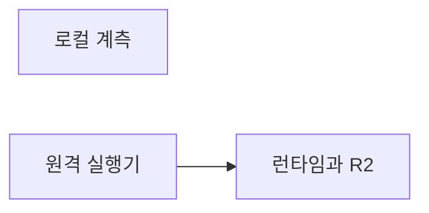

# DuckDB ccache 재사용 검증

C3·C4, jemalloc-off, 워커 둘과 컴파일 슬롯 각각 넷을 유지한다. 빈 캐시와 재사용 조건을 로컬·Cloudflare 각각 세 번 실행한다. 첫 빈 캐시의 결과를 고정 seed로 쓰고 후속 실행의 빌드 디렉터리는 비운다. 복원·빌드·컴파일·링크·캐시 통계와 원격 비용을 기록한다.

- 로컬은 공식 Darwin ccache 4.14.3을 별도 디렉터리에 설치하고 같은 안정된 경로에서 반복한다.
- 원격은 공식 Linux static ccache 4.14.3을 고정 도구 아티팩트로 전달한다. runtime이 작업별 권한으로 R2 archive를 읽고 쓰며 sandbox에 토큰은 전달하지 않는다. 캐시 경로에는 구성과 입력 및 runtime digests를 포함한다.
- 준비와 업로드는 빌드 시간에서 분리해 측정하되 완료 시간과 비용에는 포함한다. 같은 seed의 해시와 성공한 테스트를 보고한다.
