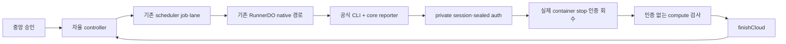
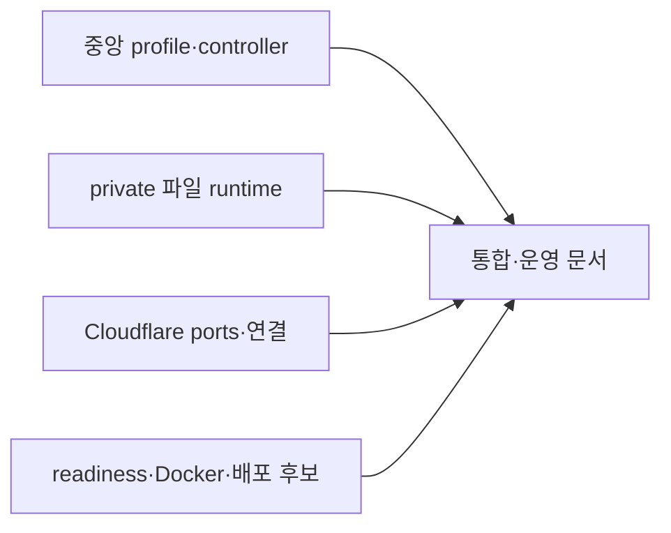

# 자율 작업 실사용 준비: Cloudflare 실행 연결

**Goal:** 기존 Cloudflare Scheduler·Runner·credential stream을 재사용해 승인한 자율 작업을 실제 실행 가능한 경로로 연결하고 배포 후보를 준비한다.
**Architecture:** 중앙 자율 lease → 기존 JobRecord → 기존 RunnerDO → private native 파일 실행 → 암호화 R2 session·인증 회수 → 기존 compute 검사 → 중앙 finishCloud → 다음 alarm.
**Tech stack:** TypeScript, Node24, Durable Object, 기존 Container/R2, Docker, Wrangler.
**Detail:** contracts
**Full suite:** yes
**Target-min:** 40
**Ignore:** .superlite/, .hivemind/, dist/, node_modules/, *.sqlite*, .env

## 확인한 사실과 결정

- 운영 origin은 기존 설정·실제 health로 확인한 `https://hivemind-cloudflare-backend.roboco.workers.dev`, Worker는 `hivemind-cloudflare-backend`, account는 wrangler.json 값이다. 현재 version은 43196043-8ad4-4a3e-96e0-60c074789a52, runtime digest는 911c443ed7d99f20e1af8391417474f347d3372a28fc465cbc01cca25464e4c7이다.
- 기존 credential은 claude-remote·codex-remote, generation23, 격리·실행 중 아님을 값 없이 조회했다. 기존 334개 job 중 실행 중인 job은 없다. 이 상태는 배포 직전에 다시 확인한다.
- 배포된 runtime과 같은 digest의 로컬 image b5a34a33dfac가 존재하며 Linux/amd64·uid1000을 실제 Docker에서 확인했다. macOS host는 arm64다. Docker proof는 Cloudflare proof로 간주하지 않는다.
- Ruling: 실제 배포·Cloudflare container 생성·모델 실행은 아직 하지 않는다. 코드·로컬 Docker 무모델 검증·dry-run 후보를 먼저 완료한 뒤 고정된 대상·짧은 검증 범위에 대한 실행 승인을 별도로 구체적으로 요청한다. 24시간·AWS/HF 작업은 이번에 실행하지 않는다.
- Ruling: 기존 JobRecord/RunnerDO를 사용한다. 별도 credential scheduler나 전역 인증 재등록을 만들지 않는다. 새 자율 iteration도 기존 activeJobId lane과 인증 세대 회수·격리 규칙을 따른다.
- Ruling: 기본 `AUTONOMOUS_CLOUD_ENABLED=false`. pilot만 지원하며 최대4반복·반복120초·전체10분·source64KiB/32files·compute check각10초 이하로 제한한다. 활성화만으로 기존 local 작업을 실행하지 않는다.
- Ruling: 기존 미커밋 변경을 보존한다. 최초 자율 구현 전 runtime manifest와 세 파일(worker/contracts/runtime-run)의 hash가 현재 배포된 digest와 일치함을 확인했다. 배포 후보는 현재 manifest 대비 변경 목록과 root 공통 모듈 hash를 별도로 기록한다.
- Ruling: Node container에는 CONTROL_TOKEN·AUTH_STORAGE_KEY·반환 개인키·session key를 주지 않는다. 실행 역할 worker/reporter token과 일회용 native gate만 private 입력으로 전달하고 CLI 환경에서는 제외한다. OAuth는 manifest fence 뒤에만 전달한다.

## 공통 계약

- `AutonomousSpec.execution?: {backend:'cloudflare';snapshotId:string;checks:{id:string;argv:string[];timeoutMs:number}[]}`. 새 profile은 claude·구독/external_actions·credentialIds1·systems[]만 허용한다. 생성은 draft이며 승인 후 feature gate가 켜진 backend alarm에서만 실행한다. source/checks 변경은 실행 이력 뒤 거절한다.
- 일반 `claim`/`finish`는 cloud-managed profile을 거절한다. 내부 `claimCloud(id,workerId,token,runId,now)`와 `finishCloud(lease,result,checksPassed,now)`만 trusted driver에서 호출한다. HTTP에는 이 두 변경 경로를 추가하지 않는다.
- `JobRecord.autonomous?: {taskId:string;runId:string}`만 public legacy job에 저장한다. lease·session·OAuth는 별도 private controller record에 둔다.
- backend `AutonomousCloudInput`: `{version:1,jobId,attempt,runtimeId,request:NativeClaudeRequest,control:{origin,workerToken,reporterToken},authReturnPublicKey}`. 명령/URL/키는 task에서 선택하지 않는다. native input은 private file이다.
- backend `AutonomousCloudOutput`: `{version:1,jobId,attempt,ok:boolean,response?:NativeClaudeResponse,authReturn?:SealedAuth,errorCode?:string}`. sealed auth는 Worker에서만 소비하며 session은 private R2에 암호화한다. 공개 result에는 raw session/authReturn/lease/gate를 넣지 않는다.
- bootstrap port3000의 `/autonomous/prepare|state|result|cancel`은 `x-hivemind-native` gate token을 요구한다. import 시 실행 없음. `autonomous-from-file.ts`는 명시적 exec에서만 1회 실행한다.
- Env: `AUTONOMOUS_CLOUD_ENABLED`, `AUTONOMOUS_CONTROL_ORIGIN`, `AUTONOMOUS_SESSION_KEY` 추가. 기존 AUTONOMOUS_WORKER_TOKEN/REPORTER_TOKEN과 기존 RSA·credential bucket을 사용한다.

### T1 중앙 profile과 지속 controller · Complexity 7 · Est. context 45k
**Owns:** packages/contracts/src/autonomous.ts, packages/core/src/autonomous.ts, packages/core/src/autonomous-store.ts, apps/control-plane/src/autonomous-api.ts, cloudflare/backend/src/autonomous-service.ts, cloudflare/backend/src/autonomous-cloud.ts, tests/autonomous-cloud.test.ts, cloudflare/backend/test/autonomous-cloud.test.ts
**Components:** 2
**LOC owned:** 650
**Tests:** fast
**Model:** sonnet
**Produces:** execution profile/core private claimCloud·finishCloud; persistent AutonomousCloudController over typed ports.
e.g. disabled profile creates no job; enabled approved profile queues one existing agent job, polls, finishes only after check/stop/auth evidence.
e.g. lost response/restart reuses same run/job/idempotency key; uncertain launch never makes second model job.
**Review Focus:** approved immutable source/checks, private cloud claims, normal worker cannot steal/finish, legacy credential availability, persistence before side effects, restart recovery, no direct DB worker, bounded alarm step, finish verification failure cannot report completed/continue, cancel/timeout/receipt precedence, pilot limits and artifact bounds.
**Steps:** Land execution types and controller port signatures first for T2/T3. Core changes tests first. Controller uses existing service and scheduler via injected ports, not new credential record. Model job submission always goes existing Scheduler. Use private per-task record containing exact lease/run/job, phase and saved encrypted checkpoint/metadata. `claimCloud` retry may recover exact matching existing lease; normal claim returns null for remote profile. Private operations in service dispatch are not HTTP-whitelisted. `finishCloud` atomically consumes matching native result then overrides quality failure to failed without overriding cancel/budget/expiry; ordinary finish rejects remote profile. Poll returns source snapshot/usage/outcome only after actual stop/authSynced and required checks. Driver keeps heartbeat until final core commit. Unknown/missing/lost result cancels old child job and pauses/quarantines, never blind resubmit. No paid effects in tests. Expose readiness/status projection without private record. Exact constructor/ports relay immediately.

### T2 private runtime와 파일 실행 · Complexity 6 · Est. context 42k
**Owns:** cloudflare/backend/src/autonomous-cloud-protocol.ts, cloudflare/backend/src/runtime/autonomous-from-file.ts, cloudflare/backend/src/runtime/autonomous-bootstrap-routes.ts, cloudflare/backend/src/runtime/bootstrap.ts, cloudflare/backend/src/runtime/autonomous-claude.ts, cloudflare/backend/test/autonomous-cloud-runtime.test.ts
**Components:** 2
**LOC owned:** 400
**Tests:** slow
**Model:** sonnet
**Produces:** validateAutonomousCloudInput/Output; authenticated native routes; runAutonomousFromFile; TLS CA propagation.
e.g. private prepare wx then repeated equal body idempotent; start marker persisted before executor; duplicate run does not invoke again.
e.g. missing gate before malformed JSON ->403; no private config on state/health; sealed auth never public.
**Review Focus:** bounds16MiB, strict identity/version, no symlink/FIFO/read races, mode0600, no auto execution, cancel propagation, result persistence and generic errors, no stdout secret, auth envelope sealing, scoped env, actual CA certificate for native child.
**Steps:** Add pure protocol types first; existing bootstrap legacy routes unchanged, native paths delegated only when exact prefix and env gate configured. Private native input is never returned. File runner supports trusted executor injection for tests, default existing executeAutonomousClaude with authorizer/reporter created from validated control config, fixed runtimeId, known secret filters and cancel signal. Writes started/result atomically; failed/uncertain run is not replayed. Seal existing setup OAuth with authReturnPublicKey, never return raw OAuth. Production cap-drop command remains caller Runner responsibility. Native child buildEnv must propagate only public SSL_CERT_FILE/NODE_EXTRA_CA_CERTS from parent (required by CF TLS intercept), not full secret environment. No actual model calls; fixtures fake.

### T3 Cloudflare Runner와 controller ports · Complexity 7 · Est. context 48k
**Owns:** cloudflare/backend/src/cloudflare/autonomous-ports.ts, cloudflare/backend/src/cloudflare/worker.ts, cloudflare/backend/src/contracts.ts, cloudflare/backend/wrangler.json, cloudflare/backend/test/autonomous-cloud-ports.test.ts
**Components:** 3
**LOC owned:** 650
**Tests:** slow
**Model:** sonnet
**Consumes:** T1 controller ports/core operations, T2 private protocol
**Produces:** existing RunnerDO autonomous prepare/launch/poll; real R2 credential/session ports; alarm integration; operator readiness/status/result.
e.g. approved cloud task -> existing Scheduler.submit Job with same credentialId; no auth to stale runtime; no duplicated exec intent.
e.g. auth writeback or container stop unconfirmed -> lane quarantine, no core success.
**Review Focus:** reuse legacy activeJobId/auth generation, no reimport seeds, revision fence, HTTPS outbound control + provider allowlist with internetfalse, capdrop+UID, no root management/session keys in container, safe public legacy result, immutable credential writes and compute checks, default disabled, active legacy priority/no cross-lane model overlap.
**Steps:** Coordinate exact T1/T2 interfaces first, use fakes before adapters. Set job.autonomous internal two-ID binding after validated Scheduler.submit (HTTP JobSpec still rejects it). Native-specific `.advance` branch calls T2 native paths, saves encrypted session via EncryptedSessionStore+R2PrivateBlobStore using explicit 32-byte AUTONOMOUS_SESSION_KEY, consumes sealed auth through existing RSA helpers, confirms container stop, stores new credential generation via existing storeCredential and Scheduler.agentFinished; then existing compute checks execute. Never pass raw session/auth in legacy ARTIFACTS/result, only sanitized execution metadata. Failure quarantines existing lane through Scheduler.quarantine. RunnerMetadata private gate + native flag; start env only gate, native exec setpriv + new file path, stdout/stderr ignore. Native outbound handler allows existing Claude hosts and exact configured HTTPS control origin + POST native-start/heartbeat/native-ready/native-receipt paths; enforce token role and no redirects; register HTTP AND HTTPS interception. Cloud config checks required before approve/dispatch; default var enabled=false and origin existing confirmed target. GET /v1/autonomous-readiness and /:id/cloud-status|cloud-result are operator-only, use allowlisted projections and never raw transcript/auth/gate/cp. Add new optional JobRecord binding, not new resource classes/buckets. Keep old unrelated worker paths unchanged.

### T4 preflight・Docker・배포 후보 · Complexity 6 · Est. context 40k
**Owns:** cloudflare/backend/scripts/autonomous-readiness.ts, cloudflare/backend/scripts/autonomous-pilot.ts, cloudflare/backend/scripts/autonomous-docker-probe.mjs, cloudflare/backend/test/autonomous-readiness.test.ts, cloudflare/.dockerignore
**Components:** 2
**LOC owned:** 400
**Tests:** slow
**Model:** sonnet
**Produces:** read-only live readiness + local plan/dry-run manifest; opt-in small pilot plan; actual no-model Docker proof script.
e.g. --plan emits fixed account/origin/revisions and draft request, never writes remote or starts CLI.
e.g. Docker proof has networknone/auth absent and labels local-docker separately; unsupported emulation reports failed gate, not relaxed sandbox.
**Review Focus:** no secret values stdout, private0600 config, protect unknown existing secrets, exact target and version fence, explicit execute flag for eventual operator use, no autoapprove in default/read-only mode, no model inference in Docker script, deterministic source list and input exclude private files.
**Steps:** Read only existing deployment config/evidence; target is confirmed existing origin/account, do not invent a deployment target. Scripts use injected fetch in tests; secret file loader never logs values. Plan max2CLI iterations, each120s, overall10min, standard-1 one native run at a time; snapshot counter.txt and operator-frozen Node check argv (cannot be edited by model). Model pin supplied explicitly, not guessed. Default no remote mutation, no auth import. Explicit execution mode may create draft/approve only when separately invoked by operator; never run it this task. Make local Docker proof runnable and model-free: actual UID/cap boundary, immutable managed prerequisite checks, native prepare/state auth, optional local sandbox write/read-denial checks using fake canaries only. No host auth mounts or network. Harden dockerignore exclusions if needed without excluding required public benchmark assets. Main coordinator owns actual build/dryrun invocation after source freeze. Do not run wrangler deploy/upload, secret changes, remote container or model calls.

### T5 統合・증거・운영 절차 · Complexity 6 · Est. context 42k
**Owns:** tests/autonomous-cloud-integration.test.ts, cloudflare/backend/test/autonomous-cloud-integration.test.ts, docs/autonomous-tasks.md, docs/plans/2026-11-19-autonomous-cloud.report.md, cloudflare/backend/README.md, cloudflare/backend/runtime-build.json
**Components:** 2
**LOC owned:** 350
**Tests:** slow
**Model:** sonnet
**Consumes:** T1,T2,T3,T4
**Produces:** restart/no-duplicate/cancel/auth-check integration + honest release evidence and bounded approval candidate.
**Review Focus:** existing production manifest base proven, old jobs no regression, two complete iterations use one session and credential generations advance only after stop, checks fail stop core, driver carries on without local client, snapshots stay private/encrypted, rollback drain-before-code procedure, source default off.
**Steps:** Begin integration cases with port fakes; real actor/bootstrap mocked platform tests after producers. No actual model calls. Root npm run check and backend full tests at coordinator finish. Stamp only when all writers/reviewers frozen. Report real Docker separately from fake/runtime and live GET metadata; do not call local proof remote success. Prepare one concrete approval request target existing worker + delta3 secrets + feature enable + isolated two-iteration fixture, preserve unspecified existing secrets as Wrangler docs guarantee. Deployment candidate may use --secrets-file delta; existing GEMINI secret must not be deleted. No creation of secret values needed until actual deployment authorized, no source data to remote in this task.

## 완료 조건

코드·테스트·manifest·로컬 이미지/모델 없는 proof·Worker dry-run 후보를 구체화한다. 실제 배포와 두 짧은 CLI 검증은 확인된 대상과 소스 hash·범위로 별도 승인받아 실행한다. 모든 검증이 끝나기 전 실사용·24시간·8주 운영 완료를 보고하지 않는다.

## 구현 중 확정한 세부 계약

- 기존 Job attempt는 숫자가 아닌 고정 문자열이다. private envelope에도 같은 값을 전달한다.
- 승인에는 task revision·control origin·runtime·인증 설정 fingerprint를 고정하고 실행 전에 다시 확인한다.
- runtime revision fence 다음에 실제 무모델 경계 검사를 실행한다. 모든 파일 경계·namespace guard·인증 환경 제거·cleanup proof가 있어야 provider 인증을 전달한다.
- private 결과는 fsync 후 원자적으로 게시하고 별도 완료 marker로 조회를 허용한다. 시작 의도가 있으면 재실행하지 않는다.
- 실제 종료와 neverLaunched proof가 있는 실패만 credential generation을 유지해 기존 lane을 반환한다. 이미 시작했거나 불명확한 실행은 격리한다.
- private 입력의 기존 CLAUDE_NESTED_APPROVED 설정만 호환 모드에 반영한다. 공개 task가 변경할 수 없으며 sandbox 실패 fallback은 없다.
- pilot은 Bash·외부 시스템 없음·양수 외부 행동 예산1 micro를 사용한다. 이 값은 모델/플랫폼 금액 상한이 아니다.
- 로컬 Docker namespace 생성 거부는 실제 실패로 기록한다. Cloudflare 파일 경계 proof와 CLI 두 반복은 별도 승인 후 실행한다.
