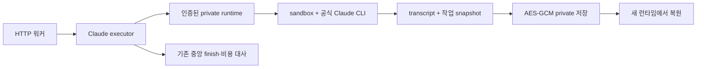
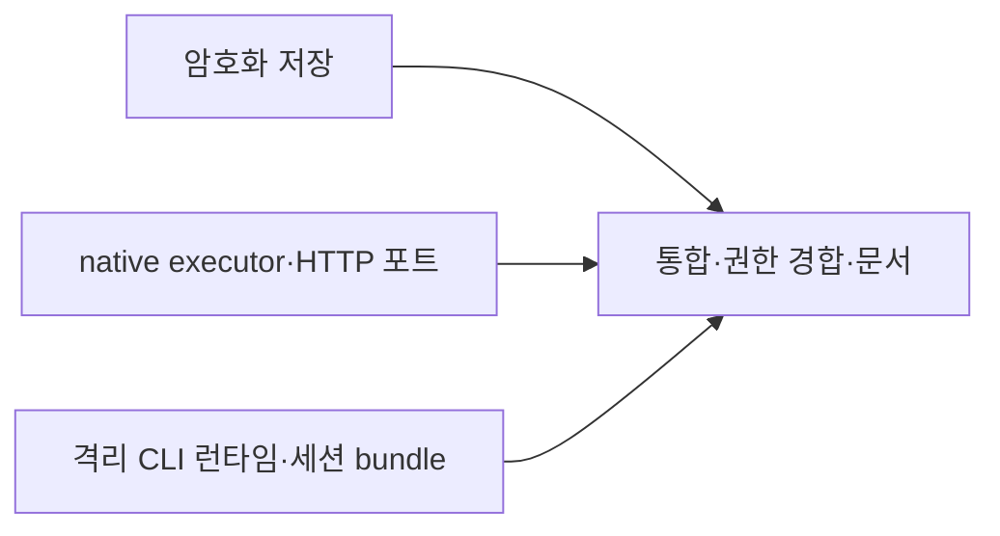

# 장기 자율 작업 2단계: Claude 실행과 비공개 세션 복원

**Goal:** 기존 중앙 정책을 우회하지 않고 공식 Claude CLI의 한 반복을 격리 실행하며, 암호화한 세션·작업 파일을 새 환경에서 복원한다.
**Architecture:** HTTP 워커 → 명시적 native executor → 인증된 격리 런타임 → 공식 CLI. 비공개 세션은 AES-GCM 저장 포트를 거쳐 파일 또는 private R2에 보존한다.
**Tech stack:** TypeScript, Node.js 24, WebCrypto, 기존 Cloudflare 컨테이너 sandbox.
**Detail:** contracts
**Full suite:** yes
**Target-min:** 30
**Ignore:** .superlite/, dist/, node_modules/, data/, *.sqlite*, .env

## 결정과 경계

- Ruling: 사용자의 다음 단계 지시로 앞서 정한 실제 실행기·영속 세션 구현을 진행한다. 추가 승인·커밋·stash·배포 없이 현재 변경을 보존한다.
- Ruling: 이 단계는 Claude만 연결한다. Codex·외부 웹·AWS·HF 실행, 실제 모델 호출·유료 자원 생성은 실행하지 않는다.
- Ruling: 기존 sandbox·capability 제거·공식 내부 서브에이전트를 재사용한다. 로컬 호스트에서 CLI를 실행하는 fallback은 없다.
- Ruling: native executor는 `systems=[]`, 허용 도구 `Bash`와 `Agent`의 부분집합만 지원한다. 미지원 범위는 실행 전에 거절한다. Agent는 승인된 worker와 모델만 호출할 수 있다.
- Ruling: 모델 비용은 `null`로 보존한다. 기존 중앙 정책은 비용 대사 전 재개를 막는다. 이번 연결을 8주 무인 운용 완료로 보고하지 않는다.
- Ruling: 세션 ID뿐 아니라 주·서브에이전트 transcript와 작업 snapshot을 복원한다. 제공자 인증 파일·운영자 토큰은 bundle에 넣지 않는다.
- Ruling: 암호화 AAD는 작업 ID·세션 ID·모델·sequence·객체 키를 결속한다. private R2는 CREDENTIALS 계열 저장 경계이며 공개 ARTIFACTS 경로로 노출하지 않는다.
- Ruling: 테스트는 가짜 CLI와 가짜 경계 검사임을 명시한다. 실제 Claude 캐시 적중·원격 격리는 별도 실증 전 미검증이다.

## 데이터 흐름

## 고정 wire 계약

`packages/contracts/src/autonomous-native.ts`는 타입만 정의한다.

- `NativeSnapshot`: 기존 backend Snapshot과 같은 `{version:1,digest:string,files:{path,content,sha256,executable}[]}`.
- `NativeClaudeRequest`: `{version:1,taskId,model,subagentModel?,tools:string[],goal,session:{sessionId,model,sequence,data:unknown},subscriptionAuth,maxRunMs,initialSnapshot?:NativeSnapshot}`.
- `NativeClaudeResponse`: `{version:1,session:{sessionId,model,sequence,data:unknown},usage:{inputTokens,cacheReadTokens,cacheWriteTokens,outputTokens},outcome:'continue'|'complete'|'wait'|'input'|'failed',wakeAt?,boundary:{platform:'linux',verified:true,noNewPrivs:1,capabilitiesDropped:true}}`.
- `NativeClaudeRuntimePort`: `.execute(request:NativeClaudeRequest,signal:AbortSignal) -> Promise<NativeClaudeResponse>`.
- Native `session.data`는 backend가 검증하는 versioned bundle이다. 승인된 session/model과 정확히 같은 UUID, 안전한 transcript 상대 경로, snapshot만 허용한다.

## 작업 그래프

### T1 암호화 영속 저장 · Complexity 6 · Est. context 38k
**Owns:** packages/adapters/src/autonomous-session-store.ts, packages/adapters/src/autonomous-session-file.ts, cloudflare/backend/src/autonomous-session-objects.ts, tests/autonomous-session-store.test.ts, cloudflare/backend/test/autonomous-session-objects.test.ts
**Components:** 2
**LOC owned:** 400
**Tests:** slow
**Model:** sonnet
**Produces:** EncryptedSessionStore implements PrivateSessionStore with durable=true; FilePrivateBlobStore; R2PrivateBlobStore.
e.g. save(task,session) then construct new store and load(task,checkpoint) -> identical private content.
e.g. changed task/model/sequence/object key or ciphertext -> reject without plaintext disclosure.
**Review Focus:** authenticated encryption, wrong key/tampering, immutable object writes, bounded input, Unicode, path traversal/symlink/hardlink, file mode 0600/0700, interrupted writes, private R2 separation and restart. Encryption module uses only Web APIs plus type imports so CF may import its .ts source. Put filesystem implementation in separate file. Store requires explicit 32-byte key and a durable blob port; no generated ephemeral key fallback. Never log plaintext or key. Objects max 12 MiB and bounded serialization.
**Steps:** Read existing PrivateSessionStore; define narrow blob port `{durable:true,get(key):Promise<Uint8Array|undefined>,put(key,bytes):Promise<void>}`. Write failing tests then implementation. File put must be atomic and non-overwriting, reject links and unsafe ancestors. R2 port uses explicit private bucket only and immutable conditional put; no public URLs. Focused tests, no full suite.

### T2 Claude executor와 private HTTP 포트 · Complexity 6 · Est. context 38k
**Owns:** packages/contracts/src/autonomous-native.ts, packages/adapters/src/autonomous-claude.ts, tests/autonomous-claude.test.ts
**Components:** 2
**LOC owned:** 350
**Tests:** fast
**Model:** sonnet
**Produces:** createClaudeAutonomousExecutor(options:{runtime:NativeClaudeRuntimePort,initialSnapshot?:NativeSnapshot}) -> AutonomousExecutor; createClaudeRuntimeHttpPort(options:{url:string,token:string,fetchImpl?:typeof fetch}) -> NativeClaudeRuntimePort.
e.g. claude context with systems=[] tools=['Bash'] and scoped credential `claudeSubscription` -> fixed native request; result costMicros=null.
e.g. unapproved system/tool, missing durable session body or response model mismatch -> fail closed.
**Review Focus:** exact field allowlists, fixed main/subagent models, no arbitrary endpoint/command in task input, only HTTPS or loopback HTTP with no credentials/query/hash/redirects, bounded response, cancellation, generic error text, no secret in return or error, no network/model calls in tests. Enforce provider=claude and exactly one approved credential ID; credentials map contains only `claudeSubscription` matching subscription OAuth format. Authentication belongs to private transport only, never public finish.
**Steps:** Land shared type file first for T3. Executor forwards private session content and allowed models/tools to isolated port, verifies runtime boundary/session/usage/outcome/sequence, returns only safe public fields plus private session to runner. Do not falsely assert real cache success or cost. Fake runtime tests first, then focused build.

### T3 격리 CLI와 세션 bundle · Complexity 7 · Est. context 48k
**Owns:** cloudflare/backend/src/runtime/autonomous-claude.ts, cloudflare/backend/src/runtime/autonomous-session.ts, cloudflare/backend/src/runtime/autonomous-bootstrap.ts, cloudflare/backend/src/runtime/autonomous-tool-hook.ts, cloudflare/backend/src/runtime/claude-bash-hook.ts, cloudflare/backend/config/claude-managed-settings.json, cloudflare/backend/test/autonomous-claude-runtime.test.ts, cloudflare/backend/test/autonomous-session-runtime.test.ts, cloudflare/backend/test/autonomous-tool-hook.test.ts
**Components:** 3
**LOC owned:** 700
**Tests:** slow
**Model:** sonnet
**Consumes:** NativeClaudeRequest/Response (T2)
**Produces:** executeAutonomousClaude(request,options?) -> Promise<NativeClaudeResponse>; createAutonomousBootstrap(options) -> HTTP server; collect/restore validated Claude bundle; managed autonomous tool gate.
e.g. fake CLI first run --session-id UUID writes parent/child transcript+workspace; second fresh directory --resume same transcript -> same UUID/model, sequence+1 and independent usage.
e.g. unsafe runtime boundary, failed sandbox configuration, unapproved child model, auth in bundle or symlink transcript -> no successful response.
**Review Focus:** reuse providerArgs/claudeSettings/buildEnv/runProcess/parseProviderResult and readRuntimeBoundary from existing runtime; production boundary mandatory, not optional; preserve managed hooks. Never use API keys. Only scoped Claude OAuth env; no operator/worker/storage/AWS env. Initial workspace snapshot or restored bundle required. Stable production /workspace and /home/node. CLI session remains persistent; --session-id first then --resume UUID or absolute transcript, --model fixed, custom worker model fixed. No unapproved tools/MCP/subagents. Capture only this session's parent and worker subagent JSONL, no .credentials.json/auth/config/settings. Snapshot uses existing bounds and excludes credential material. Secrets must never reach errors or raw stdout/stderr responses. Usage four required safe counters, no invented zero. Native final result must encode bounded JSON outcome/wakeAt; parse as untrusted data. Private HTTP endpoint /iteration authenticates before bounded JSON body and permits one in-flight request; port binds loopback by default, never runs CLI at import. Reuse existing Bash managed hook; add Agent gate with fail-closed config only when autonomous-policy file exists, preserve legacy task behavior. Fixed protected policy file controls allowed tools/worker/model. No production bypass flags in request.
**Steps:** Tests with fake process output and fake boundary are explicitly synthetic. Options injection is trusted testing/runtime configuration, not request data. Use only type imports from root contracts. Keep legacy modules unchanged except surgical hook + managed config additions. No actual CLI calls, Docker build, or deployment.

### T4 통합·중앙 직렬화·문서 · Complexity 6 · Est. context 40k
**Owns:** packages/adapters/src/autonomous-runner.ts, packages/core/src/autonomous.ts, tests/autonomous.test.ts, tests/autonomous-native-integration.test.ts, tests/autonomous-runner.test.ts, docs/autonomous-tasks.md, docs/plans/2026-11-19-autonomous-native.report.md, cloudflare/backend/runtime-build.json
**Components:** 2
**LOC owned:** 300
**Tests:** slow
**Model:** sonnet
**Consumes:** T1, T2, T3
**Produces:** native runtime + encrypted sessions + existing HTTP control integration, credential-lane claim protection, final evidence document.
**Review Focus:** central claim serializes intersecting credential IDs across native tasks, including active/stopping leases and unreconciled abandoned runs. No adapter-only lock. Native session store must advertise durable=true; MemorySessionStore remains mock only. Two fresh workers/stores/runtime directories restore same encrypted native bundle; manual reconcile-run/resume between native unknown-cost iterations is expected and tested, not labeled unattended. Native server URL/token never enter task policy/public state. No model or paid calls. Preserve all prior uncommitted code.
**Steps:** Begin tests/docs against fixed interfaces; integrate after producers. Add optional `durable?:boolean` to PrivateSessionStore interface in runner (not native wire). Require durable=true for native calls and adjust existing fake tests explicitly. Stamp runtime manifest with existing script after all backend source changes, never deploy. Run full npm run check and backend typecheck/tests at coordinator gate. Update R1–R11 table accurately: native callable now, real subscription/cache/remote isolation still unverified; external systems not yet connected.

## 수용

영속 저장소와 실행기·런타임을 합친 로컬 HTTP 통합 테스트가 새 작업 디렉터리에서 같은 session UUID와 model, transcript, 작업 파일을 복원해야 한다. 가짜 CLI 출력의 캐시 수치는 합성 근거다. 실제 24시간·구독 제한 자동 대기·외부 비용 집행·8주 이력 보존은 이번 완료 조건에 포함하지 않으며 이슈 #1을 닫지 않는다.

## 세부 계약 결정

- Ruling: native 도구 구성은 Bash 또는 Bash+Agent만 지원한다. Agent-only는 자식에게 미승인 Bash 권한을 줄 수 있으므로 거절한다. worker 모델은 subagentModel이 없으면 주 모델로 명시적으로 고정한다.
- Ruling: 실행 직전 `native-start`가 중앙 lease를 한 runtimeId에 원자적으로 결속한다. private runtime은 워커가 전달한 정책을 그대로 신뢰하지 않고 중앙 응답의 범위·세션·절대 기한을 대조하며 독립 heartbeat로 취소를 감지한다. executionLease는 private wire에만 전달한다.
