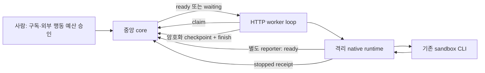
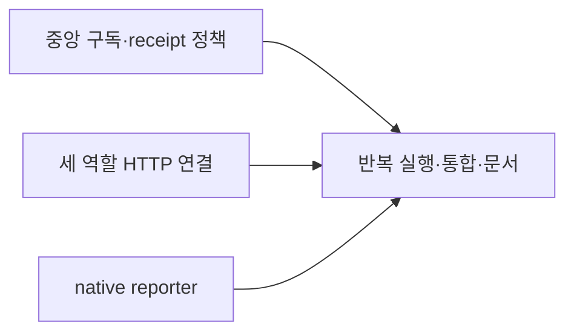

# 장기 자율 작업 3단계: 구독 반복과 외부 행동 예산

**Goal:** 사람이 명시적으로 승인한 구독 실행에서 매 반복의 모델 금액 대사 없이 계속 실행한다. 모델 금액 미확정과 외부 행동 예산을 분리하고, 신뢰한 런타임 완료 보고가 없으면 자동 재개하지 않는다.
**Architecture:** 중앙 정책 + 별도 runtime reporter 권한 + 완료 receipt + HTTP worker loop. 기존 metered 동작은 기본값으로 유지한다.
**Tech stack:** TypeScript, Node.js 24, SQLite, Cloudflare Durable Object, 기존 native CLI.
**Detail:** contracts
**Full suite:** yes
**Target-min:** 30
**Ignore:** .superlite/, dist/, node_modules/, data/, *.sqlite*, .env

## 결정

- Ruling: 사용자의 다음 단계 지시는 로컬 구현·검증 승인이다. 실제 모델·유료 자원·배포·push·커밋은 하지 않는다. 기존 변경을 보존하며 stash·체크아웃 이동·git checkpoint도 하지 않는다.
- Ruling: 새 정책은 `billingPolicy?: {model:'subscription';budget:'external_actions'}`다. 누락하면 현재의 전체 비용·미확정 대사 정책을 그대로 적용한다. 정책 변경은 revise와 새 승인이 필요하다.
- Ruling: 새 정책의 budgetMicros는 중앙 외부 행동 원장의 예산이다. 구독료·모델 금액·플랫폼 실행/R2 비용을 0으로 확정하거나 이 예산으로 제한한다고 주장하지 않는다. native costMicros는 계속 null이다.
- Ruling: worker가 구독 플래그나 비용 0을 보고하는 것만으로 자동 반복을 허용하지 않는다. 독립 reporter 권한으로 완료 receipt를 먼저 저장하고 finish가 모델·사용량·session·sequence를 일치시켜야 한다.
- Ruling: reporter token은 운영자·워커·private runtime ingress token과 별개다. CLI 환경·session·공개 응답에 전달하지 않는다. 설정이 없으면 새 정책의 실제 CLI 실행 전 ready 검사에서 거절한다.
- Ruling: lease 유실·실패로 완료 근거가 없으면 계속 수동 확인을 요구한다. 24시간 테스트는 합성 시계이며 실제 무인 운용 검증이 아니다.
- Ruling: AWS/HF 도구·청구 조회·외부 정리 실행기는 이번에 만들지 않는다. 이미 있는 외부 행동 예약·정산·정리 상태를 새 예산과 일관되게 유지한다.

## 데이터 흐름

## 고정 계약

- `AutonomousSpec.billingPolicy?: {model:'subscription';budget:'external_actions'}`. provider=claude만 새 정책을 지원한다.
- `AutonomousNativeReceipt`: `{runId,runtimeId,sessionId,model,sequence,usage:AutonomousUsage,stopped:true}`. 금액이나 secret을 담지 않는다. 모든 필드 엄격 검증.
- `AutonomousTask.nativeReceipt?`: 활성 실행의 비공개 receipt. public view에서 제거하며 finish·lease 만료에 삭제한다.
- `AutonomousRun.billingEvidence?: 'subscription_runtime'|'subscription_operator'`: 중앙에서만 기록한다. worker RunResult는 이 필드를 받지 않는다. 원래 costMicros:null을 유지한다.
- `.nativeReady(lease,runtimeId,now) -> {ready:true}`: 새 정책·현재 native binding·활성 lease를 확인한다. 이미 receipt가 있으면 새 실행은 거절한다.
- `.recordNativeReceipt(lease,receipt,now) -> {recorded:true}`: 같은 reporter 재전송은 멱등, 다른 내용·stale/cancelled lease·다른 runtime·잘못된 session/sequence는 거절한다.
- `.workerState(id) -> {taskId,status,endsAt,nextRunAt?,iteration}`: 목표·credential·session·lease token을 포함하지 않는 최소 worker 조회.
- `POST /v1/autonomous-tasks/:id/native-ready {lease,runtimeId}`와 `/native-receipt {lease,receipt}`는 reporter 전용이다.
- `GET /v1/autonomous-tasks/:id/worker-state`는 worker 전용이다. 운영자 GET /:id와 분리한다.
- Web handler `reporterToken?:string`; AppOptions `nativeReporterToken?:string`; local main `HIVEMIND_NATIVE_REPORTER_TOKEN`; Cloudflare Env `AUTONOMOUS_REPORTER_TOKEN`.
- Native reporter 기본 설정은 `HIVEMIND_CONTROL_API_URL`과 `HIVEMIND_NATIVE_REPORTER_TOKEN`이다. raw token은 기존 worker/ingress token과 같으면 거절한다.

## 작업 그래프

### T1 중앙 정책과 회계 · Complexity 7 · Est. context 45k
**Owns:** packages/contracts/src/autonomous.ts, packages/core/src/autonomous.ts, packages/core/src/autonomous-store.ts, tests/autonomous-subscription.test.ts
**Components:** 2
**LOC owned:** 450
**Tests:** fast
**Model:** sonnet
**Produces:** nativeReady(lease,runtimeId,now) -> {ready:true}; recordNativeReceipt(lease,receipt,now) -> {recorded:true}; workerState(id) -> bounded state; billingPolicy and receipt types.
e.g. approved subscription task + trusted receipt + matching continue/null/checkpoint -> ready with costMicros still null, spentMicros unchanged by model.
e.g. default task + continue/null -> awaiting_input exactly as before.
**Review Focus:** explicit opt-in and reapproval, no worker-supplied exemption, receipt mismatch/replay, budget sums actions only in new mode, prior mode unchanged, private receipt lifetime, expired/unknown-run quarantine, terminal complete/failed + cleanup, overflow, strict restore including evidence coherence and ledger totals.
**Steps:** Land type additions first. Tests first then implementation. Only new-mode receipt-verified finish may store subscription_runtime. Match current native binding/run, result checkpoint session/model/sequence and four usage counters. Accept no worker flag in RunResult. New mode finish may have cost 0 only for failed zero-usage/no-checkpoint/no native-start preflight; otherwise require cost=null and receipt. Receipt is retained until finish, rejected if stale/cancelled, private in public views. Lease expiry remains unverified and blocks automatic replay even if a receipt arrived but checkpoint was not committed. Central credential lane must treat verified subscription history as priced-for-budget, but block unknown abandoned runs. Default ledger/reconciledCostMicros behavior is unchanged. For new mode manual reconcile-run is an explicit operator stopped-run check: only amount0 accepted, stores subscription_operator without assigning model price; unresolved external actions remain blocked and are reconciled separately. Reject such reconciliation when runtime evidence already resolved the budget. Central spentMicros in new mode equals settled external actions only. Validate persisted evidence only in matching new policy/native provider and completed run shape. Policy downgrade/upgrade with history must not invalidate or silently change accounting: conservatively reject changing billingPolicy after any claimed iteration. Update proxy method set. No runtime imports in pure core.

### T2 역할별 HTTP와 설정 · Complexity 6 · Est. context 38k
**Owns:** apps/control-plane/src/autonomous-api.ts, apps/control-plane/src/app.ts, apps/control-plane/src/main.ts, cloudflare/backend/src/cloudflare/api.ts, cloudflare/backend/src/cloudflare/worker.ts, cloudflare/backend/src/autonomous-service.ts, tests/autonomous-reporter-api.test.ts, cloudflare/backend/test/autonomous-reporter-api.test.ts
**Components:** 2
**LOC owned:** 300
**Tests:** slow
**Model:** sonnet
**Consumes:** T1 methods/types
**Produces:** reporter-only native-ready/native-receipt; worker-only worker-state; optional independent reporter token local+CF configuration.
e.g. reporter token on native-receipt -> recorded; worker/operator token ->401; missing/reused reporter token ->503 before body parsing.
e.g. worker-state returns status/time/iteration only; no task goals, credential IDs or private metadata.
**Review Focus:** all auth selectors agree (Web, Fastify onRequest, CF outer+DO), strict new billingPolicy/receipt bodies, no token echo, role-specific configuration failclosed, rollback and persistence, forward-compatible old clients, soft-cap recovery headroom for receipt writes.
**Steps:** Tests first against small fakes then real core. Do not modify old test files owned elsewhere. Handler optional reporterToken is distinct from operator/worker; do not add insecure defaults. New operations nativeReady/recordNativeReceipt/workerState go through existing transaction and engine.tick. Runtime receipt is private and never sent by ordinary finish. Add recovery headroom for reporting; operator API cannot impersonate reporter. Update local main optional env binding and CF Env+both auth callsites surgically preserving unrelated worker code. No deployments.

### T3 native 완료 보고자 · Complexity 6 · Est. context 40k
**Owns:** cloudflare/backend/src/runtime/autonomous-reporter.ts, cloudflare/backend/src/runtime/autonomous-claude.ts, cloudflare/backend/test/autonomous-reporter-runtime.test.ts
**Components:** 2
**LOC owned:** 300
**Tests:** slow
**Model:** sonnet
**Consumes:** T1 receipt shape
**Produces:** createNativeHttpReporter({url,token,fetchImpl?}) -> NativeReporter; nativeReporterFromEnvironment(); options reporter?:NativeReporter on executeAutonomousClaude.
e.g. canonical billingPolicy present -> reporter.ready before fake CLI, receipt after child/process closed and bundle collected, then response.
e.g. missing reporter / wrong token / cancelled lease -> no successful auto continuation; missing configuration before CLI -> calls0.
**Review Focus:** reporter independent from worker+ingress tokens, bounded no-redirect HTTPS/loopback transport, auth/lease not in CLI env/session/results, exact canonical spec deciding policy (not raw request), report only successful final native receipt after process cleanup, independent heartbeat throughout reporting, no reports for default policy, generic secret-safe failures, retry same receipt idempotently on explicit transient transport retry only.
**Steps:** Use type-only root imports and existing authorizer/runtime guards. New mode must instantiate reporter and call ready before filesystem/CLI. Default policy remains compatible and makes no reporter call. After current safe parse/model/usage/bundle checks and confirmed runProcess completion, report exact runId/runtimeId/sessionId/model/sequence+usage+stopped. Do not report provider price0. Keep receipt submission within original deadline/lease; failures leave central policy conservative. Tests inject fake process/boundary and local/fake reporter, no actual model. Production reporter key comes only from explicit environment/config, never worker input. Do not bypass sandbox/UID checks.

### T4 워커 반복과 통합 · Complexity 6 · Est. context 42k
**Owns:** packages/adapters/src/autonomous-loop.ts, packages/adapters/src/autonomous-runner.ts, tests/autonomous-loop.test.ts, tests/autonomous-subscription-integration.test.ts, docs/autonomous-tasks.md, docs/plans/2026-11-19-autonomous-subscription.report.md, cloudflare/backend/runtime-build.json
**Components:** 2
**LOC owned:** 400
**Tests:** slow
**Model:** sonnet
**Consumes:** T1, T2, T3
**Produces:** runAutonomousLoop(options) -> {iterations,reason}; worker HTTP client workerState(); single-approval synthetic multi-iteration + wait + restart integration.
e.g. task ready -> execute, next ready -> execute without operator reconcile; waiting -> sleep with no model until nextRunAt; terminal/input/stopping -> no new model.
e.g. new store/worker instance continues committed checkpoint under same approval and model.
**Review Focus:** HTTP only, worker-state capability optional on old clients and required by loop, no operator credentials in worker, sleep abort and no spinning, max iterations/idle limit explicit, terminal/cancel/error stop, no automatic reapproval, correct actual-vs-synthetic evidence.
**Steps:** Start loop focused tests/docs with fakes; native core/runtime integration after producers. Loop is opt-in library, importing/running existing commands never starts native calls. Add optional workerState to AutonomousWorkerClient and implement in createAutonomousHttpClient without breaking old fakes. Poll only minimal state, no operator GET. Inject wait/clock for tests, production abortable sleep and bounded polling. Use real local HTTP app + encrypted File store + real private bootstrap/native function with fake CLI/boundary, actual reporter HTTP key. Prove multiple continue/wait/resume/complete runs from one approval, costs still null and no human reconcile interventions; task state and store survive re-instantiation. Simulated24h means virtual time only. Docs must say budget external_actions excludes platform/runtime/R2/subscription costs; no actual pricing/billing cap proof. Stamp backend manifest only after all backend writers/reviewers frozen. Coordinator runs final full root and backend checks. No actual providers/deploy/commit.

## 수용 범위

새 정책을 명시한 합성 작업의 반복·예약 대기·종료와 재시작 복원을 한 번 승인으로 검증한다. 기존 정책은 미확정 금액에서 대사 대기를 유지한다. 완료 receipt 없는 실행·중단·lease 유실은 자동 면제하지 않는다. 실제 외부 도구·비용 집행·모델 구독·원격 격리·24시간 및 8주 운영은 별도 검증 대상이며 이슈 #1을 닫지 않는다.

## 세부 계약 결정

- Ruling: receipt는 필수 outcome과 선택 wakeAt도 결속한다. 워커가 런타임의 입력·대기 요청을 continue로 바꾸어 자동 반복하지 못하게 한다. replay 비교는 JSON 필드 순서가 아닌 필드 값으로 한다.
