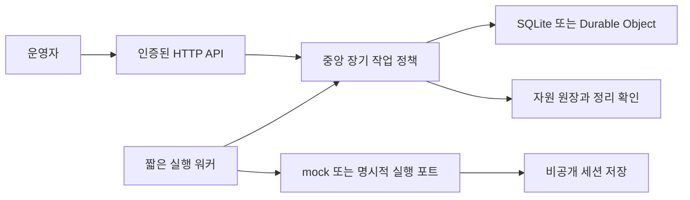
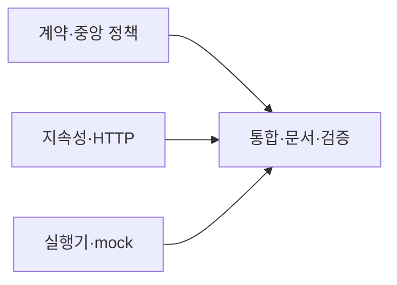

# 장기 자율 작업: 설계와 구현 계획

**Goal:** 이슈 #1의 R1–R11을 다루는 중앙 정책과 재시작 가능한 실행 흐름을 구현한다.
**Architecture:** 장기 작업은 승인과 기간·비용을 소유한다. 짧은 실행은 lease로 분배하며, 체크포인트와 다음 실행 시각을 저장한다. 외부 행동은 승인·비용 예약·자원 등록·정리 확인을 거친다.
**Tech stack:** TypeScript, Node.js 24, SQLite, Cloudflare Durable Object.
**Detail:** contracts
**Full suite:** yes
**Target-min:** 30

## 결정

- Ruling: 사용자의 “권장대로 랄프루프로 진행”을 설계·구현 승인으로 해석한다. 추가 승인 없이 로컬 구현·검증·수정을 반복한다.
- Ruling: 기존 미커밋 파일을 보존한다. 현재 체크아웃에서 파일 소유 범위를 분리한다. 자동 stash·세션 이동·checkpoint 커밋은 하지 않는다. 사용자가 커밋을 요청하지 않았기 때문이다.
- Ruling: 실제 CLI 호출·클라우드 배포·유료 자원 생성은 실행하지 않는다. 새 기능은 mock/local 실행이 기본이다. 24시간 실증·원격 세션 복원·실제 비용 상한은 별도의 미검증 수용 항목으로 남긴다.
- Ruling: 새 실행 흐름은 기존 짧은 작업의 승인·상태를 바꾸지 않는다. Cloudflare 연결은 별도 HTTP 자율 작업 API로 제공한다.
- Ruling: 외부 비용을 발생시키는 행동은 중앙 예약과 멱등 키를 요구한다. 정리 완료 전에는 작업을 종료 상태로 표시하지 않는다. 일반 Bash에 비밀을 주고 비용 상한을 보장한다고 주장하지 않는다.
- Ruling: 네이티브 세션 ID만 저장하는 것은 세션 복원이 아니다. 실행기는 private checkpoint 저장 포트를 사용하며 세션 파일·인증을 공개 snapshot에 넣지 않는다. 실제 제공자 연결이 없으면 fail closed한다.

## 데이터 흐름

## 공통 계약

`packages/contracts/src/autonomous.ts`에 타입만 정의한다. 비밀은 포함하지 않는다.

- `AutonomousSpec`: `requestId`, `goal`, `provider: 'mock'|'claude'|'codex'`, `model`, `subagentModel?`, `endsAt`, `budgetMicros`, `tools: string[]`, `systems: string[]`, `credentialIds: string[]`, `maxRunMs`, `maxIterations`.
- `AutonomousTask`: `id`, `spec`, `revision`, `status`, `createdAt`, `approvedAt?`, `nextRunAt?`, `iteration`, `lease?`, `checkpoint?`, `runs`, `actions`, `resources`, `interventions`, `spentMicros`, `reservedMicros`, `stopReason?`.
- `AutonomousStatus`: `awaiting_approval|ready|running|waiting|awaiting_input|stopping|completed|cancelled|budget_exceeded|expired|failed`.
- `AutonomousLease`: `taskId`, `runId`, `workerId`, `token`, `expiresAt`.
- `AutonomousCheckpoint`: `sessionId`, `objectKey`, `model`, `sequence` (비공개 저장소의 참조만).
- `AutonomousUsage`: `inputTokens`, `cacheReadTokens`, `cacheWriteTokens`, `outputTokens`; 모두 0 이상의 안전한 정수.
- `AutonomousRunResult`: `outcome: 'continue'|'wait'|'input'|'complete'|'failed'`, `checkpoint?`, `usage`, `costMicros: number|null`, `wakeAt?`, `message?`. 모델이 반환한 요청은 중앙에서 다시 검증한다.
- `AutonomousActionRequest`: `requestId`, `tool`, `system`, `operation`, `estimatedCostMicros`.
- `AutonomousAction`: `id`, 요청 필드, `status: reserved|succeeded|failed|unknown`, `actualCostMicros?`, `resourceId?`.
- `AutonomousResource`: `id`, `system`, `cleanupOperation`, `status: active|cleanup_pending|cleaned`, `actionId`.
- `AutonomousState`: `version: 1`, `tasks: Record<string,AutonomousTask>`.

## 파일과 작업 그래프

### T1 중앙 정책 · Complexity 7 · Est. context 45k
**Owns:** packages/contracts/src/autonomous.ts, packages/core/src/autonomous.ts, tests/autonomous.test.ts
**Components:** 2
**LOC owned:** 650
**Tests:** fast
**Model:** sonnet
**Produces:** AutonomousEngine(state?: AutonomousState); `.snapshot() -> AutonomousState`; `.create(spec: AutonomousSpec, now: number, id: string) -> AutonomousTask`; `.get(id: string) -> AutonomousTask`; `.list() -> AutonomousTask[]`; `.approve(id: string, revision: number, reason: string, now: number) -> AutonomousTask`; `.claim(id: string, workerId: string, token: string, runId: string, now: number) -> AutonomousLease|null`; `.heartbeat(lease: AutonomousLease, now: number) -> AutonomousLease`; `.finish(lease: AutonomousLease, result: AutonomousRunResult, now: number) -> AutonomousTask`; `.cancel(id: string, reason: string, now: number) -> AutonomousTask`; `.message(id: string, message: string, now: number) -> AutonomousTask`; `.reserve(lease: AutonomousLease, request: AutonomousActionRequest, now: number) -> AutonomousAction`; `.settle(lease: AutonomousLease, actionId: string, actualCostMicros: number, success: boolean, resource: {id:string;system:string;cleanupOperation:string}|undefined, now: number) -> AutonomousAction`; `.cleaned(id: string, resourceId: string, now: number) -> AutonomousTask`; `.tick(now: number) -> void`.
e.g. create mock task then claim before approval -> null; approve current revision then claim -> lease.
e.g. finish wait with wakeAt=2000 then tick(1999) -> waiting; tick(2000) -> ready.
**Review Focus:** stale approvals and leases, cancel/late-result race, policy escape, idempotent reservations, arithmetic overflow, budget exhaustion, cleanup failure, model/session mismatch, unknown cost, deadline crossing, serialized restore, no secrets in public views.
**Steps:** Write failing tests; implement pure engine with injected time/IDs; rerun focused tests. Get/list/snapshot return defensive copies. Lease tokens are private and get/list must redact them. State snapshot is private. Explicitly validate persisted state, do not trust cast data. No network or filesystem access.

### T2 지속성과 HTTP · Complexity 6 · Est. context 40k
**Owns:** packages/core/src/autonomous-store.ts, apps/control-plane/src/autonomous-api.ts, cloudflare/backend/src/autonomous-service.ts, cloudflare/backend/src/cloudflare/autonomous-api.ts, tests/autonomous-api.test.ts, cloudflare/backend/test/autonomous-api.test.ts
**Components:** 2
**LOC owned:** 450
**Tests:** slow
**Model:** sonnet
**Consumes:** AutonomousEngine (T1)
**Produces:** createAutonomousStore(path: string) -> persistent engine facade; handleAutonomousApi(request: Request, options: {operatorToken:string;workerToken:string;service:AutonomousService}) -> Promise<Response>; AutonomousService(storage, clock?) -> serialized mutation facade.
e.g. POST /v1/autonomous-tasks draft then restart service -> same draft, no execution.
e.g. operator token on worker claim endpoint -> 401; worker token on approve -> 401.
**Review Focus:** authorization before body parsing; strict input fields; worker sees only claimed spec and allowed credentials IDs; SQLite transaction and rollback; Durable Object restore; operation persistence before response; stale policy revision 409; private state never returned; malformed request 400 and bounded bodies.
**Steps:** Test first against a small fake conforming to T1 and its examples; add Node SQLite facade and Web Request/Response HTTP handler. No edits to existing dirty worker.ts. Cloudflare service imports core directly using .ts; keep core runtime imports portable. Expose operator create/list/get/approve/cancel/message/cleanup confirmation and worker claim/heartbeat/finish/reserve/settle via HTTP. Worker requests require full lease. No worker can confirm cleanup or approve scope.

### T3 실행기와 mock · Complexity 6 · Est. context 40k
**Owns:** packages/adapters/src/autonomous-runner.ts, apps/worker/src/autonomous-mock.ts, tests/autonomous-runner.test.ts
**Components:** 2
**LOC owned:** 400
**Tests:** fast
**Model:** sonnet
**Consumes:** AutonomousEngine (T1)
**Produces:** runAutonomousIteration(options) -> Promise<boolean>; MemorySessionStore -> private session storage; mock executor with explicit synthetic evidence.
e.g. waiting task before nextRunAt -> no executor invocation.
e.g. restore checkpoint in a new worker -> exact same session identity/model and separate usage per run.
**Review Focus:** HTTP-only worker access; heartbeat/cancel abort; no provider invocation when waiting; no real model fallback; private session reference restoration; external cleanup retry without model calls; unknown costs are not zero; usage per iteration; fixed model and optional child model passed to executor; credentials resolved only into executor scope and never serialized.
**Steps:** Define narrow HTTP client/executor/private checkpoint/cleanup ports using T1 contracts. Tests first with fake HTTP control server and synthetic executor. Provide runnable mock scenario through Node built output; no CLI or cloud calls. Native provider execution must require an explicitly supplied executor, not silently use mock. Return a clearly named unsupported error when required capability is absent.

### T4 통합과 수용 · Complexity 6 · Est. context 35k
**Owns:** apps/control-plane/src/app.ts, cloudflare/backend/src/cloudflare/api.ts, cloudflare/backend/src/cloudflare/worker.ts, docs/autonomous-tasks.md, package.json, tests/autonomous-integration.test.ts, cloudflare/backend/test/autonomous-service.test.ts, packages/contracts/src/README.md, packages/core/src/README.md
**Components:** 2
**LOC owned:** 300
**Tests:** slow
**Model:** sonnet
**Consumes:** T1, T2, T3
**Produces:** authenticated local and Cloudflare API registration; npm run autonomous:mock; integration evidence and documented runtime gates.
**Review Focus:** preserve existing behavior and dirty edits; remote state never stored in local SQLite; one central policy; no automatic model or paid action; simulated 24-hour run labeled synthetic, crash restore and wait tested with virtual clock; session artifacts never public; state machine cleanup cannot be bypassed by ordinary worker finish.
**Steps:** Wire handlers into both backends without changing existing task contracts. Write integration tests for one approval, repeat execution, service+worker restart, wait/resume, cost stop and cleanup retry. Update Korean docs with R1–R11 status, API usage, trust boundaries and explicit unverified real-platform gates. Run npm run check, backend typecheck and focused/backend tests. Repeat fixes until green; fresh independent final review before reporting.

## 수용 구분

로컬 mock 검증은 정책·지속성·예약·복구·정리 흐름의 근거다. 실제 Claude 구독, 요청 모델의 존재·사용 가능 여부, 컨테이너를 바꾼 세션 재개와 캐시 읽기, 24시간 운영, AWS 실제 지출·리소스 종료는 실제 검증 전까지 미검증이다. 이 구현만으로 이슈 #1을 닫지 않는다.

## 통합 중 확정한 계약

- Ruling: `.revise(id,spec,reason,now)`는 실행 중이 아닌 작업의 범위를 고치고 승인을 무효화한다. 주 모델과 제공자는 작업 중 바꾸지 않는다.
- Ruling: `.reconcile(id,actionId,actualCostMicros,success,resource,reason,now)`는 lease 유실로 결과가 불명확한 외부 행동을 운영자가 대사하는 경로다. worker는 호출할 수 없다.
- Ruling: 범위 초과·비용 중단처럼 의도된 거절의 상태 변경은 `AutonomousError.commitState`로 표시하고 오류 응답 전에 저장한다. 그 외 실패는 원자적으로 롤백한다.
- Ruling: `runAutonomousCleanup`은 모델 실행과 분리된 신뢰하는 정리 포트만 사용한다. 정리 실패는 원장에 남기고 다음 호출에서 재시도한다. 운영자 권한을 모델에 전달하지 않는다.
- Ruling: Cloudflare 대기는 2초 반복 조회를 유지하지 않고 다음 대기·lease·작업 기한으로 alarm을 예약한다.
- Ruling: `.resume(id,revision,reason,now)`는 해결된 입력 대기를 같은 승인 범위에서 재개한다. 범위를 늘리려면 revise와 재승인이 필요하다.
- Ruling: `.reconcileRun(id,runId,actualCostMicros,reason,now)`는 원래 미확정 보고값을 유지한 채 운영자가 확인한 비용을 별도로 기록한다.
- Ruling: heartbeat는 최초 claim 시각에 고정한 실행 기한 안에서만 lease를 갱신한다. lease 갱신으로 maxRunMs를 우회하지 않는다.
- Ruling: lease가 만료된 실행은 사용량을 추측하지 않는다. 내부 `usageUnavailable` 표시와 미확정 비용을 보존하고 비용 대사 전까지 재개·최종 종료를 막는다. 이는 실제 네이티브 무인 복구가 완료됐다는 뜻이 아니다.
