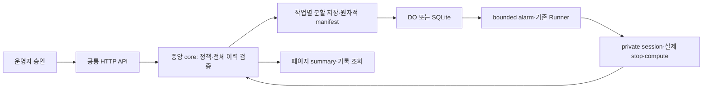
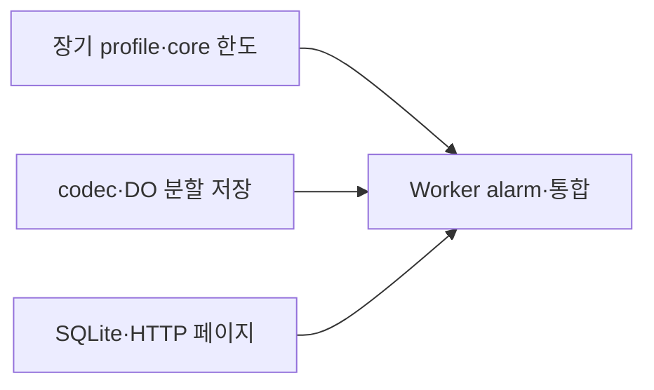

# 이슈 #1 잔여 구현: 장기 실행 기반과 후속 연결

**Goal:** 기존 실증된 pilot를 보존하고 장기 profile·분할 저장·페이지 조회를 구현한다. 이어 예약/구독 대기, 웹, 외부 자격·행동·비용·정리를 연결한다.
**Architecture:** 중앙 core가 정책과 이력의 진실을 유지한다. 같은 DO/SQLite 트랜잭션에서 분할 레코드와 색인을 게시한다. 실제 모델·제공자 호출은 별도 실증이다.
**Tech stack:** TypeScript, Node24, SQLite, Cloudflare Durable Object.
**Detail:** contracts
**Full suite:** yes
**Target-min:** 30

## 결정과 범위

- Ruling: 사용자의 “잔여작업 랄프 루프로 진행해”를 로컬 설계·구현·검증·수정 반복의 사전 승인과 AI 조율로 해석한다. 같은 계획 승인을 다시 묻지 않는다.
- Ruling: 기존 working tree에서 소유 파일을 분리한다. 이전 단계와 DuckDB 미커밋 변경을 보존하며 stash/checkout/커밋/checkpoint 커밋/푸시하지 않는다. 기준 사본은 `.superlite/remaining-baseline/`이다.
- Ruling: 코드는 agent가 작성하고 coordinator는 설계·계약·검증을 통합한다. 모델 override는 사용하지 않는다.
- Ruling: 새 실제 모델·유료 자원·배포·외부 공개는 수행하지 않는다. 이전 원격 시험 두 반복 승인은 소진됐다. 실증의 준비를 마친 뒤 별도 구체적 승인이 필요하다.
- Ruling: 기존 중단/미확정 비용/credential 직렬화/receipt/실제 종료/인증 세대/경계 probe는 유지한다. 한도만 제거하거나 세션을 public artifact에 넣지 않는다.

## 1차 수용 기준 — R1

- `execution.mode`를 생략하거나 pilot로 지정하면 기존10분/4회/회당120초를 유지한다.
- 명시적 long_running profile은 생성 시부터 최대56일, 최대65536회, 회당최대120초다. source64KiB/32파일·검사1..4개/각10초는 유지한다. 주/자식 모델·source/checks·모드는 첫 실행 후 불변이다.
- 배열을 잘라 이력을 잃지 않는다. 긴 profile의 전체 이력은 검증하되 직렬화된 task는 정상30MiB·복구32MiB의 명시적 상한, 각 저장 chunk는128KiB 이하로 제한한다. 이 크기는8주 실행 보장이 아니라 승인 기간·실제 기록 크기를 각각 제한한다.
- 장기 profile의 이력 개수 상한은65536이며 복구용 개입 기록 여유를 별도로 둔다. pilot 기존 MAX_ITEMS 의미는 유지한다.
- 단일 autonomous-state의2MB 한계 대신 작업별 generation/chunks·manifest·requestId 색인·bounded 목록을 저장한다. 동일 credential의 lease/미확정 비용을 가진 모든 task는 중앙 claim 판단에 남는다.
- manifest 전환과 task/request/credential 관련 쓰기는 트랜잭션으로 원자화한다. 부분 저장을 공개하지 않는다. transaction 미지원 저장소는 legacy pilot만 허용하고 long_running은 거절한다.
- legacy snapshot을 core 검증 후 migration한다. 실패하면 legacy가 계속 진실이며 재시도 가능하다. active manifest 게시 후에도 legacy 삭제는 별도 보존 정책 없이 수행하지 않는다.
- 페이지 조회는 기본20·최대100, opaque 검증 cursor와 고정 high-watermark를 사용한다. 원래 list 배열 API는 호환성을 유지하고 새 페이지는 summary만 반환한다. token/checkpoint/native private 필드는 노출하지 않는다.
- 초기 보존 정책은 이력 영구 유지·명시적32MiB 정지다. 자동 삭제/TTL/손실 압축은 하지 않는다. 오래된 generation chunk는 새 manifest 확정 후 안전하게 정리한다.
- 실제 Cloudflare alarm은 페이지 기반 bounded batch로 진행하고 ready/running/stopping 모두 공정하게 방문한다. 숨겨진 장기 작업을 영구 굶기거나 대기 중 모델을 호출하지 않는다.

## 데이터 흐름



## 파일과 작업 그래프



### C1 장기 profile · Complexity 6 · Est. context 40k
**Owns:** packages/contracts/src/autonomous.ts, packages/core/src/autonomous.ts, tests/autonomous-long-running.test.ts
**Components:** 2
**LOC owned:** 180
**Tests:** fast
**Model:** sonnet
**Produces:** AutonomousCloudExecution.mode?:'pilot'|'long_running'; exported core policies via validation only.
예: 생략/10분/4회 허용, 생략/5회 거절. mode long_running/56일/65536회 허용. 56일 초과 거절. 새 모드의 이력1001건 복원·취소·credential 경합 검사.
**Review Focus:** create/revise/restore의 같은 한도, overflow, 근거 없는 이력 절단 금지, 과거 모델/source/모드 불변, 개입 포화 때 취소 가능.
**Steps:** 먼저 실패 테스트, 최소 구현, 집중 회귀. 실행 세션·합성24시간·실제 실증을 구분한다.

### C2 codec와 DO 분할 저장 · Complexity 8 · Est. context 55k
**Owns:** packages/core/src/autonomous-repository.ts, cloudflare/backend/src/autonomous-service.ts, cloudflare/backend/test/autonomous-partitioned.test.ts
**Components:** 2
**LOC owned:** 430
**Tests:** fast
**Model:** sonnet
**Produces:** encodeAutonomousRecord(value:unknown)->{chunks:string[],digest:string,bytes:number}; decodeAutonomousRecord(record:{chunks:string[],digest:string,bytes:number})->unknown; AutonomousService.execute keeps interface and supports listPage.
예: 한국어 문자열을 UTF8 128KiB 이하 chunk로 분할/복원, 변경 chunk는 거절. listPage({limit:20}) returns {items:task summaries,nextCursor?:string}.
**Review Focus:** 트랜잭션 이전/partial write/rollback/commitState, hash·byte bound, 기존 fake storage 호환,32MiB 초과 fail closed, private 필드 제거, 전체 credential claim 안전.
**Steps:** 순수 codec 및 transaction-aware fake로 실패 테스트 후 구현한다. 저장 계약에 optional transaction(callback)·delete 등 필요한 최소 포트를 추가한다. 기존 legacy 용량 테스트를 무력화하지 않는다.

### C3 SQLite와 HTTP 페이지 · Complexity 7 · Est. context 45k
**Owns:** packages/core/src/autonomous-store.ts, apps/control-plane/src/autonomous-api.ts, tests/autonomous-pagination.test.ts
**Components:** 2
**LOC owned:** 300
**Tests:** slow
**Model:** sonnet
**Consumes:** encodeAutonomousRecord/decodeAutonomousRecord (C2), AutonomousCloudExecution.mode (C1).
**Produces:** GET /v1/autonomous-tasks?limit=20&cursor=... -> {items,nextCursor?}; execute operation listPage; store.listPage({limit?,cursor?}).
예: 초기 두 작업/limit1은 첫 summary+cursor, 다음 페이지는 둘째 summary. 페이지 생성 뒤 등록한 작업은 같은 high-watermark 페이지에 끼어들지 않는다. query 생략은 기존 list 배열.
**Review Focus:** 인증 먼저, query 중복/unknown/oversize 거절, cursor 변조·다른 범위 재사용 거절, 원본 token/checkpoint 비공개, 기존 SQLite migration·재오픈·원자성·다른 handle 경합.
**Steps:** 공통 codec 계약으로 테스트하고 C2 구현과 합친 뒤 실검증한다. HTTP 소비자/strict whitelist의 새 mode를 허용한다.

### C4 Worker와 통합 · Complexity 7 · Est. context 50k
**Owns:** cloudflare/backend/src/cloudflare/worker.ts, cloudflare/backend/src/cloudflare/api.ts, cloudflare/backend/test/autonomous-long-running-integration.test.ts
**Components:** 2
**LOC owned:** 260
**Tests:** slow
**Model:** sonnet
**Consumes:** C1 profile, C2/C3 listPage.
**Produces:** 페이지 기반 bounded alarm scheduling; 원격 long_running 승인에는 신뢰하는 AUTONOMOUS_LONG_RUNNING_ENABLED=true와 transaction 저장 지원 필요. 기본은 비활성.
**Review Focus:** 기존 pilot no regression, default closed, legacy credential conflict,25시간 합성 시계·재시작·대기 중 no model, 페이지 공정성·만료·취소, fingerprint에 장기 활성 설정 결속.
**Steps:** production producer 완료 뒤 실제 actor 기반 합성 통합을 작성한다. 실제 provider/container를 호출하지 않는다.

Ruling: 공통 core의 새 runtime import는 .ts 확장자를 쓰고 root TypeScript의 rewriteRelativeImportExtensions를 활성화한다. Node24 backend source 테스트와 root emitted JS가 같은 구현을 참조하도록 한다. 기존 .js import는 유지한다.

## 후속 wave — 이슈 전체 완료까지 계속할 작업

1. R6: 승인 일정(daily timeZone/localTime)·quota reset 구조화 근거·사용량 미보고 보존·private 정지/세션/인증 회수 proof와 기존 wait/alarm을 연결한다. 진단 regex로 reset을 추정하지 않는다.
2. R3/R4: 기본 차단 WebFetch exact HTTPS host allowlist, redirect/SSRF·자식 도구·managed hook·실제 egress를 함께 결속한다. Fable5.2 가용성은 미확인으로 남기고 자동 대체하지 않는다.
3. R7/R8/R9/R11: 승인 action profile(credential ref/target/operations/limits/TTL), canonical parameters hash, 중앙 dispatch intent·broker receipt·reconciliation·cleanup을 연결한다. AWS/HF/GH 자격은 trusted broker에만 두고 Bash에 전달하지 않는다. provider idempotency/ownership과 lifetime+cleanup 비용 예약이 없으면 실행을 거절한다. AWS는 roboco/ap-northeast-2/CDK.
4. 앱/MCP에는 autonomous 승인·credential 참조·action/개입 기록 조회를 연결한다. 실제 secret은 표시하지 않는다.
5. 모든 로컬 구현·검토 후 실제24시간 실증의 고정 대상·도구·자격 참조·비용 상한·정리·중단 범위를 문서화해 별도 실행 승인을 요청한다. 이슈 종료는 실제 수용 기준 전체 충족 이후다.

## 검증·검토

### R1 P2 DO 작업별 로딩

AutonomousService는 전역 catalog·manifest summary·30/32MiB 합계 검사를 유지하되 일반 요청은 대상 task만 decode한다. claim은 같은 credential을 공유하는 모든 blocked owner도 함께 로딩하여 core의 전역 경합 검사를 보존한다. 만료된 소유자는 tick 후에도 미확정 실행이 남으면 격리를 유지한다. create는 영속 requestId 색인·전역 task 수·ID 충돌을 확인하고 기존 v2의 request 색인은 summary만으로 트랜잭션 안에서 복원한다. listPage는 표시하는 최대100개 중 due task만 tick하고 tick은 영속 순회 cursor로 최대25개 due task를 처리한다. 부분 snapshot은 기존 catalog에 병합하고 변경 record·request/owner 색인·합계·cursor를 함께 게시한다. 불변 조회는 쓰지 않으며 실패 rollback·commitState·legacy migration·capability downgrade 차단을 유지한다. 기존 list만 전체 로딩 호환 경로로 남긴다. 이는 큰 단일 task의 clone 비용이나128MB peak 안전·실제8주 운용을 입증하지 않는다. 최대 유효 task의 격리 Node 메모리 측정은 freeze 이후 별도 검증한다.

#### 로컬 집중 검증

- 최초 `node --test cloudflare/backend/test/autonomous-targeted.test.ts`: 11건 중10실패·1통과. 대상 외 chunk 조회, 전체 tick, request 색인 복원과 빈 조회 쓰기를 재현했다. 작업별 로딩 후11통과. 이후 경계 회귀를 추가해 전용17건 통과했다.
- 최종4파일50통과·0실패, 미시작 release 관련6통과·0실패(합계56건). 아래 소유 파일 타입 검사도 성공했다. 초기 타입 검사의 narrowing 오류는 수정했다.
- 신규 catalog 내부 필드는 `requestIndexVersion?:1`, `tickCursor?:number`다. public 계약·core·C3 bridge·provider는 수정하지 않았다. 합계30MiB 초과 일반 변경 rollback과32MiB 이내 취소 복구, 다중 미확정 owner 및 재시작 공정성·색인 upgrade rollback을 검사했다. 기존 capability downgrade503 회귀도 통과했다.
- 대용량 fixture는 저장 정책 테스트이며 메모리 측정이 아니다. 전체 검사·runtime stamp·원격 실행은 하지 않았다. 초기 legacy migration과 호환 list는 여전히 전체 상태를 로딩한다. 일반 요청도 전역 manifest metadata는 읽으며 claim은 공유 blocked owner 전체를 로딩한다. 단일 대형 이력의 core clone 비용과 실제128MB peak·8주 운용은 미검증이다.

```sh
./node_modules/.bin/tsc --noEmit --target ES2023 --module NodeNext --moduleResolution NodeNext --allowImportingTsExtensions --types node --strict --noUncheckedIndexedAccess --noUnusedLocals --noUnusedParameters --skipLibCheck cloudflare/backend/src/autonomous-service.ts cloudflare/backend/test/autonomous-targeted.test.ts
node --test cloudflare/backend/test/autonomous-targeted.test.ts cloudflare/backend/test/autonomous-partitioned.test.ts cloudflare/backend/test/autonomous-long-running-integration.test.ts cloudflare/backend/test/autonomous-service.test.ts
node --test --test-name-pattern='unstarted|preflight failure|another stream' cloudflare/backend/test/autonomous-cloud-integration.test.ts
```

- protocol/encoding/numeric/state/file와 transaction crash·late result·권한 경계를 중심으로 먼저 회귀를 작성한다.
- 각 작업 집중 검사 → 교차 검토와 수정 반복 → root npm run check → backend typecheck/test → runtime stamp/check → 독립 최종 검토.
- synthetic56일/24시간·fake provider는 실제 원격 실증으로 표시하지 않는다. 원격은 기존 두 반복 근거만 있다.
- 합의한 계약의 변경은 consumers/tests/docs를 같은 단계에서 갱신한다. 완료되지 않은 wave와 실증은 report에 명시한다.
