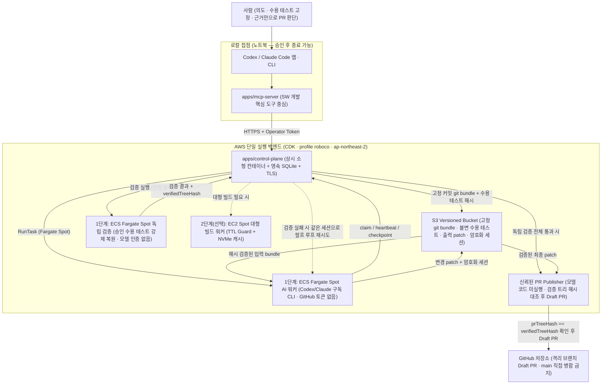

# Project HIVEMIND 방향 재정렬 및 AWS 단일 실행 마스터 플랜

상태: 확정 · 실행 중 (2026-11-25). **Cloudflare 사용안은 공식 폐기하고 원격 리소스를 전량 정리했다.** 이후 모든 원격 실행은 AWS 단일 경로(`infrastructure/aws-runtime`)로 진행한다. 실제 모델 호출·유료 AWS 자원 생성·배포는 명시적 승인 뒤에만 수행한다.
지원 제공자 범위: **Codex · Claude Code** (Gemini/`agy` 제외).

## 1. 확정된 설계 결정

| 영역 | 확정된 결정 | 근거 |
|---|---|---|
| 제품 본체 | 초기 의도(**의도·정책·독립 검증 기반 SW 개발**)를 본체로 유지 | 원격 워커의 실패 수정→독립 검증 통과는 이미 실증([MCP 워크플로 검증](../verification/2026-11-12-workflow-mcp.md)). 이번 전환은 그 결과를 **사람이 코드 없이 판단·반영하는 끝단(Draft PR + 무검토 판단)**까지 연결 |
| 제공자 범위 | Codex · Claude Code 2종 유지, Gemini(`agy`) 제외 | `agy` 구독 OAuth의 헤드리스 클라우드 이식은 공식 미지원·약관/정지 위험이 높으며 현 단계 스코프 분산 방지 |
| Cloudflare 처리 | **즉시 폐기 · 원격 리소스 전량 정리 완료 (2026-11-25)** | Phase 0(Cloudflare `#7`/SMF)를 중단하고 `hivemind-*` Worker 4개·Container 3개·이미지·R2 버킷 2개를 삭제 완료. `cloudflare/` 디렉터리는 과거 검증 아카이브로만 보존 |
| AWS 단일화 근거 | ① 관제·실행의 이중 운영 경로 제거, ② 자기 저장소(`project-hivemind`, 790파일·11.03MiB)를 Draft PR까지 끝까지 처리, ③ DO KV 2MB·Workers 128MiB 제약을 벗어난 단일 스택 | 기존 Cloudflare에도 대형 compute용 R2 multipart 경로([백엔드 안내](../../cloudflare/backend/README.md#대형-compute-입력과-standard-4-duckdb-p0))는 있으나 코딩 스냅샷(4MiB)과 분리돼 있었음 |
| 중앙 관제 | 기존 `apps/control-plane`(Fastify + SQLite)을 **AWS 소형 상시 서버 1대**(영속 볼륨 + TLS)로 호스팅 | 로컬과 동일 코드베이스 유지, 노트북 종료 후 지속성 보장, VPC 내부 워커 통신 |
| AWS 컴퓨트 | **2단계 혼합, Spot 우선**: 1단계 **ECS Fargate Spot**(SW 개발 워커 + 별도 검증), 2단계 **EC2 Spot**(대형 빌드에서 Fargate 한계 실측 시, 기존 TTL Guard CDK 재사용) | 작업별 Firecracker microVM 격리·최대 16 vCPU/120GiB/200GiB 스토리지 + Spot 비용 절감 |
| 전달·무결성 경계 | 사전 승인 정책·**워커가 수정 불가한 수용 테스트** 통과 시 **자동 격리 브랜치/Draft PR 생성**(`main` 직접 병합 금지) + **검증 코드와 PR 게시 코드의 동일성 해시 근거** 첨부 | diff를 열지 않고도 승인된 테스트를 통과한 코드임을 검증할 근거 확보 |
| Milestone 1 완료 기준 | **HIVEMIND 실제 이슈 1건**을 AWS에서 Draft PR까지 노트북 종료 상태로 완주 + **사람이 diff를 열지 않고 승인/반려를 결정할 수 있었는지와 판단 소요 시간(분) 기록** | 플랫폼 이전 성패(전달 성공)와 제품 가설 성패(사람의 무검토 판단)를 분리 평가 |

## 2. 목표 아키텍처 (AWS 단일 경로)

### 4대 신뢰 불변 조건

1. **3자 자격 분리:** AI 워커(모델 구독 인증만), 독립 검증 컨테이너(모델·GitHub 인증 없음), PR Publisher(GitHub 제한 토큰만, 모델 코드 미실행).
2. **수용 테스트 불변성:** 승인 시점에 고정한 수용 테스트 경로·파일 SHA-256·실행 argv를 워커가 변경할 수 없다. 워커의 수용 테스트 경로 변경을 거절하고, 독립 검증 컨테이너는 승인 시점 테스트 스냅샷을 강제 적용해 실행한다.
3. **검증–게시 동일성 근거:** 독립 검증이 통과한 작업 트리의 `verifiedTreeHash`와 Draft PR 커밋의 `prTreeHash`(및 `baseCommit`, `patchSha256`, `acceptanceTestDigest`)가 일치함을 확인하고 PR 본문과 중앙 이력에 기록한다.
4. **복구 증거와 효율 측정의 분리:** 의도적 실패 유도는 랄프 루프·Spot 복구 기능의 증거로만 기록하고, 토큰·시간 효율 개선은 실제 이슈 표본에서 별도로 측정한다.

## 3. 단계별 실행 순서

### Phase 0: Cloudflare 폐기 및 원격 리소스 정리 (완료 — 2026-11-25)
- 사용자 결정에 따라 Cloudflare 사용안 및 Cloudflare 기반 SMF/`#7` 운영 검증을 폐기했다.
- 계정 `f7f7c7474ced58ec160ab9a775bf2bfe`의 `hivemind-*` Worker 4개, Container 3개, Container Registry 이미지, R2 버킷 2개를 정리 완료했다(상세 내역은 [정리 기록](2026-11-25-phase0-smf-runbook.md) 참조).

### Phase 1: AWS 단일 실행 백엔드 및 자동 Draft PR 구축 (구현·CDK 배포·ECR 푸시·실제 Fargate Spot 검증 완료)
- 2026-11-25: `HivemindAwsRuntimeStack` AWS 배포 완료(`<AWS_ACCOUNT_ID>`/`ap-northeast-2`), ARM64 이미지 3종 ECR 푸시 완료, `project-hivemind`(790파일·7.71MB) 실제 AWS ECS `FARGATE_SPOT` 독립 검증 통과([실전 검증 기록](../verification/2026-11-25-aws-fargate-spot-proof.md)).
1. **불변 수용 테스트 · 검증 해시 결속 · 무검토 판단 기록 계약 (`packages/contracts`, `packages/core`):**
   - `DeliveryPolicy`(`mode: 'draft_pr'`, `main`/`master` 직접 푸시·자동 머지 금지), `AcceptanceTestSpec`(고정 경로·파일 SHA-256·argv), `VerificationAttestation`(`verifiedTreeHash`, `patchSha256`, `acceptanceTestDigest`), `DraftPrPublication`과 사람 판단 기록(`openedDiff`, `durationMinutes`).
2. **대형 저장소 전송 및 트리 해시 검증 어댑터 (`packages/adapters`):**
   - 고정 커밋 `git bundle` 생성·SHA-256 검증·복원(4MiB 한도 제거), 워커 patch 적용 + 승인 수용 테스트 강제 복원, 결정적 `git write-tree` 해시 계산.
   - 신뢰된 Draft PR Publisher 포트(비신뢰 코드 미실행, `prTreeHash === verifiedTreeHash` 강제, 비밀 가리기, `draft: true` 전용).
3. **AWS CDK 스택 (`infrastructure/aws-runtime/`, profile `roboco`, 기본 리전 `ap-northeast-2`):**
   - VPC, 버전 관리 KMS S3 버킷, ECR, 상시 소형 Control Plane 서비스, ECS Cluster(`FARGATE_SPOT` 기본 용량 공급자, 120초 `stopTimeout`으로 Spot `SIGTERM` 체크포인트 flush 지원), 3자 분리 IAM Role(ControlPlane / AiWorker / Verifier).
4. **Control Plane HTTP API · SW 개발 중심 MCP 도구 정리:**
   - 전달 정책·검증 근거·Draft PR 게시·사람 무검토 판단 기록 API 연결 및 기본 SW 개발 MCP 흐름 단순화.

### Phase 2 (Milestone 1): HIVEMIND 실제 이슈 1건 AWS 완주 + 사람 무검토 판단 측정 (완료 — 2026-11-25)
- **A. 플랫폼 이전 성패 (전달 성공) — 통과:**
  - `project-hivemind` (`origin/main` = `fbd09f0`, 636파일 · 7.24 MB `git bundle`)의 실제 과제(`GET /api/tasks/:id`)를 승인 직후 SSM 터널 종료 상태에서 AWS `FARGATE_SPOT`(AI 워커 118초 + 독립 검증기 41초, 총 3분 1.6초, 추정 Spot 컴퓨트 ~$0.0025)으로 무인 완주.
  - `acceptancePathsUnmodified: true` 및 `verifiedTreeHash === prTreeHash === GitHub 원격 커밋 tree SHA` (`830e188096ced102932a9ac35e47295dac157a88`) 3자 일치를 확인하고 격리 브랜치 [PR #10](https://github.com/roboco-io/project-hivemind/pull/10) 자동 생성 및 `main` 병합 완료([Milestone 1 실증 기록](../verification/2026-11-25-milestone1-unattended-draft-pr.md)).
- **B. 제품 가치 성패 (사람의 무검토 판단) — 통과:**
  - 운영자가 **diff를 열지 않고(`openedDiff: false`) 30초(`0.5분`) 만에 승인** 완료(`dlv-6aa481f0-ac5e-4f75-990c-c8b1424ecea3`, AWS EFS SQLite 기록).
  - 도출된 보강 근거(`missingEvidence`): *"변경사항에 대해서 좀 더 자세한 요약이 필요함."* → Phase 3 최우선 보강으로 즉시 반영.

### Phase 3: 무검토 근거 보강 · SSM MCP 연결 검증 · 문서 정합성 마감 (완료 — 2026-11-25)
1. **무검토 판단 근거 보강 (`DeliveryChangeSummary`):** 신뢰된 Git `numstat` 기반 파일별 추가/삭제 요약 표 + 비밀 가림 처리된 워커 구현 요약(`변경 파일별 요약`, `핵심 동작 변화`, `자체 확인 결과`) + 정책 준수 체크리스트를 Draft PR 본문과 중앙 `DraftPrPublication` 응답에 자동 포함.
2. **실제 AWS Control Plane ↔ MCP(`HIVEMIND_MCP_PROFILE=delivery`) SSM 연결 검증:** `scripts/aws-ssm-mcp-verify.ts`로 실제 AWS SSM 포트 포워딩 터널 경유 stdio MCP 6도구 조회·비밀 비노출 검증 완료([Phase 3 검증 기록](../verification/2026-11-25-phase3-evidence-and-mcp-ssm.md)).
3. **2단계 EC2 Spot 평가 결론:** `project-hivemind` 전체 빌드·API 테스트가 `FARGATE_SPOT`(ARM64 4 vCPU/8 GiB)에서 8.0초(추정 ~$0.0025)로 통과해 현 SW 개발 워크로드에서는 2단계 EC2 Spot 도입이 불필요함. 대형 네이티브 빌드가 Fargate 한계를 넘을 때만 기존 `infrastructure/aws-external-guard` 기반으로 도입한다.
4. **Cloudflare 아카이브 및 문서 정합성 마감:** 원격 Cloudflare 리소스 0건 유지, `README.md`, `docs/mvp.md`, `docs/roadmap.md`, `docs/adr/0008-aws-single-path-and-verified-draft-pr.md`, `apps/mcp-server/README.md` 정합화 완료.

## 4. 확정된 운영 선택지 (Phase 1–3 반영 완료)

- **Fargate Spot 구독 인증:** AWS Secrets Manager (`hivemind-runtime/model-subscription-auth`, KMS 암호화, `AiWorkerTaskRole` 전용 읽기, 실행 후 임시 `0700` 디렉터리 즉시 삭제).
- **Draft PR GitHub 자격:** AWS Secrets Manager (`hivemind-runtime/github-draft-pr`, `ControlPlaneTaskRole` 전용 읽기, `GIT_CONFIG_*` 메모리 헤더 주입). 상시 운영 강화 시 단일 저장소(`roboco-io/project-hivemind`) Fine-Grained PAT로 교체 권장.
- **상시 Control Plane 호스팅:** 단일 Fargate On-Demand ARM64(512 CPU / 1024 MiB) + 격리 서브넷 EFS Access Point(UID 1000) + **NAT Gateway 0 · EIP 0 · ALB 0 · 퍼블릭 인바운드 CIDR 0개** + **AWS SSM 포트 포워딩**(`scripts/aws-ssm-tunnel.ts`).
