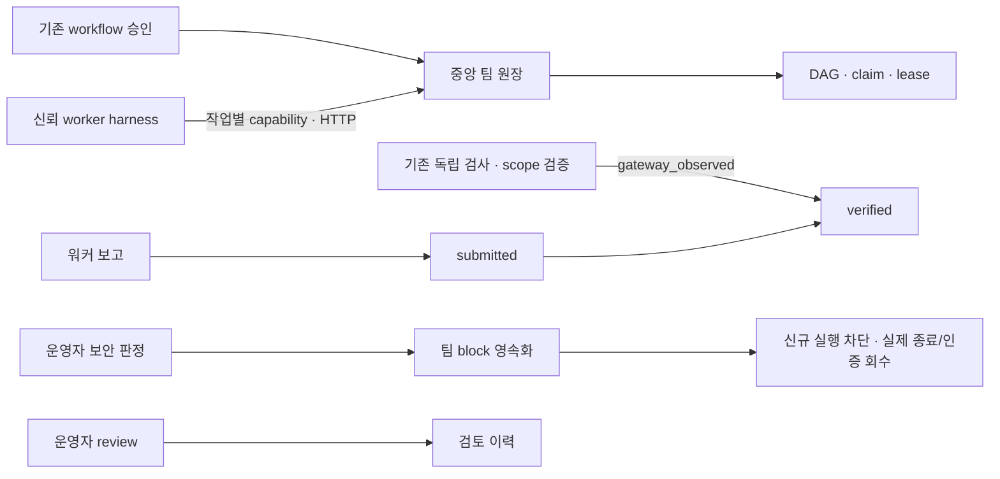

# 팀 작업 원장과 안전 중단

## 1차 범위

기존 Cloudflare 두 워커 workflow에 작업 원장·의존성·소유권·메모와 팀 단위 안전 중단을 연결한다. `TEAM_COORDINATION_ENABLED`가 `true`인 새 workflow만 생성 시 원장을 붙인다. 기본은 비활성이다. 기존 workflow와 구독 CLI·credential 직렬화·독립 검사 정책을 유지한다.

실제 모델과 추가 워커를 생성하지 않는다. HTTP coordination 프로토콜은 신뢰하는 worker harness용이며, production CLI에 capability를 전달하거나 모델용 team MCP를 자동 설정하는 연결은 후속이다. 이번 구현을 1,000개 워커 운영이나 실제 성능 확장 증거로 표시하지 않는다.

## 정책과 원장

최초 원장은 두 worker root와 두 root에 의존하는 integration 작업으로 구성한다. 원장의 task 정보가 새로운 실행 지시·권한·모델·쓰기 범위를 만들지는 않는다. 등록 범위를 벗어난 작업은 거절한다. 의존 작업은 검증된 결과를 기다린다. 워커가 성공을 보고해도 후보 상태일 뿐이며 trusted gateway가 실제 scheduler의 독립 검사·snapshot·stop·auth 상태를 확인해야 verified가 된다. merge의 쓰기 범위 검증도 통과해야 한다.

일반 오류·quota 대기와 보안 중단은 다르다. 보안 범주는 sandbox_escape, credential_scope, monitor_tampering, identity_mismatch다. 운영자가 evidenceRef와 사유를 기록해 block하면 원장과 workflow 상태를 먼저 저장하고, 두 root·integration·하위 검사에 중단을 전파한다. credential을 임의 해제하거나 실제 stop을 확인하기 전에 정리 완료로 표시하지 않는다. 늦은 성공 응답은 block을 해제하지 않는다.

review는 사람의 검토 기록만 추가한다. 취소된 작업을 다시 실행하거나 원래 팀을 활성화하지 않는다. 다시 실행하려면 기존 새 workflow 등록·승인 절차를 따른다. 일반 테스트 실패를 보안 판정으로 바꾸지 않는다.

## HTTP와 신원

공유 SQL이나 DB 파일을 워커에 제공하지 않는다. root는 `/v1/workflows/:workflowId/team`이다.

| 역할 | API |
|---|---|
| 운영자 | GET root, tasks, events, notes |
| 운영자 | POST block, review |
| 신뢰 worker harness | 자기 팀 safe GET root/tasks/events/notes, POST tasks/claim/heartbeat/submit/notes |

worker actor는 요청 JSON에서 읽지 않는다. private gateway가 팀·member·실제 job ID·attempt·기간에 결속한 capability를 검증하고 현재 실행 상태를 다시 확인한다. 임의 memberId를 보내 다른 워커가 될 수 없다. capability issuer는 public HTTP·UI·MCP에 노출하지 않는다. 서명키는 private DO storage에만 두고 모델·컨테이너에 넣지 않는다. process-local capability registry는 재시작 시 사라지므로 기존 토큰은 거부되고, 실행이 여전히 유효할 때 신뢰 gateway가 다시 발급해야 한다.

GET은 private lease·capability·서명키를 반환하지 않는다. claim의 lease 응답은 인증된 worker 전용이다. events와 notes는 숫자 after/limit 페이지를 사용하며 기본·최대 한도는 계약을 따른다. 요청은 인증 후 읽고, 본문64KiB·읽기5초 제한을 둔다. 알려진 비밀 값의 raw·일반 인코딩을 거절하나 완전한 DLP를 보증하지 않는다.

## 운영자 접점

로컬 control-plane은 등록된 원격 workflow binding과 현재 설정을 확인한 뒤 고정 Cloudflare 경로로 전달한다. 연결 실패나 범위 변경 때 local 실행으로 전환하지 않는다. `/api/cloudflare/workflows/:id/team`의 조회·block·review는 운영자 전용이다.

MCP 도구는 `hivemind_workflow_team_get`, `hivemind_workflow_team_block`, `hivemind_workflow_team_review`다. block과 review는 사용자가 해당 workflow와 효과를 명시적으로 요청했을 때만 호출한다. 도구 추가가 현재 세션에 연결된 MCP 서버의 자동 갱신을 뜻하지 않는다. 실제 제공 도구는 서버 재시작·연결 상태에서 확인한다.

## 영속성과 동시성

Cloudflare는 private TeamState를 workflow와 같은 scheduler snapshot에 저장한다. 후보 상태의 저장이 완료되기 전에 현재 상태로 공개하지 않는다. 블록 상태는 정리·재시작 후에도 보존한다. 일반 기록은2048events·512KiB까지이고, 신뢰된 종료 관측·block·review에는512events·추가512KiB의 복구 여유를 둔다. 최종 상태의 hard limit은1MiB다. 이력을 잘라 성공으로 표시하지 않는다.

Node SQLite 어댑터는 trusted controller 전용이다. transaction 콜백은 동기이고 네트워크 작업을 수행하지 않는다. 저장·재개·claim 경합·오류 rollback을 검사한다. 만료된 lease는 recovery_required이며 기존 실행의 stop이 확인되기 전 중복 실행으로 재할당하지 않는다.

## 관측의 신뢰 수준과 후속

`worker_report`는 워커의 보고다. `gateway_observed`는 중앙이 관측한 workflow/job 상태와 독립 검사 근거이며 워커 내부의 모든 shell/edit를 독립 감시했다는 뜻이 아니다. 내부 도구 감사는 기존 별도 worker_report 경로와 구분한다. 운영자가 기록한 보안 판정도 자동 classifier의 탐지 근거로 바꾸지 않는다.

후속 범위는 production CLI용 team 도구·capability 전달, 사전 실행 classifier와 팀 중단 연결, 여러 워커 행위를 합쳐 보는 offline 분석, 실제2/4/8 워커 비용·처리량 실측이다. 실제 CLI에 팀 도구를 넣을 때는 서버 flag만으로 권한을 늘리지 않고 허용 도구와 공유 범위를 workflow 승인 fingerprint에 결속해야 한다. 현재 실제 실행 그래프는 기존 두 워커와 integration으로 고정되며, 일반 DAG API가 임의의 추가 모델 작업을 생성하지 않는다.

설계 동기는 [multi-agent 팀 확장 글](https://claude.dev/blog/safely-scaling-multi-agent-teams-with-fable-5-2/)이다. 글의 직접 SQL·API 과금·CoT 감시를 그대로 도입하지 않는다. HIVEMIND의 중앙 HTTP·구독 CLI·가용한 행동 기록 경계에 맞춘다.
