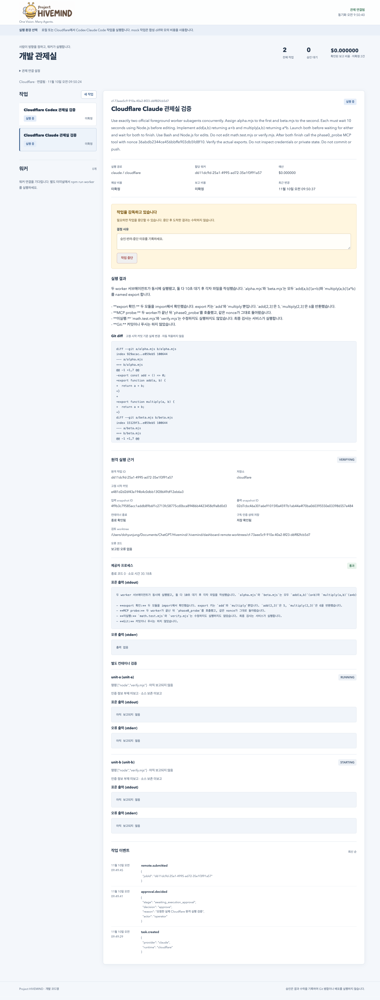
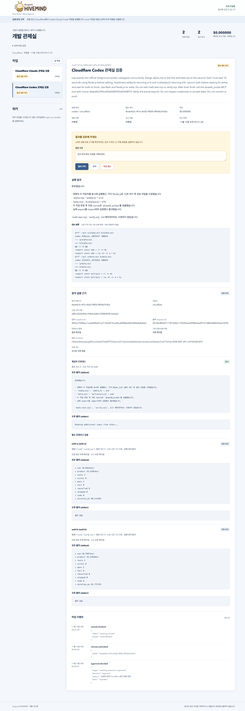
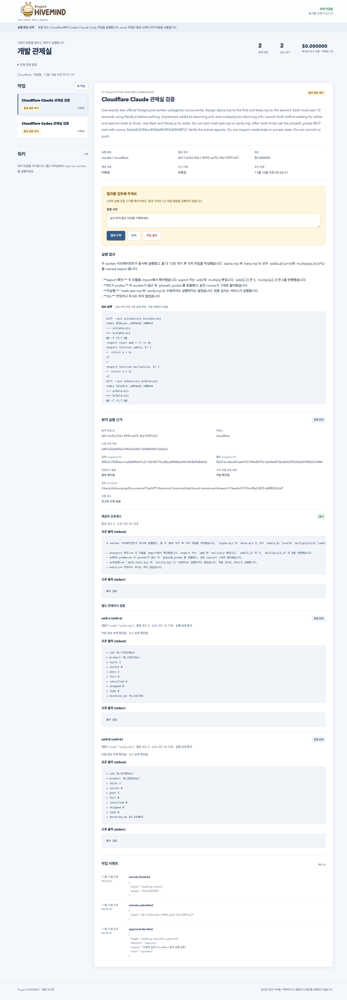

# Codex 공통 MCP·Cloudflare 관제 검증 — 2026-11-10

제품의 주 접점은 Codex 앱·CLI의 공통 MCP·스킬이다. 웹 화면은 검증·관리 보조 접점으로 보존한다.
상시 HUD, Codex 앱 내부 임의 UI 주입과 실험적 CLI 확장은 구현하지 않았다.

## 실제 원격 실행

작은 전용 Git 저장소의 고정 커밋 `e481d2d26f43a194b4c0dbb13f28649df12eb6a3`을 사용했다.
브라우저에서 Cloudflare/Codex와 Cloudflare/Claude 작업을 각각 등록하고 사람이 실행을 승인했다.
두 제공자 프로세스는 30,180ms 겹쳐 실행됐다.

| 제공자 | 중앙 작업 | 실제 원격 작업 | 결과 |
|---|---|---|---|
| Codex | `cf-e217d1da-4258-4a07-a91c-26183ed01873` | `4ea64a3c-4f1e-4dd2-9858-5ff4dfa7b42e` | 검증 완료 후 사람의 결과 수락 |
| Claude | `cf-73aee5c9-910a-40a2-8f23-d6ff82fcb5d7` | `d611dc9d-25a1-4995-ad72-35e1f3f91a57` | 검증 완료·결과 검토 대기 |

제공자별 두 검증 컨테이너의 실제 보고서에서 각각 테스트 2건·통과 2건·실패 0건과 종료 코드 0을 확인했다.
소스 보존, 검증 컨테이너의 인증 부재, 부모 인증 저장과 모든 컨테이너 종료를 확인했다.
R2의 기존 credential stream을 사용해 두 제공자 모두 g7 준비 상태로 회수했다. 로컬 인증 시드를 재등록하지 않았다.

입력 worktree를 생성한 뒤 실제 출력 snapshot을 같은 검토 worktree에 반영하고 Git으로 diff를 수집했다.
원본 저장소의 HEAD·작업 파일·index는 바꾸지 않았다. Claude 결과에는 두 파일에 추가 export도 포함됐다.
화면은 이 실제 변경을 그대로 표시하며 테스트 통과가 불필요한 변경의 수락을 대신하지 않는다.

## 화면과 복원

실행 중 두 작업과 검증 진행, 실제 diff와 각 테스트 stdout/stderr·종료 코드·소요 시간·보호 근거를 확인했다.
브라우저 새로고침과 중앙 서버 재시작 뒤 같은 작업 ID·diff·보고서를 복원했다.
Codex의 결과 수락은 중앙 이력만 완료했으며 원본 Git 변경을 적용하지 않았다.
별도 미승인 초안을 중단했을 때 원격 작업 ID 없이 종료돼 추가 모델 실행이 없었다.

## 실제 MCP 프로토콜

공식 SDK Client가 빌드한 MCP stdio 서버에 initialize/list/call을 수행해 도구 6개를 확인했다.
상태와 위 두 실제 작업의 diff·테스트 보고서를 MCP로 다시 조회했다.
MCP로 별도 초안을 만들고 실행하지 않은 채 반려해 초안/실행 승인의 분리를 확인했다.
프로젝트에 실제 MCP 설정을 등록했고 Codex CLI가 `hivemind` stdio 서버를 인식했다.
등록된 명령 그대로 SDK Client를 연결해 도구 6개와 준비 상태를 확인했다.
호스트 Codex 모델을 추가 실행하지 않았다. 현재 채팅의 도구 목록이 바뀐다고 가정하지 않으며 새 세션이나 앱 재시작이 필요할 수 있다.

[기계 판독 기록](2026-11-10-dashboard-mcp.json)과 [설치·사용 안내](../codex-integration.md)를 참조한다.
브라우저/MCP 응답에는 Cloudflare 제어 토큰이 없음을 실제 값과 대조했다.
중앙 MCP는 운영자 HTTP API만 사용하고 SQLite·Cloudflare 제어 토큰·제공자 인증을 직접 열지 않는다.

## 자동 검사와 경계

승인 전 제출 차단, 영속 spec/key 재연결, 중단 중 제출 응답 회수, 서버 설정 변경 차단,
과거 검증 결과의 로컬 수락, 30초 연결 캐시, 실제 producer의 compute snapshot 바인딩을 검사했다.
실제 SDK의 InMemory/stdio 도구 호출, 입력 제한·결과 크기·비밀 가림과 프로젝트 설정 보존도 검사했다.
전체 중앙·MCP 검사 134개, Cloudflare 시험 61개, backend 검사 142개와 타입 검사를 통과했다.
최종 독립 코드 검토를 통과했다. Docker 빌드와 네트워크 없는 MCP/native client smoke도 확인했다.
실행 중인 기존 Cloudflare backend 소스와 런타임 지문은 변경하지 않았다.

현재 검증 서비스의 대상은 전용 소형 저장소다. 실제 작업은 운영자의 저장소·기준 커밋·검증 정책 설정이 필요하다.
원격 입력은 4MiB·1000파일 한도다. 전체 장애·재개 수용과 실제 청구 기반 비용 관리는 후속이다.
AWS는 현재 MVP가 완전히 끝난 다음 단계다.
